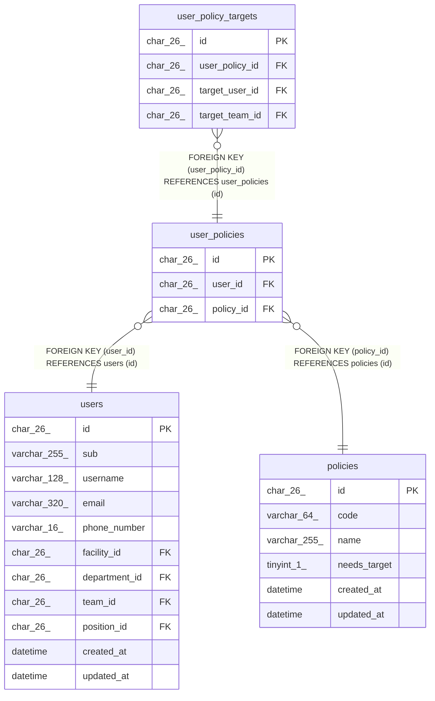

# user_policies

## Description

職員が持つ権限。職員と権限の組で一意

<details>
<summary><strong>Table Definition</strong></summary>

```sql
CREATE TABLE `user_policies` (
  `id` char(26) NOT NULL,
  `user_id` char(26) NOT NULL,
  `policy_id` char(26) NOT NULL,
  PRIMARY KEY (`id`),
  UNIQUE KEY `uq_user_policies_user_policy` (`user_id`,`policy_id`),
  KEY `fk_user_policies_policy` (`policy_id`),
  CONSTRAINT `fk_user_policies_policy` FOREIGN KEY (`policy_id`) REFERENCES `policies` (`id`),
  CONSTRAINT `fk_user_policies_user` FOREIGN KEY (`user_id`) REFERENCES `users` (`id`) ON DELETE CASCADE
) ENGINE=InnoDB DEFAULT CHARSET=utf8mb4 COLLATE=utf8mb4_0900_ai_ci
```

</details>

## Columns

| Name      | Type     | Default | Nullable | Children                                      | Parents                 | Comment |
| --------- | -------- | ------- | -------- | --------------------------------------------- | ----------------------- | ------- |
| id        | char(26) |         | false    | [user_policy_targets](user_policy_targets.md) |                         |         |
| user_id   | char(26) |         | false    |                                               | [users](users.md)       |         |
| policy_id | char(26) |         | false    |                                               | [policies](policies.md) |         |

## Viewpoints

| Name                                | Definition                                                             |
| ----------------------------------- | ---------------------------------------------------------------------- |
| [職員と権限](viewpoint-policies.md) | 職員が持つ権限と、その対象。職員を登録するとき、役職の既定の権限を写す |

## Constraints

| Name                         | Type        | Definition                                                   |
| ---------------------------- | ----------- | ------------------------------------------------------------ |
| fk_user_policies_policy      | FOREIGN KEY | FOREIGN KEY (policy_id) REFERENCES policies (id)             |
| fk_user_policies_user        | FOREIGN KEY | FOREIGN KEY (user_id) REFERENCES users (id)                  |
| PRIMARY                      | PRIMARY KEY | PRIMARY KEY (id)                                             |
| uq_user_policies_user_policy | UNIQUE      | UNIQUE KEY uq_user_policies_user_policy (user_id, policy_id) |

## Indexes

| Name                         | Definition                                                               |
| ---------------------------- | ------------------------------------------------------------------------ |
| fk_user_policies_policy      | KEY fk_user_policies_policy (policy_id) USING BTREE                      |
| PRIMARY                      | PRIMARY KEY (id) USING BTREE                                             |
| uq_user_policies_user_policy | UNIQUE KEY uq_user_policies_user_policy (user_id, policy_id) USING BTREE |

## Relations



---

> Generated by [tbls](https://github.com/k1LoW/tbls)
