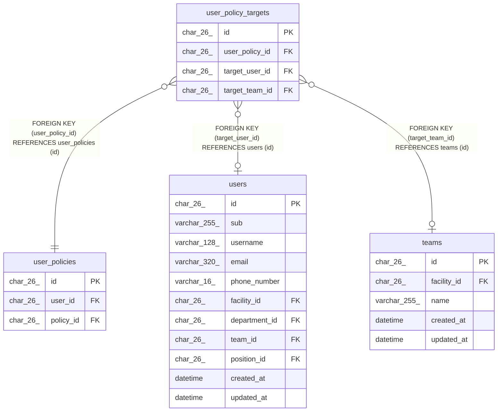

# user_policy_targets

## Description

職員の権限の対象

<details>
<summary><strong>Table Definition</strong></summary>

```sql
CREATE TABLE `user_policy_targets` (
  `id` char(26) NOT NULL,
  `user_policy_id` char(26) NOT NULL,
  `target_user_id` char(26) DEFAULT NULL,
  `target_team_id` char(26) DEFAULT NULL,
  PRIMARY KEY (`id`),
  UNIQUE KEY `uq_user_policy_targets_user` (`user_policy_id`,`target_user_id`),
  UNIQUE KEY `uq_user_policy_targets_team` (`user_policy_id`,`target_team_id`),
  KEY `fk_user_policy_targets_user` (`target_user_id`),
  KEY `fk_user_policy_targets_team` (`target_team_id`),
  CONSTRAINT `fk_user_policy_targets_team` FOREIGN KEY (`target_team_id`) REFERENCES `teams` (`id`),
  CONSTRAINT `fk_user_policy_targets_user` FOREIGN KEY (`target_user_id`) REFERENCES `users` (`id`),
  CONSTRAINT `fk_user_policy_targets_user_policy` FOREIGN KEY (`user_policy_id`) REFERENCES `user_policies` (`id`) ON DELETE CASCADE,
  CONSTRAINT `chk_user_policy_targets_one` CHECK (((`target_user_id` is null) <> (`target_team_id` is null)))
) ENGINE=InnoDB DEFAULT CHARSET=utf8mb4 COLLATE=utf8mb4_0900_ai_ci
```

</details>

## Columns

| Name           | Type     | Default | Nullable | Children | Parents                           | Comment                  |
| -------------- | -------- | ------- | -------- | -------- | --------------------------------- | ------------------------ |
| id             | char(26) |         | false    |          |                                   |                          |
| user_policy_id | char(26) |         | false    |          | [user_policies](user_policies.md) |                          |
| target_user_id | char(26) |         | true     |          | [users](users.md)                 | 対象の職員。チームと排他 |
| target_team_id | char(26) |         | true     |          | [teams](teams.md)                 | 対象のチーム。職員と排他 |

## Constraints

| Name                               | Type        | Definition                                                              |
| ---------------------------------- | ----------- | ----------------------------------------------------------------------- |
| fk_user_policy_targets_team        | FOREIGN KEY | FOREIGN KEY (target_team_id) REFERENCES teams (id)                      |
| fk_user_policy_targets_user        | FOREIGN KEY | FOREIGN KEY (target_user_id) REFERENCES users (id)                      |
| fk_user_policy_targets_user_policy | FOREIGN KEY | FOREIGN KEY (user_policy_id) REFERENCES user_policies (id)              |
| PRIMARY                            | PRIMARY KEY | PRIMARY KEY (id)                                                        |
| uq_user_policy_targets_team        | UNIQUE      | UNIQUE KEY uq_user_policy_targets_team (user_policy_id, target_team_id) |
| uq_user_policy_targets_user        | UNIQUE      | UNIQUE KEY uq_user_policy_targets_user (user_policy_id, target_user_id) |
| chk_user_policy_targets_one        | CHECK       | CHECK (((`target_user_id` is null) <> (`target_team_id` is null)))      |

## Indexes

| Name                        | Definition                                                                          |
| --------------------------- | ----------------------------------------------------------------------------------- |
| fk_user_policy_targets_team | KEY fk_user_policy_targets_team (target_team_id) USING BTREE                        |
| fk_user_policy_targets_user | KEY fk_user_policy_targets_user (target_user_id) USING BTREE                        |
| PRIMARY                     | PRIMARY KEY (id) USING BTREE                                                        |
| uq_user_policy_targets_team | UNIQUE KEY uq_user_policy_targets_team (user_policy_id, target_team_id) USING BTREE |
| uq_user_policy_targets_user | UNIQUE KEY uq_user_policy_targets_user (user_policy_id, target_user_id) USING BTREE |

## Relations



---

> Generated by [tbls](https://github.com/k1LoW/tbls)
