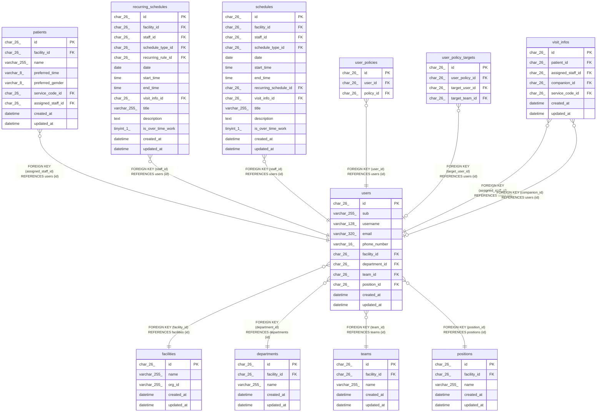

# users

## Description

職員

<details>
<summary><strong>Table Definition</strong></summary>

```sql
CREATE TABLE `users` (
  `id` char(26) NOT NULL,
  `sub` varchar(255) DEFAULT NULL,
  `username` varchar(128) NOT NULL,
  `email` varchar(320) NOT NULL,
  `phone_number` varchar(16) DEFAULT NULL,
  `facility_id` char(26) NOT NULL,
  `department_id` char(26) NOT NULL,
  `team_id` char(26) NOT NULL,
  `position_id` char(26) NOT NULL,
  `created_at` datetime NOT NULL DEFAULT CURRENT_TIMESTAMP,
  `updated_at` datetime NOT NULL DEFAULT CURRENT_TIMESTAMP ON UPDATE CURRENT_TIMESTAMP,
  PRIMARY KEY (`id`),
  UNIQUE KEY `uq_users_facility_email` (`facility_id`,`email`),
  UNIQUE KEY `uq_users_sub` (`sub`),
  KEY `idx_users_facility` (`facility_id`),
  KEY `fk_users_department` (`department_id`),
  KEY `fk_users_team` (`team_id`),
  KEY `fk_users_position` (`position_id`),
  CONSTRAINT `fk_users_department` FOREIGN KEY (`department_id`) REFERENCES `departments` (`id`),
  CONSTRAINT `fk_users_facility` FOREIGN KEY (`facility_id`) REFERENCES `facilities` (`id`),
  CONSTRAINT `fk_users_position` FOREIGN KEY (`position_id`) REFERENCES `positions` (`id`),
  CONSTRAINT `fk_users_team` FOREIGN KEY (`team_id`) REFERENCES `teams` (`id`)
) ENGINE=InnoDB DEFAULT CHARSET=utf8mb4 COLLATE=utf8mb4_0900_ai_ci
```

</details>

## Columns

| Name          | Type         | Default           | Nullable | Extra Definition                              | Children                                                                                                                                                                                                      | Parents                       | Comment                                          |
| ------------- | ------------ | ----------------- | -------- | --------------------------------------------- | ------------------------------------------------------------------------------------------------------------------------------------------------------------------------------------------------------------- | ----------------------------- | ------------------------------------------------ |
| id            | char(26)     |                   | false    |                                               | [patients](patients.md) [recurring_schedules](recurring_schedules.md) [schedules](schedules.md) [user_policies](user_policies.md) [user_policy_targets](user_policy_targets.md) [visit_infos](visit_infos.md) |                               |                                                  |
| sub           | varchar(255) |                   | true     |                                               |                                                                                                                                                                                                               |                               | ブローカーの subject。初回のログインまで NULL    |
| username      | varchar(128) |                   | false    |                                               |                                                                                                                                                                                                               |                               | 電子カルテの職員名と同じ表記。照合が名前で比べる |
| email         | varchar(320) |                   | false    |                                               |                                                                                                                                                                                                               |                               | 事業所の中で一意                                 |
| phone_number  | varchar(16)  |                   | true     |                                               |                                                                                                                                                                                                               |                               |                                                  |
| facility_id   | char(26)     |                   | false    |                                               |                                                                                                                                                                                                               | [facilities](facilities.md)   |                                                  |
| department_id | char(26)     |                   | false    |                                               |                                                                                                                                                                                                               | [departments](departments.md) |                                                  |
| team_id       | char(26)     |                   | false    |                                               |                                                                                                                                                                                                               | [teams](teams.md)             |                                                  |
| position_id   | char(26)     |                   | false    |                                               |                                                                                                                                                                                                               | [positions](positions.md)     |                                                  |
| created_at    | datetime     | CURRENT_TIMESTAMP | false    | DEFAULT_GENERATED                             |                                                                                                                                                                                                               |                               |                                                  |
| updated_at    | datetime     | CURRENT_TIMESTAMP | false    | DEFAULT_GENERATED on update CURRENT_TIMESTAMP |                                                                                                                                                                                                               |                               |                                                  |

## Constraints

| Name                    | Type        | Definition                                              |
| ----------------------- | ----------- | ------------------------------------------------------- |
| fk_users_department     | FOREIGN KEY | FOREIGN KEY (department_id) REFERENCES departments (id) |
| fk_users_facility       | FOREIGN KEY | FOREIGN KEY (facility_id) REFERENCES facilities (id)    |
| fk_users_position       | FOREIGN KEY | FOREIGN KEY (position_id) REFERENCES positions (id)     |
| fk_users_team           | FOREIGN KEY | FOREIGN KEY (team_id) REFERENCES teams (id)             |
| PRIMARY                 | PRIMARY KEY | PRIMARY KEY (id)                                        |
| uq_users_facility_email | UNIQUE      | UNIQUE KEY uq_users_facility_email (facility_id, email) |
| uq_users_sub            | UNIQUE      | UNIQUE KEY uq_users_sub (sub)                           |

## Indexes

| Name                    | Definition                                                          |
| ----------------------- | ------------------------------------------------------------------- |
| fk_users_department     | KEY fk_users_department (department_id) USING BTREE                 |
| fk_users_position       | KEY fk_users_position (position_id) USING BTREE                     |
| fk_users_team           | KEY fk_users_team (team_id) USING BTREE                             |
| idx_users_facility      | KEY idx_users_facility (facility_id) USING BTREE                    |
| PRIMARY                 | PRIMARY KEY (id) USING BTREE                                        |
| uq_users_facility_email | UNIQUE KEY uq_users_facility_email (facility_id, email) USING BTREE |
| uq_users_sub            | UNIQUE KEY uq_users_sub (sub) USING BTREE                           |

## Relations



---

> Generated by [tbls](https://github.com/k1LoW/tbls)
