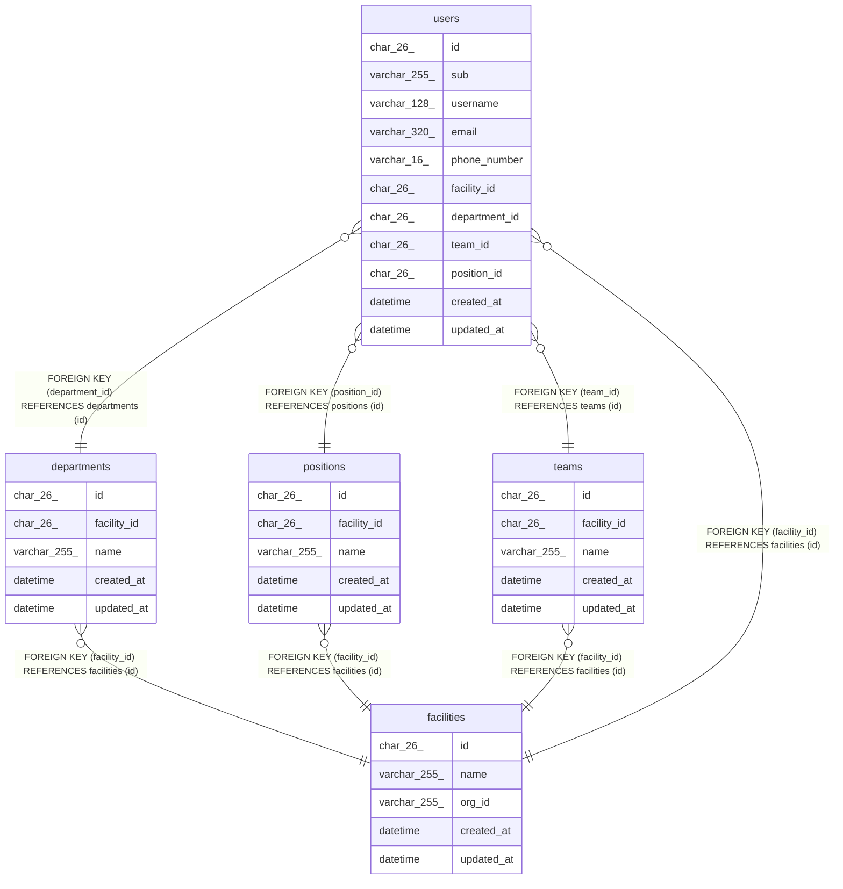

# 事業所と組織

## Description

事業所と、その中の部署、チーム、役職、職員

## Tables

| Name                          | Columns | Comment                                                | Type       |
| ----------------------------- | ------- | ------------------------------------------------------ | ---------- |
| [departments](departments.md) | 5       | 事業所の部署                                           | BASE TABLE |
| [facilities](facilities.md)   | 5       | 訪問看護の事業所                                       | BASE TABLE |
| [positions](positions.md)     | 5       | 事業所の役職。職員を登録するときに写す既定の権限を持つ | BASE TABLE |
| [teams](teams.md)             | 5       | 事業所のチーム                                         | BASE TABLE |
| [users](users.md)             | 11      | 職員                                                   | BASE TABLE |

## Relations

---

> Generated by [tbls](https://github.com/k1LoW/tbls)
