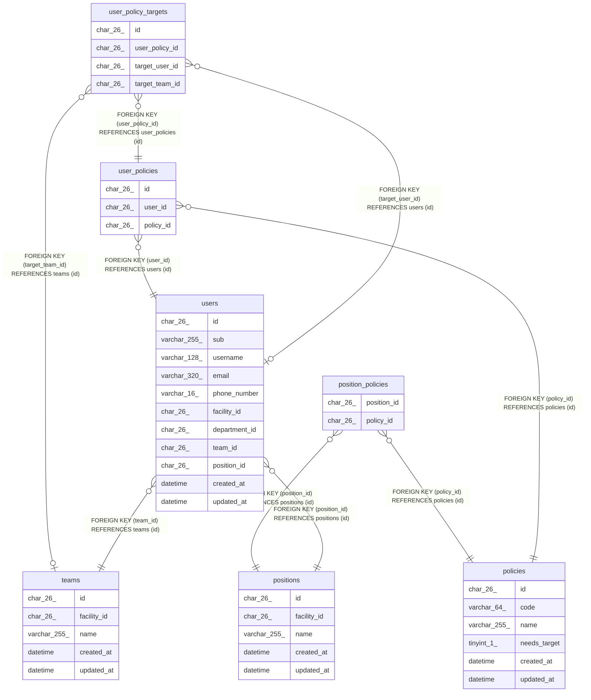

# 職員と権限

## Description

職員が持つ権限と、その対象。職員を登録するとき、役職の既定の権限を写す

## Tables

| Name                                          | Columns | Comment                                                | Type       |
| --------------------------------------------- | ------- | ------------------------------------------------------ | ---------- |
| [policies](policies.md)                       | 6       | 権限。マイグレーションで入れ、API では作らない         | BASE TABLE |
| [position_policies](position_policies.md)     | 2       | 役職の既定の権限                                       | BASE TABLE |
| [positions](positions.md)                     | 5       | 事業所の役職。職員を登録するときに写す既定の権限を持つ | BASE TABLE |
| [teams](teams.md)                             | 5       | 事業所のチーム                                         | BASE TABLE |
| [user_policies](user_policies.md)             | 3       | 職員が持つ権限。職員と権限の組で一意                   | BASE TABLE |
| [user_policy_targets](user_policy_targets.md) | 4       | 職員の権限の対象                                       | BASE TABLE |
| [users](users.md)                             | 11      | 職員                                                   | BASE TABLE |

## Relations

---

> Generated by [tbls](https://github.com/k1LoW/tbls)
