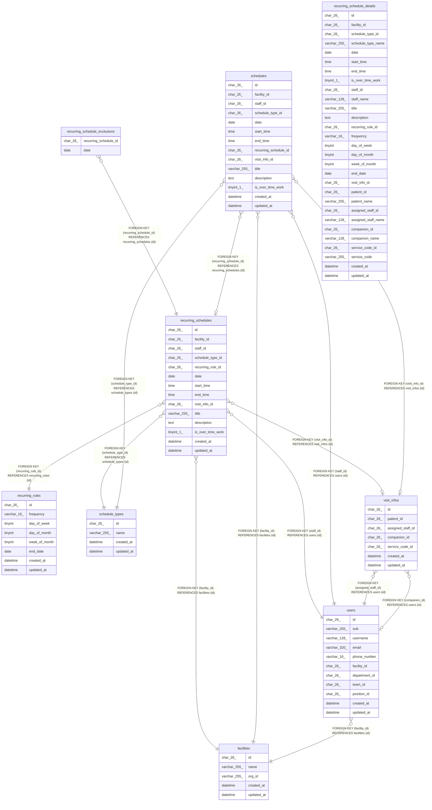

# 繰り返しの予定

## Description

繰り返しの規則と予定、回にしない日。繰り返しの 1 回を置き換えた予定は schedules に入る

## Tables

| Name                                                              | Columns | Comment                                                                | Type       |
| ----------------------------------------------------------------- | ------- | ---------------------------------------------------------------------- | ---------- |
| [facilities](facilities.md)                                       | 5       | 訪問看護の事業所                                                       | BASE TABLE |
| [recurring_rules](recurring_rules.md)                             | 8       | 繰り返しの規則                                                         | BASE TABLE |
| [recurring_schedule_details](recurring_schedule_details.md)       | 29      | 一覧の読み出しに使う、繰り返しの予定と訪問の情報と名前を結合したビュー | VIEW       |
| [recurring_schedule_exclusions](recurring_schedule_exclusions.md) | 2       | 繰り返しの予定のうち、回にしない日                                     | BASE TABLE |
| [recurring_schedules](recurring_schedules.md)                     | 14      | 繰り返しの予定                                                         | BASE TABLE |
| [schedule_types](schedule_types.md)                               | 4       | 予定の種類（通常、訪問）。マイグレーションで入れる                     | BASE TABLE |
| [schedules](schedules.md)                                         | 14      | 予定                                                                   | BASE TABLE |
| [users](users.md)                                                 | 11      | 職員                                                                   | BASE TABLE |
| [visit_infos](visit_infos.md)                                     | 7       | 訪問の情報                                                             | BASE TABLE |

## Relations

---

> Generated by [tbls](https://github.com/k1LoW/tbls)
