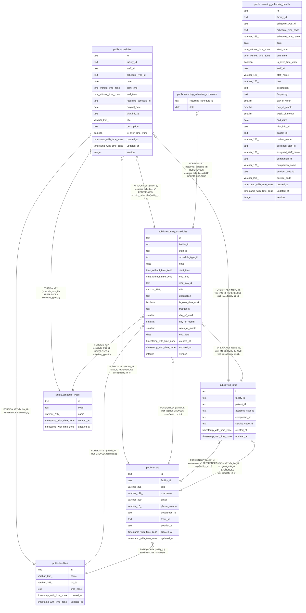

# 繰り返しの予定

## Description

繰り返しの予定と規則、回にしない日。繰り返しの 1 回を置き換えた予定は schedules に入る

## Tables

| Name                                                                            | Columns | Comment                                                                | Type       |
| ------------------------------------------------------------------------------- | ------- | ---------------------------------------------------------------------- | ---------- |
| [public.facilities](public.facilities.md)                                       | 6       | 訪問看護の事業所                                                       | BASE TABLE |
| [public.users](public.users.md)                                                 | 11      | 職員                                                                   | BASE TABLE |
| [public.visit_infos](public.visit_infos.md)                                     | 8       | 訪問の情報                                                             | BASE TABLE |
| [public.schedule_types](public.schedule_types.md)                               | 5       | 予定の種類（通常、訪問）。マイグレーションで入れる                     | BASE TABLE |
| [public.recurring_schedules](public.recurring_schedules.md)                     | 19      | 繰り返しの予定と、その規則                                             | BASE TABLE |
| [public.recurring_schedule_exclusions](public.recurring_schedule_exclusions.md) | 2       | 繰り返しの予定のうち、回にしない日                                     | BASE TABLE |
| [public.schedules](public.schedules.md)                                         | 16      | 予定                                                                   | BASE TABLE |
| [public.recurring_schedule_details](public.recurring_schedule_details.md)       | 30      | 一覧の読み出しに使う、繰り返しの予定と訪問の情報と名前を結合したビュー | VIEW       |

## Relations

---

> Generated by [tbls](https://github.com/k1LoW/tbls)
