# 予定と訪問

## Description

予定と、訪問のときの訪問の情報と区分、予定の取り消し

## Tables

| Name                                                          | Columns | Comment                                                      | Type       |
| ------------------------------------------------------------- | ------- | ------------------------------------------------------------ | ---------- |
| [facilities](facilities.md)                                   | 5       | 訪問看護の事業所                                             | BASE TABLE |
| [patients](patients.md)                                       | 9       | 利用者                                                       | BASE TABLE |
| [recurring_schedules](recurring_schedules.md)                 | 14      | 繰り返しの予定                                               | BASE TABLE |
| [schedule_cancels](schedule_cancels.md)                       | 5       | 予定の取り消し                                               | BASE TABLE |
| [schedule_details](schedule_details.md)                       | 26      | 一覧の読み出しに使う、予定と訪問の情報と名前を結合したビュー | VIEW       |
| [schedule_types](schedule_types.md)                           | 4       | 予定の種類（通常、訪問）。マイグレーションで入れる           | BASE TABLE |
| [schedules](schedules.md)                                     | 14      | 予定                                                         | BASE TABLE |
| [service_codes](service_codes.md)                             | 6       | サービスコード。マイグレーションで入れる                     | BASE TABLE |
| [users](users.md)                                             | 11      | 職員                                                         | BASE TABLE |
| [visit_categories](visit_categories.md)                       | 4       | 訪問の区分（夜勤、緊急、入院）。マイグレーションで入れる     | BASE TABLE |
| [visit_info_details](visit_info_details.md)                   | 9       | 訪問の情報と名前を結合したビュー                             | VIEW       |
| [visit_info_visit_categories](visit_info_visit_categories.md) | 2       | 訪問に付けた区分。1 件の訪問に複数を付けられる               | BASE TABLE |
| [visit_infos](visit_infos.md)                                 | 7       | 訪問の情報                                                   | BASE TABLE |

## Relations

```mermaid
erDiagram

"patients" }o--|| "users" : "FOREIGN KEY (assigned_staff_id) REFERENCES users (id)"
"patients" }o--|| "facilities" : "FOREIGN KEY (facility_id) REFERENCES facilities (id)"
"patients" }o--|| "service_codes" : "FOREIGN KEY (service_code_id) REFERENCES service_codes (id)"
"recurring_schedules" }o--|| "facilities" : "FOREIGN KEY (facility_id) REFERENCES facilities (id)"
"recurring_schedules" }o--|| "users" : "FOREIGN KEY (staff_id) REFERENCES users (id)"
"recurring_schedules" }o--|| "schedule_types" : "FOREIGN KEY (schedule_type_id) REFERENCES schedule_types (id)"
"recurring_schedules" }o--o| "visit_infos" : "FOREIGN KEY (visit_info_id) REFERENCES visit_infos (id)"
"schedule_cancels" |o--|| "schedules" : "FOREIGN KEY (schedule_id) REFERENCES schedules (id)"
"schedules" }o--|| "facilities" : "FOREIGN KEY (facility_id) REFERENCES facilities (id)"
"schedules" }o--o| "recurring_schedules" : "FOREIGN KEY (recurring_schedule_id) REFERENCES recurring_schedules (id)"
"schedules" }o--|| "users" : "FOREIGN KEY (staff_id) REFERENCES users (id)"
"schedules" }o--|| "schedule_types" : "FOREIGN KEY (schedule_type_id) REFERENCES schedule_types (id)"
"schedules" }o--o| "visit_infos" : "FOREIGN KEY (visit_info_id) REFERENCES visit_infos (id)"
"users" }o--|| "facilities" : "FOREIGN KEY (facility_id) REFERENCES facilities (id)"
"visit_info_visit_categories" }o--|| "visit_categories" : "FOREIGN KEY (visit_category_id) REFERENCES visit_categories (id)"
"visit_info_visit_categories" }o--|| "visit_infos" : "FOREIGN KEY (visit_info_id) REFERENCES visit_infos (id)"
"visit_infos" }o--|| "users" : "FOREIGN KEY (assigned_staff_id) REFERENCES users (id)"
"visit_infos" }o--o| "users" : "FOREIGN KEY (companion_id) REFERENCES users (id)"
"visit_infos" }o--|| "patients" : "FOREIGN KEY (patient_id) REFERENCES patients (id)"
"visit_infos" }o--|| "service_codes" : "FOREIGN KEY (service_code_id) REFERENCES service_codes (id)"

"facilities" {
  char_26_ id
  varchar_255_ name
  varchar_255_ org_id
  datetime created_at
  datetime updated_at
}
"patients" {
  char_26_ id
  char_26_ facility_id
  varchar_255_ name
  varchar_8_ preferred_time
  varchar_8_ preferred_gender
  char_26_ service_code_id
  char_26_ assigned_staff_id
  datetime created_at
  datetime updated_at
}
"recurring_schedules" {
  char_26_ id
  char_26_ facility_id
  char_26_ staff_id
  char_26_ schedule_type_id
  char_26_ recurring_rule_id
  date date
  time start_time
  time end_time
  char_26_ visit_info_id
  varchar_255_ title
  text description
  tinyint_1_ is_over_time_work
  datetime created_at
  datetime updated_at
}
"schedule_cancels" {
  char_26_ id
  char_26_ schedule_id
  varchar_255_ reason
  datetime created_at
  datetime updated_at
}
"schedule_details" {
  char_26_ id
  char_26_ facility_id
  char_26_ schedule_type_id
  varchar_255_ schedule_type_name
  date date
  time start_time
  time end_time
  tinyint_1_ is_over_time_work
  char_26_ staff_id
  varchar_128_ staff_name
  varchar_255_ title
  text description
  char_26_ recurring_schedule_id
  char_26_ visit_info_id
  char_26_ patient_id
  varchar_255_ patient_name
  char_26_ assigned_staff_id
  varchar_128_ assigned_staff_name
  char_26_ companion_id
  varchar_128_ companion_name
  char_26_ service_code_id
  varchar_255_ service_code
  char_26_ cancel_id
  varchar_255_ cancel_reason
  datetime created_at
  datetime updated_at
}
"schedule_types" {
  char_26_ id
  varchar_255_ name
  datetime created_at
  datetime updated_at
}
"schedules" {
  char_26_ id
  char_26_ facility_id
  char_26_ staff_id
  char_26_ schedule_type_id
  date date
  time start_time
  time end_time
  char_26_ recurring_schedule_id
  char_26_ visit_info_id
  varchar_255_ title
  text description
  tinyint_1_ is_over_time_work
  datetime created_at
  datetime updated_at
}
"service_codes" {
  char_26_ id
  varchar_255_ code
  int service_time_range_start
  int service_time_range_end
  datetime created_at
  datetime updated_at
}
"users" {
  char_26_ id
  varchar_255_ sub
  varchar_128_ username
  varchar_320_ email
  varchar_16_ phone_number
  char_26_ facility_id
  char_26_ department_id
  char_26_ team_id
  char_26_ position_id
  datetime created_at
  datetime updated_at
}
"visit_categories" {
  char_26_ id
  varchar_255_ name
  datetime created_at
  datetime updated_at
}
"visit_info_details" {
  char_26_ id
  char_26_ patient_id
  varchar_255_ patient_name
  char_26_ assigned_staff_id
  varchar_128_ assigned_staff_name
  char_26_ companion_id
  varchar_128_ companion_name
  char_26_ service_code_id
  varchar_255_ service_code
}
"visit_info_visit_categories" {
  char_26_ visit_info_id
  char_26_ visit_category_id
}
"visit_infos" {
  char_26_ id
  char_26_ patient_id
  char_26_ assigned_staff_id
  char_26_ companion_id
  char_26_ service_code_id
  datetime created_at
  datetime updated_at
}
```

---

> Generated by [tbls](https://github.com/k1LoW/tbls)
