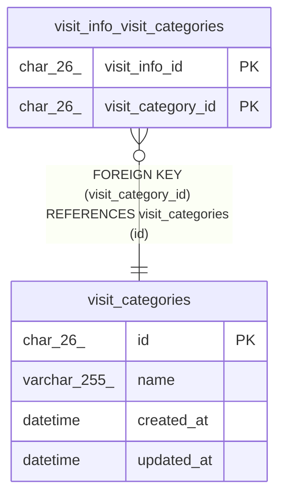

# visit_categories

## Description

訪問の区分（夜勤、緊急、入院）。マイグレーションで入れる

<details>
<summary><strong>Table Definition</strong></summary>

```sql
CREATE TABLE `visit_categories` (
  `id` char(26) NOT NULL,
  `name` varchar(255) NOT NULL,
  `created_at` datetime NOT NULL DEFAULT CURRENT_TIMESTAMP,
  `updated_at` datetime NOT NULL DEFAULT CURRENT_TIMESTAMP ON UPDATE CURRENT_TIMESTAMP,
  PRIMARY KEY (`id`),
  UNIQUE KEY `uq_visit_categories_name` (`name`)
) ENGINE=InnoDB DEFAULT CHARSET=utf8mb4 COLLATE=utf8mb4_0900_ai_ci
```

</details>

## Columns

| Name       | Type         | Default           | Nullable | Extra Definition                              | Children                                                      | Parents | Comment |
| ---------- | ------------ | ----------------- | -------- | --------------------------------------------- | ------------------------------------------------------------- | ------- | ------- |
| id         | char(26)     |                   | false    |                                               | [visit_info_visit_categories](visit_info_visit_categories.md) |         |         |
| name       | varchar(255) |                   | false    |                                               |                                                               |         |         |
| created_at | datetime     | CURRENT_TIMESTAMP | false    | DEFAULT_GENERATED                             |                                                               |         |         |
| updated_at | datetime     | CURRENT_TIMESTAMP | false    | DEFAULT_GENERATED on update CURRENT_TIMESTAMP |                                                               |         |         |

## Constraints

| Name                     | Type        | Definition                                 |
| ------------------------ | ----------- | ------------------------------------------ |
| PRIMARY                  | PRIMARY KEY | PRIMARY KEY (id)                           |
| uq_visit_categories_name | UNIQUE      | UNIQUE KEY uq_visit_categories_name (name) |

## Indexes

| Name                     | Definition                                             |
| ------------------------ | ------------------------------------------------------ |
| PRIMARY                  | PRIMARY KEY (id) USING BTREE                           |
| uq_visit_categories_name | UNIQUE KEY uq_visit_categories_name (name) USING BTREE |

## Relations



---

> Generated by [tbls](https://github.com/k1LoW/tbls)
