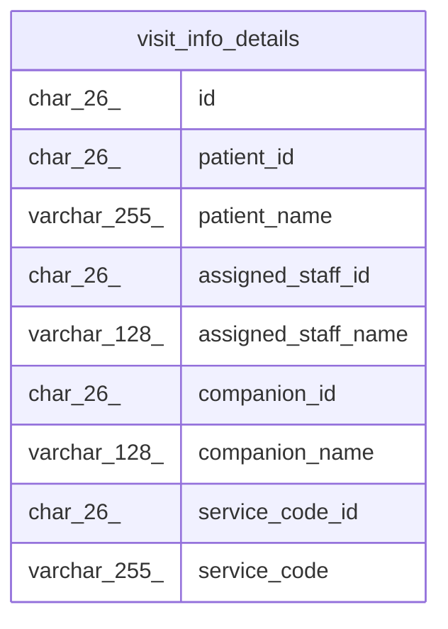

# visit_info_details

## Description

訪問の情報と名前を結合したビュー

<details>
<summary><strong>Table Definition</strong></summary>

```sql
CREATE VIEW visit_info_details AS (select `vi`.`id` AS `id`,`vi`.`patient_id` AS `patient_id`,`pa`.`name` AS `patient_name`,`vi`.`assigned_staff_id` AS `assigned_staff_id`,`au`.`username` AS `assigned_staff_name`,`vi`.`companion_id` AS `companion_id`,`cu`.`username` AS `companion_name`,`vi`.`service_code_id` AS `service_code_id`,`sc`.`code` AS `service_code` from ((((`buddy`.`visit_infos` `vi` join `buddy`.`patients` `pa` on((`pa`.`id` = `vi`.`patient_id`))) join `buddy`.`users` `au` on((`au`.`id` = `vi`.`assigned_staff_id`))) left join `buddy`.`users` `cu` on((`cu`.`id` = `vi`.`companion_id`))) join `buddy`.`service_codes` `sc` on((`sc`.`id` = `vi`.`service_code_id`))))
```

</details>

## Columns

| Name                | Type         | Default | Nullable | Children | Parents | Comment |
| ------------------- | ------------ | ------- | -------- | -------- | ------- | ------- |
| id                  | char(26)     |         | false    |          |         |         |
| patient_id          | char(26)     |         | false    |          |         |         |
| patient_name        | varchar(255) |         | false    |          |         |         |
| assigned_staff_id   | char(26)     |         | false    |          |         |         |
| assigned_staff_name | varchar(128) |         | false    |          |         |         |
| companion_id        | char(26)     |         | true     |          |         |         |
| companion_name      | varchar(128) |         | true     |          |         |         |
| service_code_id     | char(26)     |         | false    |          |         |         |
| service_code        | varchar(255) |         | false    |          |         |         |

## Referenced Tables

| Name                              | Columns | Comment                                  | Type       |
| --------------------------------- | ------- | ---------------------------------------- | ---------- |
| [visit_infos](visit_infos.md)     | 7       | 訪問の情報                               | BASE TABLE |
| [patients](patients.md)           | 9       | 利用者                                   | BASE TABLE |
| [users](users.md)                 | 11      | 職員                                     | BASE TABLE |
| [service_codes](service_codes.md) | 6       | サービスコード。マイグレーションで入れる | BASE TABLE |

## Relations



---

> Generated by [tbls](https://github.com/k1LoW/tbls)
