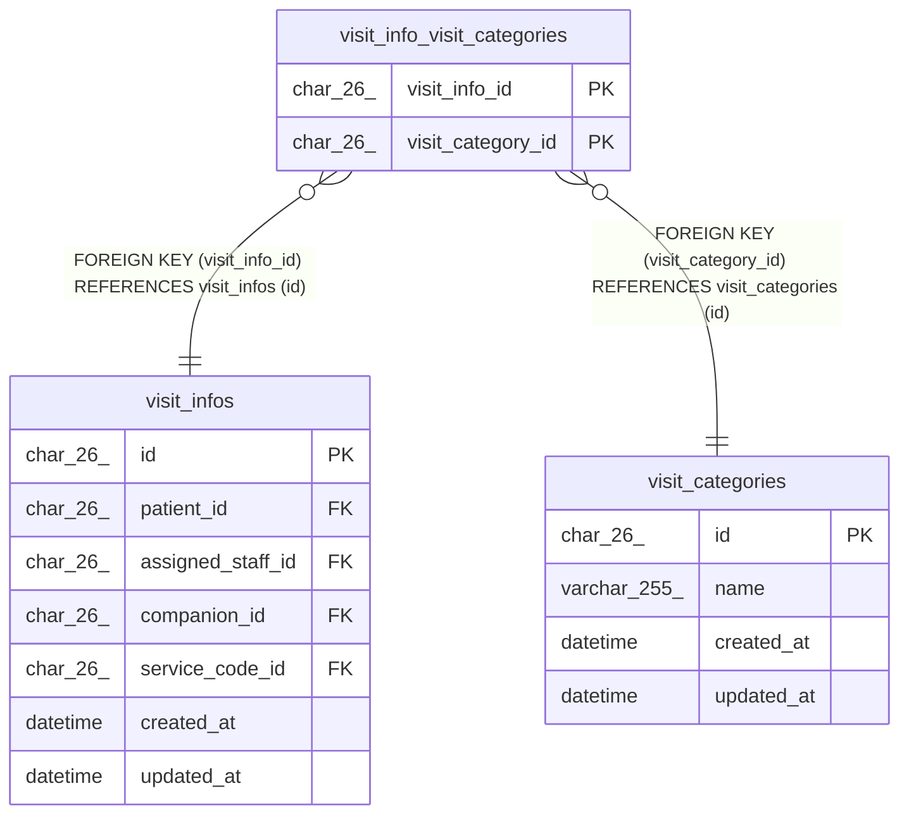

# visit_info_visit_categories

## Description

訪問に付けた区分。1 件の訪問に複数を付けられる

<details>
<summary><strong>Table Definition</strong></summary>

```sql
CREATE TABLE `visit_info_visit_categories` (
  `visit_info_id` char(26) NOT NULL,
  `visit_category_id` char(26) NOT NULL,
  PRIMARY KEY (`visit_info_id`,`visit_category_id`),
  KEY `fk_vivc_visit_category` (`visit_category_id`),
  CONSTRAINT `fk_vivc_visit_category` FOREIGN KEY (`visit_category_id`) REFERENCES `visit_categories` (`id`),
  CONSTRAINT `fk_vivc_visit_info` FOREIGN KEY (`visit_info_id`) REFERENCES `visit_infos` (`id`) ON DELETE CASCADE
) ENGINE=InnoDB DEFAULT CHARSET=utf8mb4 COLLATE=utf8mb4_0900_ai_ci
```

</details>

## Columns

| Name              | Type     | Default | Nullable | Children | Parents                                 | Comment |
| ----------------- | -------- | ------- | -------- | -------- | --------------------------------------- | ------- |
| visit_info_id     | char(26) |         | false    |          | [visit_infos](visit_infos.md)           |         |
| visit_category_id | char(26) |         | false    |          | [visit_categories](visit_categories.md) |         |

## Viewpoints

| Name                                 | Definition                                           |
| ------------------------------------ | ---------------------------------------------------- |
| [予定と訪問](viewpoint-schedules.md) | 予定と、訪問のときの訪問の情報と区分、予定の取り消し |

## Constraints

| Name                   | Type        | Definition                                                       |
| ---------------------- | ----------- | ---------------------------------------------------------------- |
| fk_vivc_visit_category | FOREIGN KEY | FOREIGN KEY (visit_category_id) REFERENCES visit_categories (id) |
| fk_vivc_visit_info     | FOREIGN KEY | FOREIGN KEY (visit_info_id) REFERENCES visit_infos (id)          |
| PRIMARY                | PRIMARY KEY | PRIMARY KEY (visit_info_id, visit_category_id)                   |

## Indexes

| Name                   | Definition                                                 |
| ---------------------- | ---------------------------------------------------------- |
| fk_vivc_visit_category | KEY fk_vivc_visit_category (visit_category_id) USING BTREE |
| PRIMARY                | PRIMARY KEY (visit_info_id, visit_category_id) USING BTREE |

## Relations



---

> Generated by [tbls](https://github.com/k1LoW/tbls)
