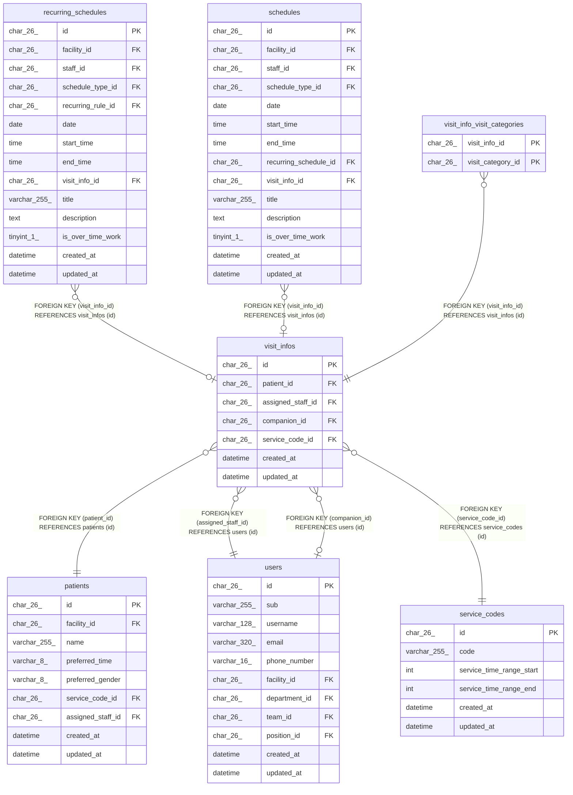

# visit_infos

## Description

訪問の情報

<details>
<summary><strong>Table Definition</strong></summary>

```sql
CREATE TABLE `visit_infos` (
  `id` char(26) NOT NULL,
  `patient_id` char(26) NOT NULL,
  `assigned_staff_id` char(26) NOT NULL,
  `companion_id` char(26) DEFAULT NULL,
  `service_code_id` char(26) NOT NULL,
  `created_at` datetime NOT NULL DEFAULT CURRENT_TIMESTAMP,
  `updated_at` datetime NOT NULL DEFAULT CURRENT_TIMESTAMP ON UPDATE CURRENT_TIMESTAMP,
  PRIMARY KEY (`id`),
  KEY `fk_visit_infos_patient` (`patient_id`),
  KEY `fk_visit_infos_assigned_staff` (`assigned_staff_id`),
  KEY `fk_visit_infos_companion` (`companion_id`),
  KEY `fk_visit_infos_service_code` (`service_code_id`),
  CONSTRAINT `fk_visit_infos_assigned_staff` FOREIGN KEY (`assigned_staff_id`) REFERENCES `users` (`id`),
  CONSTRAINT `fk_visit_infos_companion` FOREIGN KEY (`companion_id`) REFERENCES `users` (`id`),
  CONSTRAINT `fk_visit_infos_patient` FOREIGN KEY (`patient_id`) REFERENCES `patients` (`id`),
  CONSTRAINT `fk_visit_infos_service_code` FOREIGN KEY (`service_code_id`) REFERENCES `service_codes` (`id`)
) ENGINE=InnoDB DEFAULT CHARSET=utf8mb4 COLLATE=utf8mb4_0900_ai_ci
```

</details>

## Columns

| Name              | Type     | Default           | Nullable | Extra Definition                              | Children                                                                                                                              | Parents                           | Comment  |
| ----------------- | -------- | ----------------- | -------- | --------------------------------------------- | ------------------------------------------------------------------------------------------------------------------------------------- | --------------------------------- | -------- |
| id                | char(26) |                   | false    |                                               | [recurring_schedules](recurring_schedules.md) [schedules](schedules.md) [visit_info_visit_categories](visit_info_visit_categories.md) |                                   |          |
| patient_id        | char(26) |                   | false    |                                               |                                                                                                                                       | [patients](patients.md)           |          |
| assigned_staff_id | char(26) |                   | false    |                                               |                                                                                                                                       | [users](users.md)                 | 主訪問者 |
| companion_id      | char(26) |                   | true     |                                               |                                                                                                                                       | [users](users.md)                 | 同行者   |
| service_code_id   | char(26) |                   | false    |                                               |                                                                                                                                       | [service_codes](service_codes.md) |          |
| created_at        | datetime | CURRENT_TIMESTAMP | false    | DEFAULT_GENERATED                             |                                                                                                                                       |                                   |          |
| updated_at        | datetime | CURRENT_TIMESTAMP | false    | DEFAULT_GENERATED on update CURRENT_TIMESTAMP |                                                                                                                                       |                                   |          |

## Constraints

| Name                          | Type        | Definition                                                  |
| ----------------------------- | ----------- | ----------------------------------------------------------- |
| fk_visit_infos_assigned_staff | FOREIGN KEY | FOREIGN KEY (assigned_staff_id) REFERENCES users (id)       |
| fk_visit_infos_companion      | FOREIGN KEY | FOREIGN KEY (companion_id) REFERENCES users (id)            |
| fk_visit_infos_patient        | FOREIGN KEY | FOREIGN KEY (patient_id) REFERENCES patients (id)           |
| fk_visit_infos_service_code   | FOREIGN KEY | FOREIGN KEY (service_code_id) REFERENCES service_codes (id) |
| PRIMARY                       | PRIMARY KEY | PRIMARY KEY (id)                                            |

## Indexes

| Name                          | Definition                                                        |
| ----------------------------- | ----------------------------------------------------------------- |
| fk_visit_infos_assigned_staff | KEY fk_visit_infos_assigned_staff (assigned_staff_id) USING BTREE |
| fk_visit_infos_companion      | KEY fk_visit_infos_companion (companion_id) USING BTREE           |
| fk_visit_infos_patient        | KEY fk_visit_infos_patient (patient_id) USING BTREE               |
| fk_visit_infos_service_code   | KEY fk_visit_infos_service_code (service_code_id) USING BTREE     |
| PRIMARY                       | PRIMARY KEY (id) USING BTREE                                      |

## Relations



---

> Generated by [tbls](https://github.com/k1LoW/tbls)
