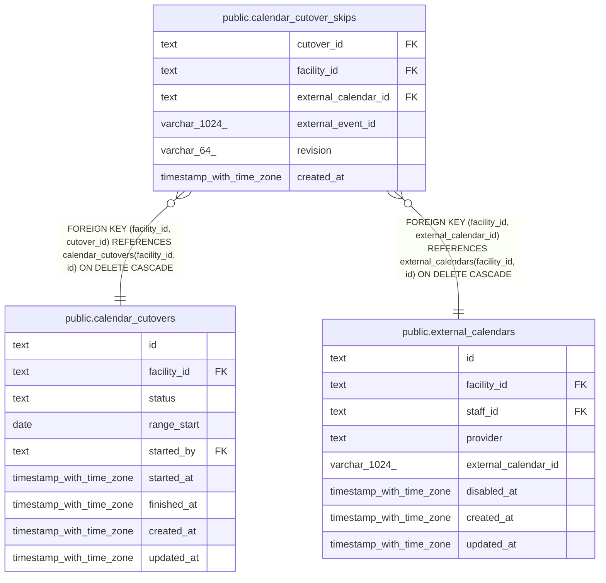

# public.calendar_cutover_skips

## Description

移行の取り込みで、確認が必要な予定に取り込まないを選んだ記録

## Columns

| Name                 | Type                     | Default | Nullable | Children | Parents                                                                                                           | Comment                                                                                                     |
| -------------------- | ------------------------ | ------- | -------- | -------- | ----------------------------------------------------------------------------------------------------------------- | ----------------------------------------------------------------------------------------------------------- |
| cutover_id           | text                     |         | false    |          | [public.calendar_cutovers](public.calendar_cutovers.md)                                                           |                                                                                                             |
| facility_id          | text                     |         | false    |          | [public.external_calendars](public.external_calendars.md) [public.calendar_cutovers](public.calendar_cutovers.md) |                                                                                                             |
| external_calendar_id | text                     |         | false    |          | [public.external_calendars](public.external_calendars.md)                                                         |                                                                                                             |
| external_event_id    | varchar(1024)            |         | false    |          |                                                                                                                   | 取り込み方を選んだ Google の予定の ID。繰り返しの予定とその回では、親の予定の ID                            |
| revision             | varchar(64)              |         | false    |          |                                                                                                                   | 取り込み方を選んだときの、確認が必要な予定のバージョン。Google で予定が変わると変わり、記録は当たらなくなる |
| created_at           | timestamp with time zone | now()   | false    |          |                                                                                                                   |                                                                                                             |

## Viewpoints

| Name                                                               | Definition                                                                                                                                                                                                                                                                                                                                                                                                                                                                       |
| ------------------------------------------------------------------ | -------------------------------------------------------------------------------------------------------------------------------------------------------------------------------------------------------------------------------------------------------------------------------------------------------------------------------------------------------------------------------------------------------------------------------------------------------------------------------- |
| [外部のカレンダーの取り込みと書き出し](viewpoint-calendar-sync.md) | 職員の外部のカレンダーと同期の状態、外部の予定と予定の対応、取り込みの記録、書き出しの待ち、Google カレンダーの予定の写し（Projection）。書き出しは、予定の管理先が buddy_primary の事業所に限る。同期は google_primary の事業所のカレンダーだけを読み、予定の写しに書く。google_primary の事業所で buddy から Google カレンダーに書いた予定は、訪問の情報と書き込みの保留の版を記録に持つ。移行は、google_primary の事業所の予定を取り込み、完了で事業所を buddy_primary にする |

## Constraints

| Name                                                 | Type        | Definition                                                                                                       |
| ---------------------------------------------------- | ----------- | ---------------------------------------------------------------------------------------------------------------- |
| calendar_cutover_skips_created_at_not_null           | n           | NOT NULL created_at                                                                                              |
| calendar_cutover_skips_cutover_id_not_null           | n           | NOT NULL cutover_id                                                                                              |
| calendar_cutover_skips_external_calendar_id_not_null | n           | NOT NULL external_calendar_id                                                                                    |
| calendar_cutover_skips_external_event_id_not_null    | n           | NOT NULL external_event_id                                                                                       |
| calendar_cutover_skips_facility_id_not_null          | n           | NOT NULL facility_id                                                                                             |
| calendar_cutover_skips_revision_not_null             | n           | NOT NULL revision                                                                                                |
| calendar_cutover_skips_calendar_fkey                 | FOREIGN KEY | FOREIGN KEY (facility_id, external_calendar_id) REFERENCES external_calendars(facility_id, id) ON DELETE CASCADE |
| calendar_cutover_skips_cutover_fkey                  | FOREIGN KEY | FOREIGN KEY (facility_id, cutover_id) REFERENCES calendar_cutovers(facility_id, id) ON DELETE CASCADE            |
| calendar_cutover_skips_pkey                          | PRIMARY KEY | PRIMARY KEY (cutover_id, external_calendar_id, external_event_id)                                                |

## Indexes

| Name                                | Definition                                                                                                                                         |
| ----------------------------------- | -------------------------------------------------------------------------------------------------------------------------------------------------- |
| calendar_cutover_skips_pkey         | CREATE UNIQUE INDEX calendar_cutover_skips_pkey ON public.calendar_cutover_skips USING btree (cutover_id, external_calendar_id, external_event_id) |
| calendar_cutover_skips_calendar_idx | CREATE INDEX calendar_cutover_skips_calendar_idx ON public.calendar_cutover_skips USING btree (facility_id, external_calendar_id)                  |

## Relations

---

> Generated by [tbls](https://github.com/k1LoW/tbls)
