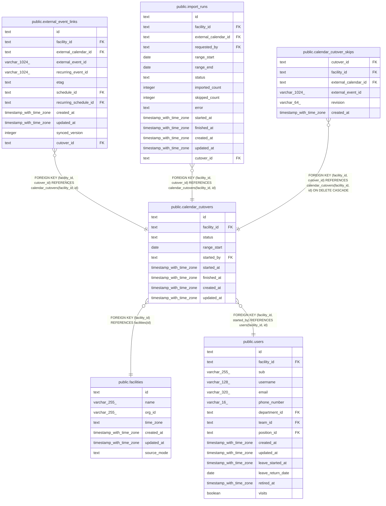

# public.calendar_cutovers

## Description

事業所の予定の正本を Google カレンダーから buddy に切り替える作業の記録（切り替え）。事業所ごとに open は 1 つまで

## Columns

| Name        | Type                     | Default | Nullable | Children                                                                                                                                                                    | Parents                                                                   | Comment                                                                                               |
| ----------- | ------------------------ | ------- | -------- | --------------------------------------------------------------------------------------------------------------------------------------------------------------------------- | ------------------------------------------------------------------------- | ----------------------------------------------------------------------------------------------------- |
| id          | text                     |         | false    | [public.external_event_links](public.external_event_links.md) [public.import_runs](public.import_runs.md) [public.calendar_cutover_skips](public.calendar_cutover_skips.md) |                                                                           |                                                                                                       |
| facility_id | text                     |         | false    | [public.external_event_links](public.external_event_links.md) [public.import_runs](public.import_runs.md) [public.calendar_cutover_skips](public.calendar_cutover_skips.md) | [public.facilities](public.facilities.md) [public.users](public.users.md) |                                                                                                       |
| status      | text                     |         | false    |                                                                                                                                                                             |                                                                           | open、completed、canceled。completed で事業所を buddy_primary にし、canceled は google_primary のまま |
| range_start | date                     |         | false    |                                                                                                                                                                             |                                                                           | 取り込みの期間の最初の日。切り替えを始めた月の初日。期間は終わりを持たない                            |
| started_by  | text                     |         | false    |                                                                                                                                                                             | [public.users](public.users.md)                                           | 切り替えを始めた職員                                                                                  |
| started_at  | timestamp with time zone | now()   | false    |                                                                                                                                                                             |                                                                           |                                                                                                       |
| finished_at | timestamp with time zone |         | true     |                                                                                                                                                                             |                                                                           | 完了したかやめた時刻。open なら NULL                                                                  |
| created_at  | timestamp with time zone | now()   | false    |                                                                                                                                                                             |                                                                           |                                                                                                       |
| updated_at  | timestamp with time zone | now()   | false    |                                                                                                                                                                             |                                                                           |                                                                                                       |

## Viewpoints

| Name                                                               | Definition                                                                                                                                                                                                                                                                                                                                                                                                                                                                                 |
| ------------------------------------------------------------------ | ------------------------------------------------------------------------------------------------------------------------------------------------------------------------------------------------------------------------------------------------------------------------------------------------------------------------------------------------------------------------------------------------------------------------------------------------------------------------------------------ |
| [外部のカレンダーの取り込みと書き出し](viewpoint-calendar-sync.md) | 職員の外部のカレンダーと同期の状態、外部の予定と予定の対応、取り込みの記録、書き出しの待ち、Google カレンダーの予定の写し（Projection）。書き出しは、予定の正本のモードが buddy_primary の事業所に限る。同期は google_primary の事業所のカレンダーだけを読み、予定の写しに書く。google_primary の事業所で buddy から Google カレンダーに書いた予定は、訪問の情報と書き込みの保留の版を記録に持つ。切り替えは、google_primary の事業所の予定を取り込み、完了で事業所を buddy_primary にする |

## Constraints

| Name                                   | Type        | Definition                                                                        |
| -------------------------------------- | ----------- | --------------------------------------------------------------------------------- |
| calendar_cutovers_created_at_not_null  | n           | NOT NULL created_at                                                               |
| calendar_cutovers_facility_id_not_null | n           | NOT NULL facility_id                                                              |
| calendar_cutovers_finished_check       | CHECK       | CHECK (((status = 'open'::text) = (finished_at IS NULL)))                         |
| calendar_cutovers_id_check             | CHECK       | CHECK ((id ~ '^[0-7][0-9A-HJKMNP-TV-Z]{25}$'::text))                              |
| calendar_cutovers_id_not_null          | n           | NOT NULL id                                                                       |
| calendar_cutovers_range_start_check    | CHECK       | CHECK ((EXTRACT(day FROM range_start) = (1)::numeric))                            |
| calendar_cutovers_range_start_not_null | n           | NOT NULL range_start                                                              |
| calendar_cutovers_started_at_not_null  | n           | NOT NULL started_at                                                               |
| calendar_cutovers_started_by_not_null  | n           | NOT NULL started_by                                                               |
| calendar_cutovers_status_check         | CHECK       | CHECK ((status = ANY (ARRAY['open'::text, 'completed'::text, 'canceled'::text]))) |
| calendar_cutovers_status_not_null      | n           | NOT NULL status                                                                   |
| calendar_cutovers_updated_at_not_null  | n           | NOT NULL updated_at                                                               |
| calendar_cutovers_facility_fkey        | FOREIGN KEY | FOREIGN KEY (facility_id) REFERENCES facilities(id)                               |
| calendar_cutovers_started_by_fkey      | FOREIGN KEY | FOREIGN KEY (facility_id, started_by) REFERENCES users(facility_id, id)           |
| calendar_cutovers_pkey                 | PRIMARY KEY | PRIMARY KEY (id)                                                                  |
| calendar_cutovers_facility_id_key      | UNIQUE      | UNIQUE (facility_id, id)                                                          |

## Indexes

| Name                              | Definition                                                                                                                         |
| --------------------------------- | ---------------------------------------------------------------------------------------------------------------------------------- |
| calendar_cutovers_pkey            | CREATE UNIQUE INDEX calendar_cutovers_pkey ON public.calendar_cutovers USING btree (id)                                            |
| calendar_cutovers_facility_id_key | CREATE UNIQUE INDEX calendar_cutovers_facility_id_key ON public.calendar_cutovers USING btree (facility_id, id)                    |
| calendar_cutovers_open_key        | CREATE UNIQUE INDEX calendar_cutovers_open_key ON public.calendar_cutovers USING btree (facility_id) WHERE (status = 'open'::text) |
| calendar_cutovers_started_by_idx  | CREATE INDEX calendar_cutovers_started_by_idx ON public.calendar_cutovers USING btree (facility_id, started_by)                    |

## Triggers

| Name                             | Definition                                                                                                                               |
| -------------------------------- | ---------------------------------------------------------------------------------------------------------------------------------------- |
| calendar_cutovers_set_updated_at | CREATE TRIGGER calendar_cutovers_set_updated_at BEFORE UPDATE ON public.calendar_cutovers FOR EACH ROW EXECUTE FUNCTION set_updated_at() |

## Relations

---

> Generated by [tbls](https://github.com/k1LoW/tbls)
