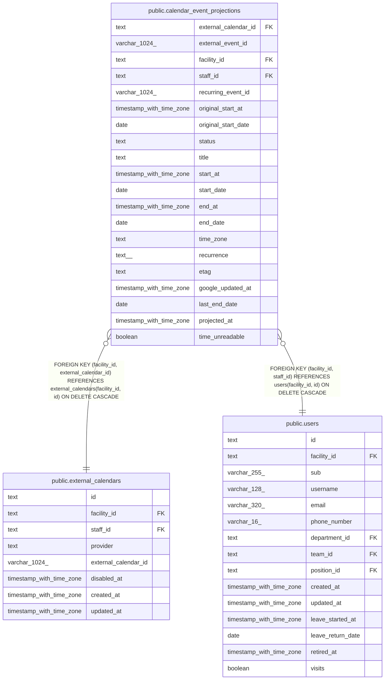

# public.calendar_event_projections

## Description

予定を Google カレンダーで管理している事業所の、Google カレンダーの予定の写し（Projection）。1 つの予定を 1 行にする

## Columns

| Name                 | Type                     | Default      | Nullable | Children | Parents                                                                                   | Comment                                                                                                                                                                                                                                      |
| -------------------- | ------------------------ | ------------ | -------- | -------- | ----------------------------------------------------------------------------------------- | -------------------------------------------------------------------------------------------------------------------------------------------------------------------------------------------------------------------------------------------- |
| external_calendar_id | text                     |              | false    |          | [public.external_calendars](public.external_calendars.md)                                 |                                                                                                                                                                                                                                              |
| external_event_id    | varchar(1024)            |              | false    |          |                                                                                           | Google の予定の ID                                                                                                                                                                                                                           |
| facility_id          | text                     |              | false    |          | [public.users](public.users.md) [public.external_calendars](public.external_calendars.md) | 写した時点のカレンダーの事業所                                                                                                                                                                                                               |
| staff_id             | text                     |              | false    |          | [public.users](public.users.md)                                                           | 写した時点のカレンダーの職員                                                                                                                                                                                                                 |
| recurring_event_id   | varchar(1024)            |              | true     |          |                                                                                           | 繰り返しの予定の例外の回のとき、親の予定の ID                                                                                                                                                                                                |
| original_start_at    | timestamp with time zone |              | true     |          |                                                                                           | 例外の回が元の規則で始まるはずだった日時。終日の予定は original_start_date に持つ                                                                                                                                                            |
| original_start_date  | date                     |              | true     |          |                                                                                           |                                                                                                                                                                                                                                              |
| status               | text                     |              | false    |          |                                                                                           | confirmed、cancelled。cancelled は Google で取り消した予定で、単発の予定と親の予定も行に残す。予定の表示の読み出しは返さない                                                                                                                 |
| title                | text                     |              | false    |          |                                                                                           | Google の予定のタイトル。利用者名を含むが、表示と照合に要るので持つ。取り消した回は空                                                                                                                                                        |
| start_at             | timestamp with time zone |              | true     |          |                                                                                           | 開始の日時。終日の予定は start_date に持つ。取り消した回はどちらも NULL                                                                                                                                                                      |
| start_date           | date                     |              | true     |          |                                                                                           |                                                                                                                                                                                                                                              |
| end_at               | timestamp with time zone |              | true     |          |                                                                                           | 終了の日時。終日の予定は end_date（Google と同じく、終わる日の翌日）に持つ                                                                                                                                                                   |
| end_date             | date                     |              | true     |          |                                                                                           |                                                                                                                                                                                                                                              |
| time_zone            | text                     |              | true     |          |                                                                                           | Google の予定の開始のタイムゾーン（IANA）。繰り返しの規則はこの暦で数える                                                                                                                                                                    |
| recurrence           | text[]                   | '{}'::text[] | false    |          |                                                                                           | 繰り返しの親の予定の RRULE、EXDATE、RDATE の行                                                                                                                                                                                               |
| etag                 | text                     |              | false    |          |                                                                                           |                                                                                                                                                                                                                                              |
| google_updated_at    | timestamp with time zone |              | true     |          |                                                                                           | Google で予定を最後に変えた時刻。行を書き直すのは、書く予定の時刻がこの時刻より新しいときだけにする                                                                                                                                          |
| last_end_date        | date                     |              | true     |          |                                                                                           | Asia/Tokyo で予定が終わる日。繰り返しは最後の回、取り消した回は元の開始の日、取り消した単発の予定と親の予定は取り消しを写した日。終わりの無い繰り返しと、最後の回を決められない繰り返しは NULL。保持する期間より前に終わった行を消すのに使う |
| projected_at         | timestamp with time zone | now()        | false    |          |                                                                                           | 同期が行を書いた時刻                                                                                                                                                                                                                         |
| time_unreadable      | boolean                  | false        | false    |          |                                                                                           | 開始か終了の日時を読めない予定のとき true。読めた方の日時か日付だけを持つ。予定のカレンダーは、出せない予定の件数に数える                                                                                                                    |

## Viewpoints

| Name                                                               | Definition                                                                                                                                                                                                                                                                                                                                                                                                                                                                       |
| ------------------------------------------------------------------ | -------------------------------------------------------------------------------------------------------------------------------------------------------------------------------------------------------------------------------------------------------------------------------------------------------------------------------------------------------------------------------------------------------------------------------------------------------------------------------- |
| [外部のカレンダーの取り込みと書き出し](viewpoint-calendar-sync.md) | 職員の外部のカレンダーと同期の状態、外部の予定と予定の対応、取り込みの記録、書き出しの待ち、Google カレンダーの予定の写し（Projection）。書き出しは、予定の管理先が buddy_primary の事業所に限る。同期は google_primary の事業所のカレンダーだけを読み、予定の写しに書く。google_primary の事業所で buddy から Google カレンダーに書いた予定は、訪問の情報と書き込みの保留の版を記録に持つ。移行は、google_primary の事業所の予定を取り込み、完了で事業所を buddy_primary にする |

## Constraints

| Name                                                     | Type        | Definition                                                                                                                                            |
| -------------------------------------------------------- | ----------- | ----------------------------------------------------------------------------------------------------------------------------------------------------- |
| calendar_event_projections_end_check                     | CHECK       | CHECK (((num_nonnulls(end_at, end_date) <= 1) AND ((status = 'cancelled'::text) OR time_unreadable OR (num_nonnulls(end_at, end_date) = 1))))         |
| calendar_event_projections_etag_not_null                 | n           | NOT NULL etag                                                                                                                                         |
| calendar_event_projections_external_calendar_id_not_null | n           | NOT NULL external_calendar_id                                                                                                                         |
| calendar_event_projections_external_event_id_not_null    | n           | NOT NULL external_event_id                                                                                                                            |
| calendar_event_projections_facility_id_not_null          | n           | NOT NULL facility_id                                                                                                                                  |
| calendar_event_projections_original_check                | CHECK       | CHECK ((num_nonnulls(original_start_at, original_start_date) <= 1))                                                                                   |
| calendar_event_projections_projected_at_not_null         | n           | NOT NULL projected_at                                                                                                                                 |
| calendar_event_projections_recurrence_not_null           | n           | NOT NULL recurrence                                                                                                                                   |
| calendar_event_projections_staff_id_not_null             | n           | NOT NULL staff_id                                                                                                                                     |
| calendar_event_projections_start_check                   | CHECK       | CHECK (((num_nonnulls(start_at, start_date) <= 1) AND ((status = 'cancelled'::text) OR time_unreadable OR (num_nonnulls(start_at, start_date) = 1)))) |
| calendar_event_projections_status_check                  | CHECK       | CHECK ((status = ANY (ARRAY['confirmed'::text, 'cancelled'::text])))                                                                                  |
| calendar_event_projections_status_not_null               | n           | NOT NULL status                                                                                                                                       |
| calendar_event_projections_time_unreadable_not_null      | n           | NOT NULL time_unreadable                                                                                                                              |
| calendar_event_projections_title_not_null                | n           | NOT NULL title                                                                                                                                        |
| calendar_event_projections_staff_fkey                    | FOREIGN KEY | FOREIGN KEY (facility_id, staff_id) REFERENCES users(facility_id, id) ON DELETE CASCADE                                                               |
| calendar_event_projections_calendar_fkey                 | FOREIGN KEY | FOREIGN KEY (facility_id, external_calendar_id) REFERENCES external_calendars(facility_id, id) ON DELETE CASCADE                                      |
| calendar_event_projections_pkey                          | PRIMARY KEY | PRIMARY KEY (external_calendar_id, external_event_id)                                                                                                 |

## Indexes

| Name                                                  | Definition                                                                                                                                                                                                                                                                             |
| ----------------------------------------------------- | -------------------------------------------------------------------------------------------------------------------------------------------------------------------------------------------------------------------------------------------------------------------------------------- |
| calendar_event_projections_pkey                       | CREATE UNIQUE INDEX calendar_event_projections_pkey ON public.calendar_event_projections USING btree (external_calendar_id, external_event_id)                                                                                                                                         |
| calendar_event_projections_facility_end_idx           | CREATE INDEX calendar_event_projections_facility_end_idx ON public.calendar_event_projections USING btree (facility_id, last_end_date)                                                                                                                                                 |
| calendar_event_projections_schedule_id_idx            | CREATE INDEX calendar_event_projections_schedule_id_idx ON public.calendar_event_projections USING btree (projected_schedule_id(external_calendar_id, (external_event_id)::text))                                                                                                      |
| calendar_event_projections_detached_id_idx            | CREATE INDEX calendar_event_projections_detached_id_idx ON public.calendar_event_projections USING btree (detached_schedule_id(external_calendar_id, (external_event_id)::text))                                                                                                       |
| calendar_event_projections_occurrence_id_idx          | CREATE INDEX calendar_event_projections_occurrence_id_idx ON public.calendar_event_projections USING btree (occurrence_schedule_id(external_calendar_id, (recurring_event_id)::text, original_start_at, original_start_date)) WHERE (recurring_event_id IS NOT NULL)                   |
| calendar_event_projections_detached_occurrence_id_idx | CREATE INDEX calendar_event_projections_detached_occurrence_id_idx ON public.calendar_event_projections USING btree (detached_occurrence_schedule_id(external_calendar_id, (recurring_event_id)::text, original_start_at, original_start_date)) WHERE (recurring_event_id IS NOT NULL) |

## Relations

---

> Generated by [tbls](https://github.com/k1LoW/tbls)
