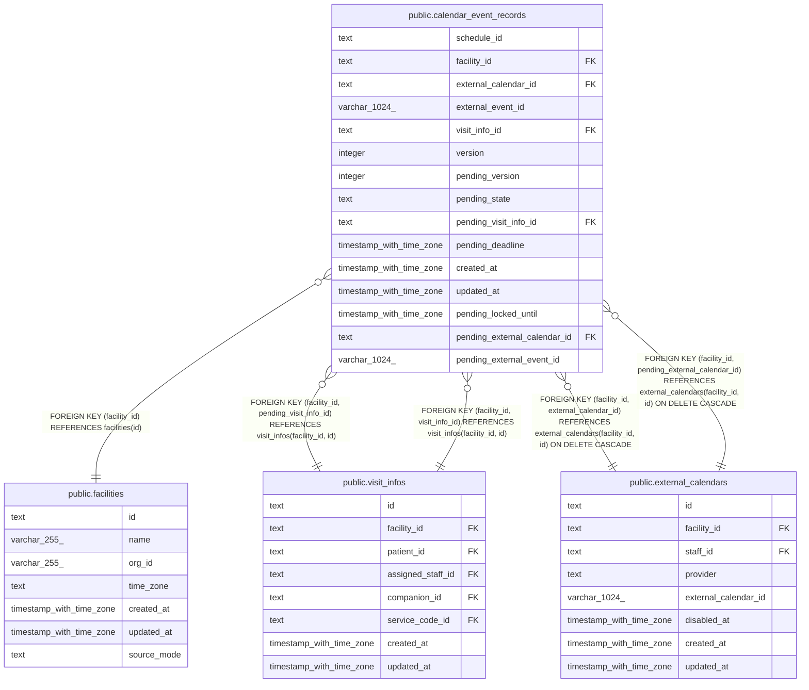

# public.calendar_event_records

## Description

google_primary の事業所で、予定の API が Google カレンダーに書いた予定の、訪問の情報と書き込みの保留の版（ADR-0029）。通常の予定も保留の版を持つために行を作る

## Columns

| Name                         | Type                     | Default | Nullable | Children | Parents                                                                                                                                         | Comment                                                                                                                                                       |
| ---------------------------- | ------------------------ | ------- | -------- | -------- | ----------------------------------------------------------------------------------------------------------------------------------------------- | ------------------------------------------------------------------------------------------------------------------------------------------------------------- |
| schedule_id                  | text                     |         | false    |          |                                                                                                                                                 | buddy の予定の ID。画面が作成のリクエストに付ける。Google の予定の ID はこの ID から決める                                                                    |
| facility_id                  | text                     |         | false    |          | [public.facilities](public.facilities.md) [public.visit_infos](public.visit_infos.md) [public.external_calendars](public.external_calendars.md) |                                                                                                                                                               |
| external_calendar_id         | text                     |         | false    |          | [public.external_calendars](public.external_calendars.md)                                                                                       | 予定を書いた、結び付けたカレンダー                                                                                                                            |
| external_event_id            | varchar(1024)            |         | false    |          |                                                                                                                                                 | Google の予定の ID                                                                                                                                            |
| visit_info_id                | text                     |         | true     |          | [public.visit_infos](public.visit_infos.md)                                                                                                     | Google が受けた版の訪問の情報。通常の予定と、まだ版を確定していない行は NULL                                                                                  |
| version                      | integer                  | 0       | false    |          |                                                                                                                                                 | Google が受けたと分かった最後の版。0 は、まだ受けたと分かっていない。0 の行は保留の版を持つ                                                                   |
| pending_version              | integer                  |         | true     |          |                                                                                                                                                 | 書き込みの保留の版。Google の予定の extendedProperties.private の buddyVersion に置く。保留が無ければ NULL で、保留の状態、訪問の情報、書く期限も NULL        |
| pending_state                | text                     |         | true     |          |                                                                                                                                                 | writing（書いている途中）、unknown（Google が受けたかが分からない）                                                                                           |
| pending_visit_info_id        | text                     |         | true     |          | [public.visit_infos](public.visit_infos.md)                                                                                                     | 保留の版の訪問の情報。版を確定すると visit_info_id に移す                                                                                                     |
| pending_deadline             | timestamp with time zone |         | true     |          |                                                                                                                                                 | 書く期限。保留の版を書いた時刻に、Google を呼ぶ時間の上限と余裕を足した時刻                                                                                   |
| created_at                   | timestamp with time zone | now()   | false    |          |                                                                                                                                                 |                                                                                                                                                               |
| updated_at                   | timestamp with time zone | now()   | false    |          |                                                                                                                                                 |                                                                                                                                                               |
| pending_locked_until         | timestamp with time zone |         | true     |          |                                                                                                                                                 | 同期が保留の版を読み戻す間、ほかの Worker に記録を渡さない期限。読み戻せなかった記録は、この時刻の後に取り直す。保留の版を解いても NULL に戻さない            |
| pending_external_calendar_id | text                     |         | true     |          | [public.external_calendars](public.external_calendars.md)                                                                                       | 保留の版が予定を別のカレンダーに移す書き込みのときの、移す先のカレンダー。移さない書き込みと、保留が無い行は NULL。版を確定すると external_calendar_id に移す |
| pending_external_event_id    | varchar(1024)            |         | true     |          |                                                                                                                                                 | 移す先のカレンダーに作る Google の予定の ID。pending_external_calendar_id と一緒に NULL になる                                                                |

## Viewpoints

| Name                                                               | Definition                                                                                                                                                                                                                                                                                                                                                                                                                                                                                 |
| ------------------------------------------------------------------ | ------------------------------------------------------------------------------------------------------------------------------------------------------------------------------------------------------------------------------------------------------------------------------------------------------------------------------------------------------------------------------------------------------------------------------------------------------------------------------------------ |
| [外部のカレンダーの取り込みと書き出し](viewpoint-calendar-sync.md) | 職員の外部のカレンダーと同期の状態、外部の予定と予定の対応、取り込みの記録、書き出しの待ち、Google カレンダーの予定の写し（Projection）。書き出しは、予定の正本のモードが buddy_primary の事業所に限る。同期は google_primary の事業所のカレンダーだけを読み、予定の写しに書く。google_primary の事業所で buddy から Google カレンダーに書いた予定は、訪問の情報と書き込みの保留の版を記録に持つ。切り替えは、google_primary の事業所の予定を取り込み、完了で事業所を buddy_primary にする |

## Constraints

| Name                                                 | Type        | Definition                                                                                                                                                                                                                                 |
| ---------------------------------------------------- | ----------- | ------------------------------------------------------------------------------------------------------------------------------------------------------------------------------------------------------------------------------------------ |
| calendar_event_records_created_at_not_null           | n           | NOT NULL created_at                                                                                                                                                                                                                        |
| calendar_event_records_external_calendar_id_not_null | n           | NOT NULL external_calendar_id                                                                                                                                                                                                              |
| calendar_event_records_external_event_id_not_null    | n           | NOT NULL external_event_id                                                                                                                                                                                                                 |
| calendar_event_records_facility_id_not_null          | n           | NOT NULL facility_id                                                                                                                                                                                                                       |
| calendar_event_records_pending_check                 | CHECK       | CHECK ((((pending_version IS NULL) AND (pending_state IS NULL) AND (pending_visit_info_id IS NULL) AND (pending_deadline IS NULL)) OR ((pending_version IS NOT NULL) AND (pending_state IS NOT NULL) AND (pending_deadline IS NOT NULL)))) |
| calendar_event_records_pending_move_check            | CHECK       | CHECK ((((pending_external_calendar_id IS NULL) AND (pending_external_event_id IS NULL)) OR ((pending_external_calendar_id IS NOT NULL) AND (pending_external_event_id IS NOT NULL) AND (pending_version IS NOT NULL))))                   |
| calendar_event_records_pending_state_check           | CHECK       | CHECK ((pending_state = ANY (ARRAY['writing'::text, 'unknown'::text])))                                                                                                                                                                    |
| calendar_event_records_pending_version_check         | CHECK       | CHECK ((pending_version > version))                                                                                                                                                                                                        |
| calendar_event_records_schedule_id_check             | CHECK       | CHECK ((schedule_id ~ '^[0-7][0-9A-HJKMNP-TV-Z]{25}$'::text))                                                                                                                                                                              |
| calendar_event_records_schedule_id_not_null          | n           | NOT NULL schedule_id                                                                                                                                                                                                                       |
| calendar_event_records_unconfirmed_check             | CHECK       | CHECK (((version > 0) OR ((pending_version IS NOT NULL) AND (visit_info_id IS NULL))))                                                                                                                                                     |
| calendar_event_records_updated_at_not_null           | n           | NOT NULL updated_at                                                                                                                                                                                                                        |
| calendar_event_records_version_check                 | CHECK       | CHECK ((version >= 0))                                                                                                                                                                                                                     |
| calendar_event_records_version_not_null              | n           | NOT NULL version                                                                                                                                                                                                                           |
| calendar_event_records_facility_fkey                 | FOREIGN KEY | FOREIGN KEY (facility_id) REFERENCES facilities(id)                                                                                                                                                                                        |
| calendar_event_records_pending_visit_info_fkey       | FOREIGN KEY | FOREIGN KEY (facility_id, pending_visit_info_id) REFERENCES visit_infos(facility_id, id)                                                                                                                                                   |
| calendar_event_records_visit_info_fkey               | FOREIGN KEY | FOREIGN KEY (facility_id, visit_info_id) REFERENCES visit_infos(facility_id, id)                                                                                                                                                           |
| calendar_event_records_calendar_fkey                 | FOREIGN KEY | FOREIGN KEY (facility_id, external_calendar_id) REFERENCES external_calendars(facility_id, id) ON DELETE CASCADE                                                                                                                           |
| calendar_event_records_pending_calendar_fkey         | FOREIGN KEY | FOREIGN KEY (facility_id, pending_external_calendar_id) REFERENCES external_calendars(facility_id, id) ON DELETE CASCADE                                                                                                                   |
| calendar_event_records_pkey                          | PRIMARY KEY | PRIMARY KEY (schedule_id)                                                                                                                                                                                                                  |
| calendar_event_records_event_key                     | UNIQUE      | UNIQUE (external_calendar_id, external_event_id)                                                                                                                                                                                           |

## Indexes

| Name                                          | Definition                                                                                                                                                                |
| --------------------------------------------- | ------------------------------------------------------------------------------------------------------------------------------------------------------------------------- |
| calendar_event_records_pkey                   | CREATE UNIQUE INDEX calendar_event_records_pkey ON public.calendar_event_records USING btree (schedule_id)                                                                |
| calendar_event_records_event_key              | CREATE UNIQUE INDEX calendar_event_records_event_key ON public.calendar_event_records USING btree (external_calendar_id, external_event_id)                               |
| calendar_event_records_calendar_idx           | CREATE INDEX calendar_event_records_calendar_idx ON public.calendar_event_records USING btree (facility_id, external_calendar_id)                                         |
| calendar_event_records_visit_info_idx         | CREATE INDEX calendar_event_records_visit_info_idx ON public.calendar_event_records USING btree (visit_info_id) WHERE (visit_info_id IS NOT NULL)                         |
| calendar_event_records_pending_visit_info_idx | CREATE INDEX calendar_event_records_pending_visit_info_idx ON public.calendar_event_records USING btree (pending_visit_info_id) WHERE (pending_visit_info_id IS NOT NULL) |
| calendar_event_records_pending_deadline_idx   | CREATE INDEX calendar_event_records_pending_deadline_idx ON public.calendar_event_records USING btree (pending_deadline) WHERE (pending_version IS NOT NULL)              |

## Triggers

| Name                                  | Definition                                                                                                                                         |
| ------------------------------------- | -------------------------------------------------------------------------------------------------------------------------------------------------- |
| calendar_event_records_set_updated_at | CREATE TRIGGER calendar_event_records_set_updated_at BEFORE UPDATE ON public.calendar_event_records FOR EACH ROW EXECUTE FUNCTION set_updated_at() |

## Relations

---

> Generated by [tbls](https://github.com/k1LoW/tbls)
