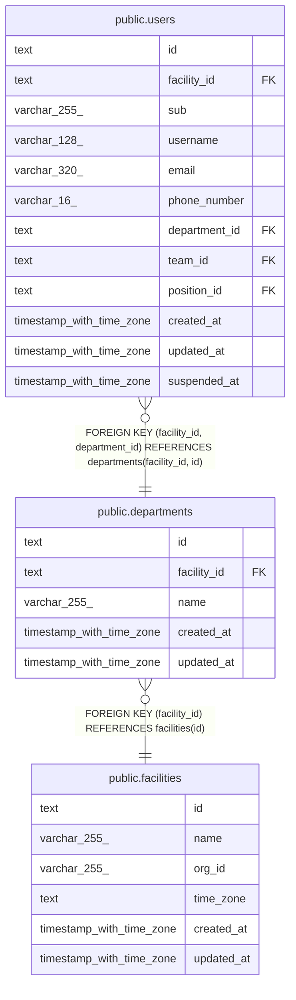

# public.departments

## Description

事業所の部署

## Columns

| Name        | Type                     | Default | Nullable | Children                        | Parents                                   | Comment          |
| ----------- | ------------------------ | ------- | -------- | ------------------------------- | ----------------------------------------- | ---------------- |
| id          | text                     |         | false    | [public.users](public.users.md) |                                           |                  |
| facility_id | text                     |         | false    | [public.users](public.users.md) | [public.facilities](public.facilities.md) |                  |
| name        | varchar(255)             |         | false    |                                 |                                           | 事業所の中で一意 |
| created_at  | timestamp with time zone | now()   | false    |                                 |                                           |                  |
| updated_at  | timestamp with time zone | now()   | false    |                                 |                                           |                  |

## Viewpoints

| Name                                      | Definition                                 |
| ----------------------------------------- | ------------------------------------------ |
| [事業所と組織](viewpoint-organization.md) | 事業所と、その中の部署、チーム、役職、職員 |

## Constraints

| Name                             | Type        | Definition                                           |
| -------------------------------- | ----------- | ---------------------------------------------------- |
| departments_created_at_not_null  | n           | NOT NULL created_at                                  |
| departments_facility_id_not_null | n           | NOT NULL facility_id                                 |
| departments_id_check             | CHECK       | CHECK ((id ~ '^[0-7][0-9A-HJKMNP-TV-Z]{25}$'::text)) |
| departments_id_not_null          | n           | NOT NULL id                                          |
| departments_name_not_null        | n           | NOT NULL name                                        |
| departments_updated_at_not_null  | n           | NOT NULL updated_at                                  |
| departments_facility_fkey        | FOREIGN KEY | FOREIGN KEY (facility_id) REFERENCES facilities(id)  |
| departments_pkey                 | PRIMARY KEY | PRIMARY KEY (id)                                     |
| departments_facility_name_key    | UNIQUE      | UNIQUE (facility_id, name)                           |
| departments_facility_id_key      | UNIQUE      | UNIQUE (facility_id, id)                             |

## Indexes

| Name                          | Definition                                                                                              |
| ----------------------------- | ------------------------------------------------------------------------------------------------------- |
| departments_pkey              | CREATE UNIQUE INDEX departments_pkey ON public.departments USING btree (id)                             |
| departments_facility_name_key | CREATE UNIQUE INDEX departments_facility_name_key ON public.departments USING btree (facility_id, name) |
| departments_facility_id_key   | CREATE UNIQUE INDEX departments_facility_id_key ON public.departments USING btree (facility_id, id)     |

## Triggers

| Name                       | Definition                                                                                                                   |
| -------------------------- | ---------------------------------------------------------------------------------------------------------------------------- |
| departments_set_updated_at | CREATE TRIGGER departments_set_updated_at BEFORE UPDATE ON public.departments FOR EACH ROW EXECUTE FUNCTION set_updated_at() |

## Relations

---

> Generated by [tbls](https://github.com/k1LoW/tbls)
