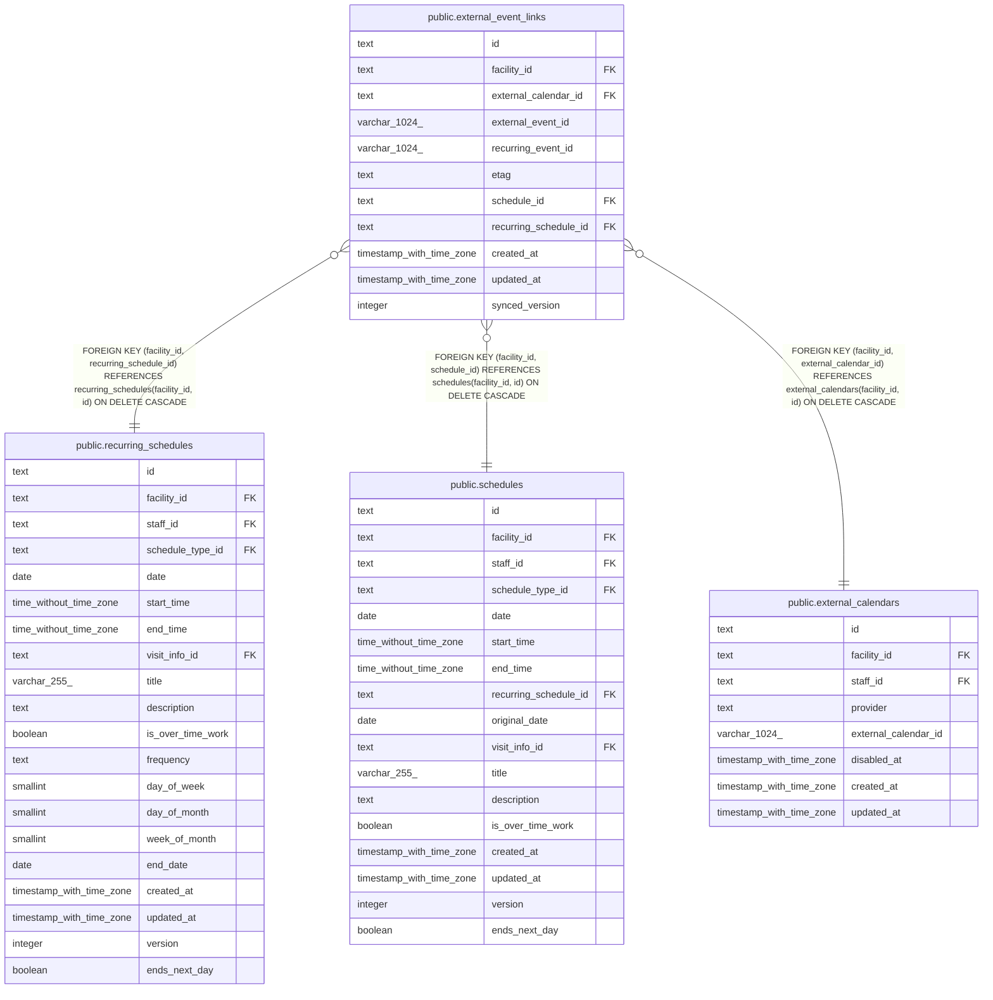

# public.external_event_links

## Description

外部の予定と、buddy の単発か繰り返しの予定の対応

## Columns

| Name                  | Type                     | Default | Nullable | Children | Parents                                                                                                                                                       | Comment                                                                                 |
| --------------------- | ------------------------ | ------- | -------- | -------- | ------------------------------------------------------------------------------------------------------------------------------------------------------------- | --------------------------------------------------------------------------------------- |
| id                    | text                     |         | false    |          |                                                                                                                                                               |                                                                                         |
| facility_id           | text                     |         | false    |          | [public.recurring_schedules](public.recurring_schedules.md) [public.schedules](public.schedules.md) [public.external_calendars](public.external_calendars.md) |                                                                                         |
| external_calendar_id  | text                     |         | false    |          | [public.external_calendars](public.external_calendars.md)                                                                                                     |                                                                                         |
| external_event_id     | varchar(1024)            |         | false    |          |                                                                                                                                                               |                                                                                         |
| recurring_event_id    | varchar(1024)            |         | true     |          |                                                                                                                                                               | 繰り返しの 1 回のとき、外部の繰り返しの予定の ID                                        |
| etag                  | text                     |         | false    |          |                                                                                                                                                               | 最後に同期した時点の外部の予定の etag                                                   |
| schedule_id           | text                     |         | true     |          | [public.schedules](public.schedules.md)                                                                                                                       |                                                                                         |
| recurring_schedule_id | text                     |         | true     |          | [public.recurring_schedules](public.recurring_schedules.md)                                                                                                   |                                                                                         |
| created_at            | timestamp with time zone | now()   | false    |          |                                                                                                                                                               |                                                                                         |
| updated_at            | timestamp with time zone | now()   | false    |          |                                                                                                                                                               |                                                                                         |
| synced_version        | integer                  |         | true     |          |                                                                                                                                                               | 最後に外部の予定と同じにした時点の、buddy の予定の更新の番号。この列を足す前の行は NULL |

## Viewpoints

| Name                                                               | Definition                                                                                                                                                                                                                                                                     |
| ------------------------------------------------------------------ | ------------------------------------------------------------------------------------------------------------------------------------------------------------------------------------------------------------------------------------------------------------------------------ |
| [外部のカレンダーの取り込みと書き出し](viewpoint-calendar-sync.md) | 職員の外部のカレンダーと同期の状態、外部の予定と予定の対応、取り込みの記録、書き出しの待ち、Google カレンダーの予定の写し（Projection）。書き出しは、予定の正本のモードが buddy_primary の事業所に限る。同期は google_primary の事業所のカレンダーだけを読み、予定の写しに書く |

## Constraints

| Name                                               | Type        | Definition                                                                                                         |
| -------------------------------------------------- | ----------- | ------------------------------------------------------------------------------------------------------------------ |
| external_event_links_created_at_not_null           | n           | NOT NULL created_at                                                                                                |
| external_event_links_etag_not_null                 | n           | NOT NULL etag                                                                                                      |
| external_event_links_external_calendar_id_not_null | n           | NOT NULL external_calendar_id                                                                                      |
| external_event_links_external_event_id_not_null    | n           | NOT NULL external_event_id                                                                                         |
| external_event_links_facility_id_not_null          | n           | NOT NULL facility_id                                                                                               |
| external_event_links_id_check                      | CHECK       | CHECK ((id ~ '^[0-7][0-9A-HJKMNP-TV-Z]{25}$'::text))                                                               |
| external_event_links_id_not_null                   | n           | NOT NULL id                                                                                                        |
| external_event_links_synced_version_check          | CHECK       | CHECK ((synced_version >= 1))                                                                                      |
| external_event_links_target_check                  | CHECK       | CHECK ((num_nonnulls(schedule_id, recurring_schedule_id) = 1))                                                     |
| external_event_links_updated_at_not_null           | n           | NOT NULL updated_at                                                                                                |
| external_event_links_recurring_schedule_fkey       | FOREIGN KEY | FOREIGN KEY (facility_id, recurring_schedule_id) REFERENCES recurring_schedules(facility_id, id) ON DELETE CASCADE |
| external_event_links_schedule_fkey                 | FOREIGN KEY | FOREIGN KEY (facility_id, schedule_id) REFERENCES schedules(facility_id, id) ON DELETE CASCADE                     |
| external_event_links_calendar_fkey                 | FOREIGN KEY | FOREIGN KEY (facility_id, external_calendar_id) REFERENCES external_calendars(facility_id, id) ON DELETE CASCADE   |
| external_event_links_pkey                          | PRIMARY KEY | PRIMARY KEY (id)                                                                                                   |
| external_event_links_event_key                     | UNIQUE      | UNIQUE (external_calendar_id, external_event_id)                                                                   |
| external_event_links_schedule_key                  | UNIQUE      | UNIQUE (schedule_id)                                                                                               |
| external_event_links_recurring_schedule_key        | UNIQUE      | UNIQUE (recurring_schedule_id)                                                                                     |

## Indexes

| Name                                                 | Definition                                                                                                                                                                                  |
| ---------------------------------------------------- | ------------------------------------------------------------------------------------------------------------------------------------------------------------------------------------------- |
| external_event_links_pkey                            | CREATE UNIQUE INDEX external_event_links_pkey ON public.external_event_links USING btree (id)                                                                                               |
| external_event_links_event_key                       | CREATE UNIQUE INDEX external_event_links_event_key ON public.external_event_links USING btree (external_calendar_id, external_event_id)                                                     |
| external_event_links_schedule_key                    | CREATE UNIQUE INDEX external_event_links_schedule_key ON public.external_event_links USING btree (schedule_id)                                                                              |
| external_event_links_recurring_schedule_key          | CREATE UNIQUE INDEX external_event_links_recurring_schedule_key ON public.external_event_links USING btree (recurring_schedule_id)                                                          |
| external_event_links_facility_calendar_idx           | CREATE INDEX external_event_links_facility_calendar_idx ON public.external_event_links USING btree (facility_id, external_calendar_id)                                                      |
| external_event_links_facility_schedule_idx           | CREATE INDEX external_event_links_facility_schedule_idx ON public.external_event_links USING btree (facility_id, schedule_id) WHERE (schedule_id IS NOT NULL)                               |
| external_event_links_facility_recurring_schedule_idx | CREATE INDEX external_event_links_facility_recurring_schedule_idx ON public.external_event_links USING btree (facility_id, recurring_schedule_id) WHERE (recurring_schedule_id IS NOT NULL) |

## Triggers

| Name                                | Definition                                                                                                                                     |
| ----------------------------------- | ---------------------------------------------------------------------------------------------------------------------------------------------- |
| external_event_links_set_updated_at | CREATE TRIGGER external_event_links_set_updated_at BEFORE UPDATE ON public.external_event_links FOR EACH ROW EXECUTE FUNCTION set_updated_at() |

## Relations

---

> Generated by [tbls](https://github.com/k1LoW/tbls)
