# public.facilities

## Description

訪問看護の事業所

## Columns

| Name        | Type                     | Default                | Nullable | Children                                                                                                                                                                                                                                                                                                                                            | Parents | Comment                                                                                                                                                   |
| ----------- | ------------------------ | ---------------------- | -------- | --------------------------------------------------------------------------------------------------------------------------------------------------------------------------------------------------------------------------------------------------------------------------------------------------------------------------------------------------- | ------- | --------------------------------------------------------------------------------------------------------------------------------------------------------- |
| id          | text                     |                        | false    | [public.departments](public.departments.md) [public.teams](public.teams.md) [public.positions](public.positions.md) [public.users](public.users.md) [public.patients](public.patients.md) [public.recurring_schedules](public.recurring_schedules.md) [public.schedules](public.schedules.md) [public.calendar_exports](public.calendar_exports.md) |         |                                                                                                                                                           |
| name        | varchar(255)             |                        | false    |                                                                                                                                                                                                                                                                                                                                                     |         | 事業所名                                                                                                                                                  |
| org_id      | varchar(255)             |                        | true     |                                                                                                                                                                                                                                                                                                                                                     |         | ブローカーの組織の ID。結び付けるまで NULL                                                                                                                |
| time_zone   | text                     | 'Asia/Tokyo'::text     | false    |                                                                                                                                                                                                                                                                                                                                                     |         | 予定の日付と時刻を読む現地のタイムゾーン（IANA の名前）                                                                                                   |
| created_at  | timestamp with time zone | now()                  | false    |                                                                                                                                                                                                                                                                                                                                                     |         |                                                                                                                                                           |
| updated_at  | timestamp with time zone | now()                  | false    |                                                                                                                                                                                                                                                                                                                                                     |         |                                                                                                                                                           |
| source_mode | text                     | 'google_primary'::text | false    |                                                                                                                                                                                                                                                                                                                                                     |         | 予定の正本のモード。google_primary は Google カレンダーが正本で予定の API から予定を書けない。buddy_primary は buddy が正本で Google カレンダーへ書き出す |

## Viewpoints

| Name                                                               | Definition                                                                                                                                                                                                                                                                     |
| ------------------------------------------------------------------ | ------------------------------------------------------------------------------------------------------------------------------------------------------------------------------------------------------------------------------------------------------------------------------ |
| [事業所と組織](viewpoint-organization.md)                          | 事業所と、その中の部署、チーム、役職、職員。事業所は予定の正本のモードを持つ                                                                                                                                                                                                   |
| [利用者](viewpoint-patients.md)                                    | 利用者と、受けているサービスと、主に担当する職員                                                                                                                                                                                                                               |
| [予定と訪問](viewpoint-schedules.md)                               | 予定と、訪問のときの訪問の情報と区分、予定の取り消し                                                                                                                                                                                                                           |
| [繰り返しの予定](viewpoint-recurring.md)                           | 繰り返しの予定と規則、回にしない日。繰り返しの 1 回を置き換えた予定は schedules に入る                                                                                                                                                                                         |
| [外部のカレンダーの取り込みと書き出し](viewpoint-calendar-sync.md) | 職員の外部のカレンダーと同期の状態、外部の予定と予定の対応、取り込みの記録、書き出しの待ち、Google カレンダーの予定の写し（Projection）。書き出しは、予定の正本のモードが buddy_primary の事業所に限る。同期は google_primary の事業所のカレンダーだけを読み、予定の写しに書く |

## Constraints

| Name                            | Type        | Definition                                                                         |
| ------------------------------- | ----------- | ---------------------------------------------------------------------------------- |
| facilities_created_at_not_null  | n           | NOT NULL created_at                                                                |
| facilities_id_check             | CHECK       | CHECK ((id ~ '^[0-7][0-9A-HJKMNP-TV-Z]{25}$'::text))                               |
| facilities_id_not_null          | n           | NOT NULL id                                                                        |
| facilities_name_not_null        | n           | NOT NULL name                                                                      |
| facilities_source_mode_check    | CHECK       | CHECK ((source_mode = ANY (ARRAY['google_primary'::text, 'buddy_primary'::text]))) |
| facilities_source_mode_not_null | n           | NOT NULL source_mode                                                               |
| facilities_time_zone_not_null   | n           | NOT NULL time_zone                                                                 |
| facilities_updated_at_not_null  | n           | NOT NULL updated_at                                                                |
| facilities_pkey                 | PRIMARY KEY | PRIMARY KEY (id)                                                                   |
| facilities_org_id_key           | UNIQUE      | UNIQUE (org_id)                                                                    |

## Indexes

| Name                  | Definition                                                                          |
| --------------------- | ----------------------------------------------------------------------------------- |
| facilities_pkey       | CREATE UNIQUE INDEX facilities_pkey ON public.facilities USING btree (id)           |
| facilities_org_id_key | CREATE UNIQUE INDEX facilities_org_id_key ON public.facilities USING btree (org_id) |

## Triggers

| Name                      | Definition                                                                                                                 |
| ------------------------- | -------------------------------------------------------------------------------------------------------------------------- |
| facilities_set_updated_at | CREATE TRIGGER facilities_set_updated_at BEFORE UPDATE ON public.facilities FOR EACH ROW EXECUTE FUNCTION set_updated_at() |

## Relations

```mermaid
erDiagram

"public.departments" }o--|| "public.facilities" : "FOREIGN KEY (facility_id) REFERENCES facilities(id)"
"public.teams" }o--|| "public.facilities" : "FOREIGN KEY (facility_id) REFERENCES facilities(id)"
"public.positions" }o--|| "public.facilities" : "FOREIGN KEY (facility_id) REFERENCES facilities(id)"
"public.users" }o--|| "public.facilities" : "FOREIGN KEY (facility_id) REFERENCES facilities(id)"
"public.patients" }o--|| "public.facilities" : "FOREIGN KEY (facility_id) REFERENCES facilities(id)"
"public.recurring_schedules" }o--|| "public.facilities" : "FOREIGN KEY (facility_id) REFERENCES facilities(id)"
"public.schedules" }o--|| "public.facilities" : "FOREIGN KEY (facility_id) REFERENCES facilities(id)"
"public.calendar_exports" }o--|| "public.facilities" : "FOREIGN KEY (facility_id) REFERENCES facilities(id)"

"public.facilities" {
  text id
  varchar_255_ name
  varchar_255_ org_id
  text time_zone
  timestamp_with_time_zone created_at
  timestamp_with_time_zone updated_at
  text source_mode
}
"public.departments" {
  text id
  text facility_id FK
  varchar_255_ name
  timestamp_with_time_zone created_at
  timestamp_with_time_zone updated_at
}
"public.teams" {
  text id
  text facility_id FK
  varchar_255_ name
  timestamp_with_time_zone created_at
  timestamp_with_time_zone updated_at
  text color
}
"public.positions" {
  text id
  text facility_id FK
  varchar_255_ name
  timestamp_with_time_zone created_at
  timestamp_with_time_zone updated_at
}
"public.users" {
  text id
  text facility_id FK
  varchar_255_ sub
  varchar_128_ username
  varchar_320_ email
  varchar_16_ phone_number
  text department_id FK
  text team_id FK
  text position_id FK
  timestamp_with_time_zone created_at
  timestamp_with_time_zone updated_at
  timestamp_with_time_zone leave_started_at
  date leave_return_date
  timestamp_with_time_zone retired_at
  boolean visits
}
"public.patients" {
  text id
  text facility_id FK
  varchar_255_ name
  text preferred_time
  text preferred_gender
  text service_code_id FK
  text assigned_staff_id FK
  timestamp_with_time_zone created_at
  timestamp_with_time_zone updated_at
  timestamp_with_time_zone ended_at
}
"public.recurring_schedules" {
  text id
  text facility_id FK
  text staff_id FK
  text schedule_type_id FK
  date date
  time_without_time_zone start_time
  time_without_time_zone end_time
  text visit_info_id FK
  varchar_255_ title
  text description
  boolean is_over_time_work
  text frequency
  smallint day_of_week
  smallint day_of_month
  smallint week_of_month
  date end_date
  timestamp_with_time_zone created_at
  timestamp_with_time_zone updated_at
  integer version
  boolean ends_next_day
}
"public.schedules" {
  text id
  text facility_id FK
  text staff_id FK
  text schedule_type_id FK
  date date
  time_without_time_zone start_time
  time_without_time_zone end_time
  text recurring_schedule_id FK
  date original_date
  text visit_info_id FK
  varchar_255_ title
  text description
  boolean is_over_time_work
  timestamp_with_time_zone created_at
  timestamp_with_time_zone updated_at
  integer version
  boolean ends_next_day
}
"public.calendar_exports" {
  text id
  text facility_id FK
  text schedule_id FK
  text recurring_schedule_id FK
  text status
  integer revision
  integer attempts
  timestamp_with_time_zone next_attempt_at
  timestamp_with_time_zone locked_until
  boolean overwrite
  text error_code
  timestamp_with_time_zone finished_at
  timestamp_with_time_zone created_at
  timestamp_with_time_zone updated_at
}
```

---

> Generated by [tbls](https://github.com/k1LoW/tbls)
