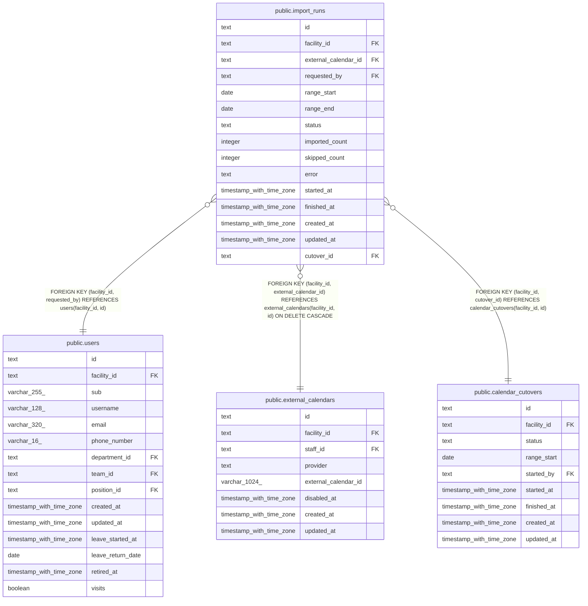

# public.import_runs

## Description

外部のカレンダーからの取り込みの 1 回ごとの記録

## Columns

| Name                 | Type                     | Default | Nullable | Children | Parents                                                                                                                                           | Comment                                                                           |
| -------------------- | ------------------------ | ------- | -------- | -------- | ------------------------------------------------------------------------------------------------------------------------------------------------- | --------------------------------------------------------------------------------- |
| id                   | text                     |         | false    |          |                                                                                                                                                   |                                                                                   |
| facility_id          | text                     |         | false    |          | [public.users](public.users.md) [public.external_calendars](public.external_calendars.md) [public.calendar_cutovers](public.calendar_cutovers.md) |                                                                                   |
| external_calendar_id | text                     |         | false    |          | [public.external_calendars](public.external_calendars.md)                                                                                         |                                                                                   |
| requested_by         | text                     |         | false    |          | [public.users](public.users.md)                                                                                                                   | 取り込みを確定した職員                                                            |
| range_start          | date                     |         | false    |          |                                                                                                                                                   | 取り込む期間の最初の日                                                            |
| range_end            | date                     |         | true     |          |                                                                                                                                                   | 取り込む期間の最後の日。この日を含む。移行の取り込みでは NULL（終わりを持たない） |
| status               | text                     |         | false    |          |                                                                                                                                                   | running、succeeded、failed                                                        |
| imported_count       | integer                  | 0       | false    |          |                                                                                                                                                   |                                                                                   |
| skipped_count        | integer                  | 0       | false    |          |                                                                                                                                                   | buddy の予定に写せず、取り込まなかった外部の予定の数                              |
| error                | text                     |         | true     |          |                                                                                                                                                   |                                                                                   |
| started_at           | timestamp with time zone | now()   | false    |          |                                                                                                                                                   |                                                                                   |
| finished_at          | timestamp with time zone |         | true     |          |                                                                                                                                                   |                                                                                   |
| created_at           | timestamp with time zone | now()   | false    |          |                                                                                                                                                   |                                                                                   |
| updated_at           | timestamp with time zone | now()   | false    |          |                                                                                                                                                   |                                                                                   |
| cutover_id           | text                     |         | true     |          | [public.calendar_cutovers](public.calendar_cutovers.md)                                                                                           | 移行の取り込みのとき、その移行                                                    |

## Viewpoints

| Name                                                               | Definition                                                                                                                                                                                                                                                                                                                                                                                                                                                                       |
| ------------------------------------------------------------------ | -------------------------------------------------------------------------------------------------------------------------------------------------------------------------------------------------------------------------------------------------------------------------------------------------------------------------------------------------------------------------------------------------------------------------------------------------------------------------------- |
| [外部のカレンダーの取り込みと書き出し](viewpoint-calendar-sync.md) | 職員の外部のカレンダーと同期の状態、外部の予定と予定の対応、取り込みの記録、書き出しの待ち、Google カレンダーの予定の写し（Projection）。書き出しは、予定の管理先が buddy_primary の事業所に限る。同期は google_primary の事業所のカレンダーだけを読み、予定の写しに書く。google_primary の事業所で buddy から Google カレンダーに書いた予定は、訪問の情報と書き込みの保留の版を記録に持つ。移行は、google_primary の事業所の予定を取り込み、完了で事業所を buddy_primary にする |

## Constraints

| Name                                      | Type        | Definition                                                                                                       |
| ----------------------------------------- | ----------- | ---------------------------------------------------------------------------------------------------------------- |
| import_runs_count_check                   | CHECK       | CHECK (((imported_count >= 0) AND (skipped_count >= 0)))                                                         |
| import_runs_created_at_not_null           | n           | NOT NULL created_at                                                                                              |
| import_runs_external_calendar_id_not_null | n           | NOT NULL external_calendar_id                                                                                    |
| import_runs_facility_id_not_null          | n           | NOT NULL facility_id                                                                                             |
| import_runs_finished_check                | CHECK       | CHECK (((status = 'running'::text) = (finished_at IS NULL)))                                                     |
| import_runs_id_check                      | CHECK       | CHECK ((id ~ '^[0-7][0-9A-HJKMNP-TV-Z]{25}$'::text))                                                             |
| import_runs_id_not_null                   | n           | NOT NULL id                                                                                                      |
| import_runs_imported_count_not_null       | n           | NOT NULL imported_count                                                                                          |
| import_runs_open_range_check              | CHECK       | CHECK (((range_end IS NOT NULL) OR (cutover_id IS NOT NULL)))                                                    |
| import_runs_range_check                   | CHECK       | CHECK ((range_start <= range_end))                                                                               |
| import_runs_range_start_not_null          | n           | NOT NULL range_start                                                                                             |
| import_runs_requested_by_not_null         | n           | NOT NULL requested_by                                                                                            |
| import_runs_skipped_count_not_null        | n           | NOT NULL skipped_count                                                                                           |
| import_runs_started_at_not_null           | n           | NOT NULL started_at                                                                                              |
| import_runs_status_check                  | CHECK       | CHECK ((status = ANY (ARRAY['running'::text, 'succeeded'::text, 'failed'::text])))                               |
| import_runs_status_not_null               | n           | NOT NULL status                                                                                                  |
| import_runs_updated_at_not_null           | n           | NOT NULL updated_at                                                                                              |
| import_runs_requested_by_fkey             | FOREIGN KEY | FOREIGN KEY (facility_id, requested_by) REFERENCES users(facility_id, id)                                        |
| import_runs_calendar_fkey                 | FOREIGN KEY | FOREIGN KEY (facility_id, external_calendar_id) REFERENCES external_calendars(facility_id, id) ON DELETE CASCADE |
| import_runs_pkey                          | PRIMARY KEY | PRIMARY KEY (id)                                                                                                 |
| import_runs_cutover_fkey                  | FOREIGN KEY | FOREIGN KEY (facility_id, cutover_id) REFERENCES calendar_cutovers(facility_id, id)                              |

## Indexes

| Name                              | Definition                                                                                                                       |
| --------------------------------- | -------------------------------------------------------------------------------------------------------------------------------- |
| import_runs_pkey                  | CREATE UNIQUE INDEX import_runs_pkey ON public.import_runs USING btree (id)                                                      |
| import_runs_facility_calendar_idx | CREATE INDEX import_runs_facility_calendar_idx ON public.import_runs USING btree (facility_id, external_calendar_id, started_at) |
| import_runs_requested_by_idx      | CREATE INDEX import_runs_requested_by_idx ON public.import_runs USING btree (facility_id, requested_by)                          |
| import_runs_cutover_idx           | CREATE INDEX import_runs_cutover_idx ON public.import_runs USING btree (facility_id, cutover_id) WHERE (cutover_id IS NOT NULL)  |

## Triggers

| Name                       | Definition                                                                                                                   |
| -------------------------- | ---------------------------------------------------------------------------------------------------------------------------- |
| import_runs_set_updated_at | CREATE TRIGGER import_runs_set_updated_at BEFORE UPDATE ON public.import_runs FOR EACH ROW EXECUTE FUNCTION set_updated_at() |

## Relations

---

> Generated by [tbls](https://github.com/k1LoW/tbls)
