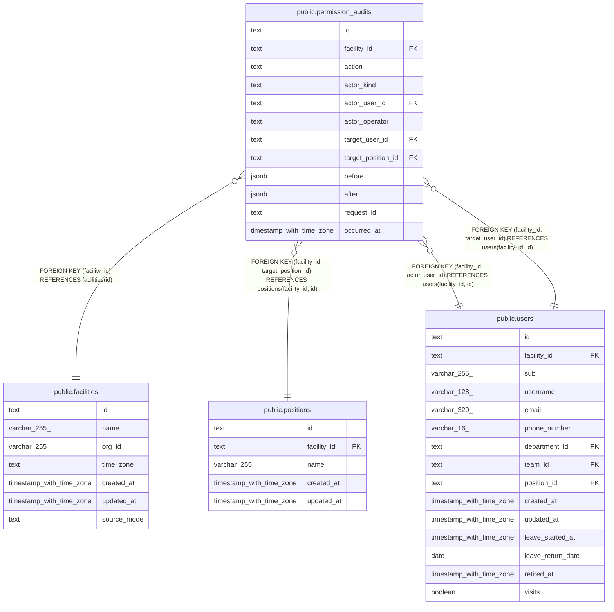

# public.permission_audits

## Description

権限の変更と運営者の登録の監査の記録（ADR-0042）。画面と API に出さず、運営者が DB で読む。消さず、書き換えない

## Columns

| Name               | Type                     | Default | Nullable | Children | Parents                                                                                                           | Comment                                                                                                                                             |
| ------------------ | ------------------------ | ------- | -------- | -------- | ----------------------------------------------------------------------------------------------------------------- | --------------------------------------------------------------------------------------------------------------------------------------------------- |
| id                 | text                     |         | false    |          |                                                                                                                   |                                                                                                                                                     |
| facility_id        | text                     |         | false    |          | [public.facilities](public.facilities.md) [public.positions](public.positions.md) [public.users](public.users.md) |                                                                                                                                                     |
| action             | text                     |         | false    |          |                                                                                                                   | 操作。facility.create、position.create、staff.create、staff.create_forced、grant.add、grant.remove、position.change、team.change、grant.migrate     |
| actor_kind         | text                     |         | false    |          |                                                                                                                   | 操作した人の種類。staff か operator。マイグレーションは operator                                                                                    |
| actor_user_id      | text                     |         | true     |          | [public.users](public.users.md)                                                                                   | 操作した職員。actor_kind が staff のときだけ持つ                                                                                                    |
| actor_operator     | text                     |         | true     |          |                                                                                                                   | 操作した運営者。運営用の CLI の引数 --operator で渡した運営者の ID か、マイグレーションの migration:\<番号\>。actor_kind が operator のときだけ持つ |
| target_user_id     | text                     |         | true     |          | [public.users](public.users.md)                                                                                   | 対象の職員。staff.*、grant.*、position.change、team.change で持つ                                                                                   |
| target_position_id | text                     |         | true     |          | [public.positions](public.positions.md)                                                                           | 対象の役職。position.create で持つ                                                                                                                  |
| before             | jsonb                    |         | true     |          |                                                                                                                   | 変更の前の全量。職員は役職とチームの ID と権限の code と対象の ID の並び。登録と役職の作成と、始まりの行では持たない                                |
| after              | jsonb                    |         | true     |          |                                                                                                                   | 変更の後の全量。職員は役職とチームの ID と権限の code と対象の ID の並び、役職の作成は名前とデフォルトの権限の code の並び                          |
| request_id         | text                     |         | false    |          |                                                                                                                   | 相関 ID。API はリクエストごと、CLI は実行ごと、マイグレーションは 1 つのマイグレーションごとに振り、ログにも同じ値を書く                            |
| occurred_at        | timestamp with time zone | now()   | false    |          |                                                                                                                   | 操作の時刻                                                                                                                                          |

## Viewpoints

| Name                                | Definition                                                                                                                   |
| ----------------------------------- | ---------------------------------------------------------------------------------------------------------------------------- |
| [職員と権限](viewpoint-policies.md) | 職員が持つ権限と、その対象。職員を登録するとき、役職のデフォルトの権限をコピーする。権限の変更は監査の記録に残す（ADR-0042） |

## Constraints

| Name                                   | Type        | Definition                                                                                                                                                                                                                                                                                                                                                                                                                                                                                                                                                                                                                                                                                                                                                                                                      |
| -------------------------------------- | ----------- | --------------------------------------------------------------------------------------------------------------------------------------------------------------------------------------------------------------------------------------------------------------------------------------------------------------------------------------------------------------------------------------------------------------------------------------------------------------------------------------------------------------------------------------------------------------------------------------------------------------------------------------------------------------------------------------------------------------------------------------------------------------------------------------------------------------- |
| permission_audits_action_actor_check   | CHECK       | CHECK ((((action <> ALL (ARRAY['facility.create'::text, 'staff.create_forced'::text, 'grant.migrate'::text])) OR (actor_kind = 'operator'::text)) AND ((action <> ALL (ARRAY['grant.add'::text, 'grant.remove'::text, 'position.change'::text, 'team.change'::text])) OR (actor_kind = 'staff'::text))))                                                                                                                                                                                                                                                                                                                                                                                                                                                                                                        |
| permission_audits_action_check         | CHECK       | CHECK ((action = ANY (ARRAY['facility.create'::text, 'position.create'::text, 'staff.create'::text, 'staff.create_forced'::text, 'grant.add'::text, 'grant.remove'::text, 'position.change'::text, 'team.change'::text, 'grant.migrate'::text])))                                                                                                                                                                                                                                                                                                                                                                                                                                                                                                                                                               |
| permission_audits_action_not_null      | n           | NOT NULL action                                                                                                                                                                                                                                                                                                                                                                                                                                                                                                                                                                                                                                                                                                                                                                                                 |
| permission_audits_actor_check          | CHECK       | CHECK ((((actor_kind = 'staff'::text) AND (actor_user_id IS NOT NULL) AND (actor_operator IS NULL)) OR ((actor_kind = 'operator'::text) AND (actor_user_id IS NULL) AND (actor_operator IS NOT NULL))))                                                                                                                                                                                                                                                                                                                                                                                                                                                                                                                                                                                                         |
| permission_audits_actor_kind_not_null  | n           | NOT NULL actor_kind                                                                                                                                                                                                                                                                                                                                                                                                                                                                                                                                                                                                                                                                                                                                                                                             |
| permission_audits_actor_operator_check | CHECK       | CHECK (((char_length(actor_operator) >= 1) AND (char_length(actor_operator) <= 255)))                                                                                                                                                                                                                                                                                                                                                                                                                                                                                                                                                                                                                                                                                                                           |
| permission_audits_facility_id_not_null | n           | NOT NULL facility_id                                                                                                                                                                                                                                                                                                                                                                                                                                                                                                                                                                                                                                                                                                                                                                                            |
| permission_audits_id_check             | CHECK       | CHECK ((id ~ '^[0-7][0-9A-HJKMNP-TV-Z]{25}$'::text))                                                                                                                                                                                                                                                                                                                                                                                                                                                                                                                                                                                                                                                                                                                                                            |
| permission_audits_id_not_null          | n           | NOT NULL id                                                                                                                                                                                                                                                                                                                                                                                                                                                                                                                                                                                                                                                                                                                                                                                                     |
| permission_audits_occurred_at_not_null | n           | NOT NULL occurred_at                                                                                                                                                                                                                                                                                                                                                                                                                                                                                                                                                                                                                                                                                                                                                                                            |
| permission_audits_request_id_check     | CHECK       | CHECK (((char_length(request_id) >= 1) AND (char_length(request_id) <= 255)))                                                                                                                                                                                                                                                                                                                                                                                                                                                                                                                                                                                                                                                                                                                                   |
| permission_audits_request_id_not_null  | n           | NOT NULL request_id                                                                                                                                                                                                                                                                                                                                                                                                                                                                                                                                                                                                                                                                                                                                                                                             |
| permission_audits_target_check         | CHECK       | CHECK ( CASE     WHEN (action = 'facility.create'::text) THEN (num_nonnulls(target_user_id, target_position_id, before, after) = 0)     WHEN (action = 'position.create'::text) THEN ((target_user_id IS NULL) AND (target_position_id IS NOT NULL) AND (before IS NULL) AND (after IS NOT NULL))     WHEN (action = ANY (ARRAY['staff.create'::text, 'staff.create_forced'::text])) THEN ((target_user_id IS NOT NULL) AND (target_position_id IS NULL) AND (before IS NULL) AND (after IS NOT NULL))     WHEN (action = 'grant.migrate'::text) THEN ((target_user_id IS NOT NULL) AND (target_position_id IS NULL) AND (after IS NOT NULL))     ELSE ((target_user_id IS NOT NULL) AND (target_position_id IS NULL) AND (before IS NOT NULL) AND (after IS NOT NULL)) END) |
| permission_audits_facility_fkey        | FOREIGN KEY | FOREIGN KEY (facility_id) REFERENCES facilities(id)                                                                                                                                                                                                                                                                                                                                                                                                                                                                                                                                                                                                                                                                                                                                                             |
| permission_audits_target_position_fkey | FOREIGN KEY | FOREIGN KEY (facility_id, target_position_id) REFERENCES positions(facility_id, id)                                                                                                                                                                                                                                                                                                                                                                                                                                                                                                                                                                                                                                                                                                                             |
| permission_audits_actor_user_fkey      | FOREIGN KEY | FOREIGN KEY (facility_id, actor_user_id) REFERENCES users(facility_id, id)                                                                                                                                                                                                                                                                                                                                                                                                                                                                                                                                                                                                                                                                                                                                      |
| permission_audits_target_user_fkey     | FOREIGN KEY | FOREIGN KEY (facility_id, target_user_id) REFERENCES users(facility_id, id)                                                                                                                                                                                                                                                                                                                                                                                                                                                                                                                                                                                                                                                                                                                                     |
| permission_audits_pkey                 | PRIMARY KEY | PRIMARY KEY (id)                                                                                                                                                                                                                                                                                                                                                                                                                                                                                                                                                                                                                                                                                                                                                                                                |

## Indexes

| Name                                  | Definition                                                                                                                                                          |
| ------------------------------------- | ------------------------------------------------------------------------------------------------------------------------------------------------------------------- |
| permission_audits_pkey                | CREATE UNIQUE INDEX permission_audits_pkey ON public.permission_audits USING btree (id)                                                                             |
| permission_audits_actor_user_idx      | CREATE INDEX permission_audits_actor_user_idx ON public.permission_audits USING btree (facility_id, actor_user_id) WHERE (actor_user_id IS NOT NULL)                |
| permission_audits_target_user_idx     | CREATE INDEX permission_audits_target_user_idx ON public.permission_audits USING btree (facility_id, target_user_id) WHERE (target_user_id IS NOT NULL)             |
| permission_audits_target_position_idx | CREATE INDEX permission_audits_target_position_idx ON public.permission_audits USING btree (facility_id, target_position_id) WHERE (target_position_id IS NOT NULL) |
| permission_audits_request_idx         | CREATE INDEX permission_audits_request_idx ON public.permission_audits USING btree (request_id)                                                                     |

## Relations

---

> Generated by [tbls](https://github.com/k1LoW/tbls)
