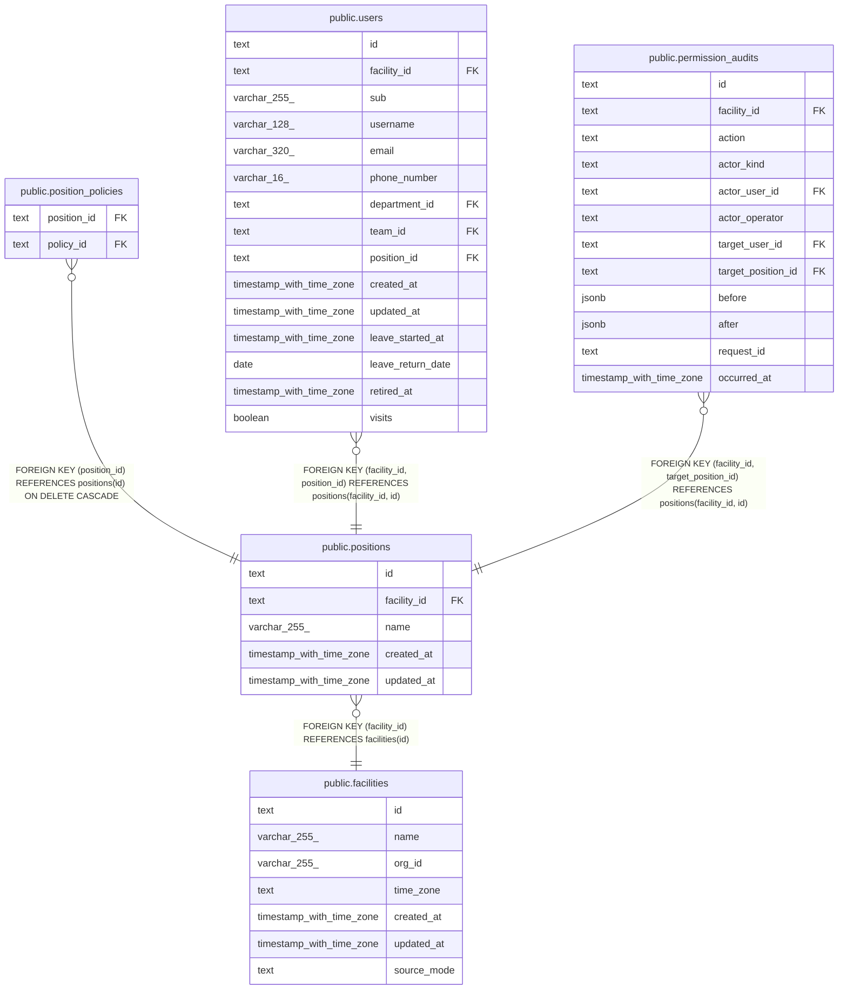

# public.positions

## Description

事業所の役職。職員を登録するときに写す既定の権限を持つ

## Columns

| Name        | Type                     | Default | Nullable | Children                                                                                                                                        | Parents                                   | Comment          |
| ----------- | ------------------------ | ------- | -------- | ----------------------------------------------------------------------------------------------------------------------------------------------- | ----------------------------------------- | ---------------- |
| id          | text                     |         | false    | [public.position_policies](public.position_policies.md) [public.users](public.users.md) [public.permission_audits](public.permission_audits.md) |                                           |                  |
| facility_id | text                     |         | false    | [public.users](public.users.md) [public.permission_audits](public.permission_audits.md)                                                         | [public.facilities](public.facilities.md) |                  |
| name        | varchar(255)             |         | false    |                                                                                                                                                 |                                           | 事業所の中で一意 |
| created_at  | timestamp with time zone | now()   | false    |                                                                                                                                                 |                                           |                  |
| updated_at  | timestamp with time zone | now()   | false    |                                                                                                                                                 |                                           |                  |

## Viewpoints

| Name                                      | Definition                                                                                                                   |
| ----------------------------------------- | ---------------------------------------------------------------------------------------------------------------------------- |
| [事業所と組織](viewpoint-organization.md) | 事業所と、その中の部署、チーム、役職、職員。事業所は予定の管理先を持つ                                                       |
| [職員と権限](viewpoint-policies.md)       | 職員が持つ権限と、その対象。職員を登録するとき、役職のデフォルトの権限をコピーする。権限の変更は監査の記録に残す（ADR-0042） |

## Constraints

| Name                           | Type        | Definition                                           |
| ------------------------------ | ----------- | ---------------------------------------------------- |
| positions_created_at_not_null  | n           | NOT NULL created_at                                  |
| positions_facility_id_not_null | n           | NOT NULL facility_id                                 |
| positions_id_check             | CHECK       | CHECK ((id ~ '^[0-7][0-9A-HJKMNP-TV-Z]{25}$'::text)) |
| positions_id_not_null          | n           | NOT NULL id                                          |
| positions_name_not_null        | n           | NOT NULL name                                        |
| positions_updated_at_not_null  | n           | NOT NULL updated_at                                  |
| positions_facility_fkey        | FOREIGN KEY | FOREIGN KEY (facility_id) REFERENCES facilities(id)  |
| positions_pkey                 | PRIMARY KEY | PRIMARY KEY (id)                                     |
| positions_facility_name_key    | UNIQUE      | UNIQUE (facility_id, name)                           |
| positions_facility_id_key      | UNIQUE      | UNIQUE (facility_id, id)                             |

## Indexes

| Name                        | Definition                                                                                          |
| --------------------------- | --------------------------------------------------------------------------------------------------- |
| positions_pkey              | CREATE UNIQUE INDEX positions_pkey ON public.positions USING btree (id)                             |
| positions_facility_name_key | CREATE UNIQUE INDEX positions_facility_name_key ON public.positions USING btree (facility_id, name) |
| positions_facility_id_key   | CREATE UNIQUE INDEX positions_facility_id_key ON public.positions USING btree (facility_id, id)     |

## Triggers

| Name                     | Definition                                                                                                               |
| ------------------------ | ------------------------------------------------------------------------------------------------------------------------ |
| positions_set_updated_at | CREATE TRIGGER positions_set_updated_at BEFORE UPDATE ON public.positions FOR EACH ROW EXECUTE FUNCTION set_updated_at() |

## Relations

---

> Generated by [tbls](https://github.com/k1LoW/tbls)
