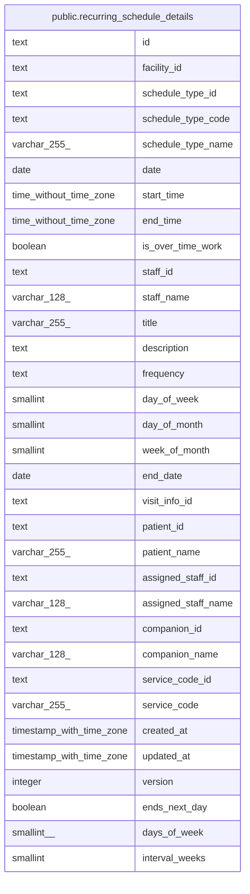

# public.recurring_schedule_details

## Description

一覧の読み出しに使う、繰り返しの予定と訪問の情報と名前を結合したビュー

<details>
<summary><strong>Table Definition</strong></summary>

```sql
CREATE VIEW recurring_schedule_details AS (
 SELECT rs.id,
    rs.facility_id,
    rs.schedule_type_id,
    st.code AS schedule_type_code,
    st.name AS schedule_type_name,
    rs.date,
    rs.start_time,
    rs.end_time,
    rs.is_over_time_work,
    rs.staff_id,
    u.username AS staff_name,
    rs.title,
    rs.description,
    rs.frequency,
    rs.day_of_week,
    rs.day_of_month,
    rs.week_of_month,
    rs.end_date,
    rs.visit_info_id,
    vid.patient_id,
    vid.patient_name,
    vid.assigned_staff_id,
    vid.assigned_staff_name,
    vid.companion_id,
    vid.companion_name,
    vid.service_code_id,
    vid.service_code,
    rs.created_at,
    rs.updated_at,
    rs.version,
    rs.ends_next_day,
    rs.days_of_week,
    rs.interval_weeks
   FROM (((recurring_schedules rs
     JOIN schedule_types st ON ((st.id = rs.schedule_type_id)))
     JOIN users u ON ((u.id = rs.staff_id)))
     LEFT JOIN visit_info_details vid ON ((vid.id = rs.visit_info_id)))
)
```

</details>

## Columns

| Name                | Type                     | Default | Nullable | Children | Parents | Comment |
| ------------------- | ------------------------ | ------- | -------- | -------- | ------- | ------- |
| id                  | text                     |         | true     |          |         |         |
| facility_id         | text                     |         | true     |          |         |         |
| schedule_type_id    | text                     |         | true     |          |         |         |
| schedule_type_code  | text                     |         | true     |          |         |         |
| schedule_type_name  | varchar(255)             |         | true     |          |         |         |
| date                | date                     |         | true     |          |         |         |
| start_time          | time without time zone   |         | true     |          |         |         |
| end_time            | time without time zone   |         | true     |          |         |         |
| is_over_time_work   | boolean                  |         | true     |          |         |         |
| staff_id            | text                     |         | true     |          |         |         |
| staff_name          | varchar(128)             |         | true     |          |         |         |
| title               | varchar(255)             |         | true     |          |         |         |
| description         | text                     |         | true     |          |         |         |
| frequency           | text                     |         | true     |          |         |         |
| day_of_week         | smallint                 |         | true     |          |         |         |
| day_of_month        | smallint                 |         | true     |          |         |         |
| week_of_month       | smallint                 |         | true     |          |         |         |
| end_date            | date                     |         | true     |          |         |         |
| visit_info_id       | text                     |         | true     |          |         |         |
| patient_id          | text                     |         | true     |          |         |         |
| patient_name        | varchar(255)             |         | true     |          |         |         |
| assigned_staff_id   | text                     |         | true     |          |         |         |
| assigned_staff_name | varchar(128)             |         | true     |          |         |         |
| companion_id        | text                     |         | true     |          |         |         |
| companion_name      | varchar(128)             |         | true     |          |         |         |
| service_code_id     | text                     |         | true     |          |         |         |
| service_code        | varchar(255)             |         | true     |          |         |         |
| created_at          | timestamp with time zone |         | true     |          |         |         |
| updated_at          | timestamp with time zone |         | true     |          |         |         |
| version             | integer                  |         | true     |          |         |         |
| ends_next_day       | boolean                  |         | true     |          |         |         |
| days_of_week        | smallint[]               |         | true     |          |         |         |
| interval_weeks      | smallint                 |         | true     |          |         |         |

## Referenced Tables

| Name                                                        | Columns | Comment                                            | Type       |
| ----------------------------------------------------------- | ------- | -------------------------------------------------- | ---------- |
| [public.recurring_schedules](public.recurring_schedules.md) | 22      | 繰り返しの予定と、その規則                         | BASE TABLE |
| [public.schedule_types](public.schedule_types.md)           | 5       | 予定の種類（通常、訪問）。マイグレーションで入れる | BASE TABLE |
| [public.users](public.users.md)                             | 15      | 職員                                               | BASE TABLE |
| [public.visit_info_details](public.visit_info_details.md)   | 10      | 訪問の情報と名前を結合したビュー                   | VIEW       |

## Viewpoints

| Name                                     | Definition                                                                             |
| ---------------------------------------- | -------------------------------------------------------------------------------------- |
| [繰り返しの予定](viewpoint-recurring.md) | 繰り返しの予定と規則、回にしない日。繰り返しの 1 回を置き換えた予定は schedules に入る |

## Relations



---

> Generated by [tbls](https://github.com/k1LoW/tbls)
