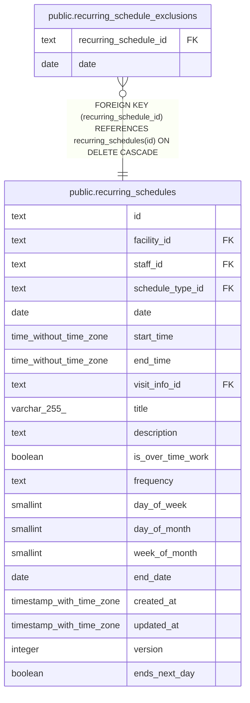

# public.recurring_schedule_exclusions

## Description

繰り返しの予定のうち、回にしない日

## Columns

| Name                  | Type | Default | Nullable | Children | Parents                                                     | Comment |
| --------------------- | ---- | ------- | -------- | -------- | ----------------------------------------------------------- | ------- |
| recurring_schedule_id | text |         | false    |          | [public.recurring_schedules](public.recurring_schedules.md) |         |
| date                  | date |         | false    |          |                                                             |         |

## Viewpoints

| Name                                     | Definition                                                                             |
| ---------------------------------------- | -------------------------------------------------------------------------------------- |
| [繰り返しの予定](viewpoint-recurring.md) | 繰り返しの予定と規則、回にしない日。繰り返しの 1 回を置き換えた予定は schedules に入る |

## Constraints

| Name                                                         | Type        | Definition                                                                               |
| ------------------------------------------------------------ | ----------- | ---------------------------------------------------------------------------------------- |
| recurring_schedule_exclusions_date_not_null                  | n           | NOT NULL date                                                                            |
| recurring_schedule_exclusions_recurring_schedule_id_not_null | n           | NOT NULL recurring_schedule_id                                                           |
| recurring_schedule_exclusions_recurring_schedule_fkey        | FOREIGN KEY | FOREIGN KEY (recurring_schedule_id) REFERENCES recurring_schedules(id) ON DELETE CASCADE |
| recurring_schedule_exclusions_pkey                           | PRIMARY KEY | PRIMARY KEY (recurring_schedule_id, date)                                                |

## Indexes

| Name                               | Definition                                                                                                                               |
| ---------------------------------- | ---------------------------------------------------------------------------------------------------------------------------------------- |
| recurring_schedule_exclusions_pkey | CREATE UNIQUE INDEX recurring_schedule_exclusions_pkey ON public.recurring_schedule_exclusions USING btree (recurring_schedule_id, date) |

## Relations

---

> Generated by [tbls](https://github.com/k1LoW/tbls)
