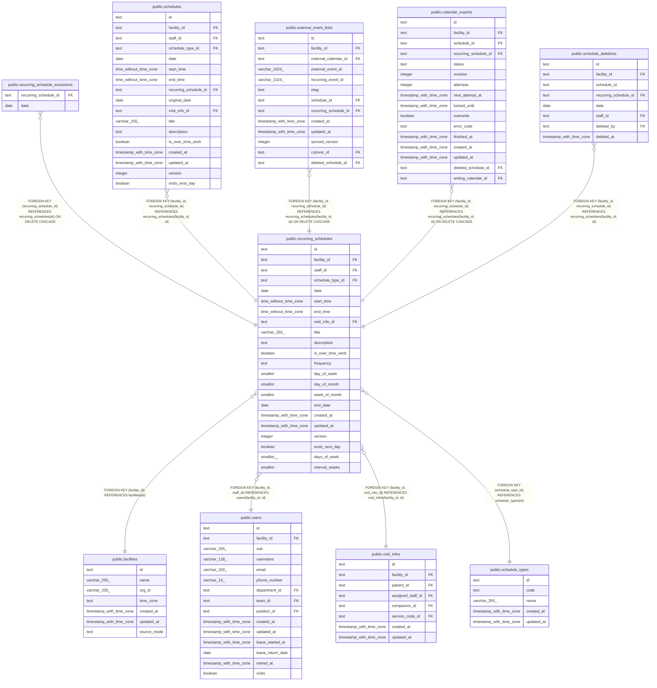

# public.recurring_schedules

## Description

繰り返しの予定と、その規則

## Columns

| Name              | Type                     | Default | Nullable | Extra Definition                                                               | Children                                                                                                                                                                                                                                                                                              | Parents                                                                                                               | Comment                                                                                                                                       |
| ----------------- | ------------------------ | ------- | -------- | ------------------------------------------------------------------------------ | ----------------------------------------------------------------------------------------------------------------------------------------------------------------------------------------------------------------------------------------------------------------------------------------------------- | --------------------------------------------------------------------------------------------------------------------- | --------------------------------------------------------------------------------------------------------------------------------------------- |
| id                | text                     |         | false    |                                                                                | [public.recurring_schedule_exclusions](public.recurring_schedule_exclusions.md) [public.schedules](public.schedules.md) [public.external_event_links](public.external_event_links.md) [public.calendar_exports](public.calendar_exports.md) [public.schedule_deletions](public.schedule_deletions.md) |                                                                                                                       |                                                                                                                                               |
| facility_id       | text                     |         | false    |                                                                                | [public.schedules](public.schedules.md) [public.external_event_links](public.external_event_links.md) [public.calendar_exports](public.calendar_exports.md) [public.schedule_deletions](public.schedule_deletions.md)                                                                                 | [public.facilities](public.facilities.md) [public.users](public.users.md) [public.visit_infos](public.visit_infos.md) |                                                                                                                                               |
| staff_id          | text                     |         | false    |                                                                                |                                                                                                                                                                                                                                                                                                       | [public.users](public.users.md)                                                                                       |                                                                                                                                               |
| schedule_type_id  | text                     |         | false    |                                                                                |                                                                                                                                                                                                                                                                                                       | [public.schedule_types](public.schedule_types.md)                                                                     |                                                                                                                                               |
| date              | date                     |         | false    |                                                                                |                                                                                                                                                                                                                                                                                                       |                                                                                                                       | 最初の回の日付                                                                                                                                |
| start_time        | time without time zone   |         | false    |                                                                                |                                                                                                                                                                                                                                                                                                       |                                                                                                                       |                                                                                                                                               |
| end_time          | time without time zone   |         | false    |                                                                                |                                                                                                                                                                                                                                                                                                       |                                                                                                                       |                                                                                                                                               |
| visit_info_id     | text                     |         | true     |                                                                                |                                                                                                                                                                                                                                                                                                       | [public.visit_infos](public.visit_infos.md)                                                                           | 訪問のときだけ。予定ごとに 1 つ                                                                                                               |
| title             | varchar(255)             |         | true     |                                                                                |                                                                                                                                                                                                                                                                                                       |                                                                                                                       |                                                                                                                                               |
| description       | text                     |         | true     |                                                                                |                                                                                                                                                                                                                                                                                                       |                                                                                                                       |                                                                                                                                               |
| is_over_time_work | boolean                  |         | false    | GENERATED ALWAYS AS (start_time \>= '17:00:00'::time without time zone) STORED |                                                                                                                                                                                                                                                                                                       |                                                                                                                       | 開始が 17 時以降。開始の時刻から生成する                                                                                                      |
| frequency         | text                     |         | false    |                                                                                |                                                                                                                                                                                                                                                                                                       |                                                                                                                       | weekly、monthly                                                                                                                               |
| day_of_week       | smallint                 |         | true     |                                                                                |                                                                                                                                                                                                                                                                                                       |                                                                                                                       | 1（月曜）から 7。毎月の week_of_month と組で使う。前のバージョンのアプリは毎週の曜日にも書く                                                  |
| day_of_month      | smallint                 |         | true     |                                                                                |                                                                                                                                                                                                                                                                                                       |                                                                                                                       | 1 から 31                                                                                                                                     |
| week_of_month     | smallint                 |         | true     |                                                                                |                                                                                                                                                                                                                                                                                                       |                                                                                                                       | 1 から 5                                                                                                                                      |
| end_date          | date                     |         | true     |                                                                                |                                                                                                                                                                                                                                                                                                       |                                                                                                                       | この日を含む。NULL なら終わりなし                                                                                                             |
| created_at        | timestamp with time zone | now()   | false    |                                                                                |                                                                                                                                                                                                                                                                                                       |                                                                                                                       |                                                                                                                                               |
| updated_at        | timestamp with time zone | now()   | false    |                                                                                |                                                                                                                                                                                                                                                                                                       |                                                                                                                       |                                                                                                                                               |
| version           | integer                  | 1       | false    |                                                                                |                                                                                                                                                                                                                                                                                                       |                                                                                                                       | 更新の番号。回を除外するたびに 1 つ増える                                                                                                     |
| ends_next_day     | boolean                  | false   | false    |                                                                                |                                                                                                                                                                                                                                                                                                       |                                                                                                                       | 終了が翌日か。全ての回が同じ値を持つ                                                                                                          |
| days_of_week      | smallint[]               |         | true     |                                                                                |                                                                                                                                                                                                                                                                                                       |                                                                                                                       | 毎週の、重ならない 1（月曜）から 7 の曜日を月曜から日曜の順に並べたもの。毎月は NULL。毎週の NULL は day_of_week か最初の日付の曜日として読む |
| interval_weeks    | smallint                 | 1       | false    |                                                                                |                                                                                                                                                                                                                                                                                                       |                                                                                                                       | 毎週の間隔の週の数。1 が毎週、2 が隔週。日曜に始まる週で、最初の日付を含む週から数える。毎月は 1                                              |

## Viewpoints

| Name                                                               | Definition                                                                                                                                                                                                                                                                                                                                                                                                                                                                       |
| ------------------------------------------------------------------ | -------------------------------------------------------------------------------------------------------------------------------------------------------------------------------------------------------------------------------------------------------------------------------------------------------------------------------------------------------------------------------------------------------------------------------------------------------------------------------- |
| [予定と訪問](viewpoint-schedules.md)                               | 予定と、訪問のときの訪問の情報と区分、予定の取り消し、誤って入れた予定の削除の監査の記録                                                                                                                                                                                                                                                                                                                                                                                         |
| [繰り返しの予定](viewpoint-recurring.md)                           | 繰り返しの予定と規則、回にしない日。繰り返しの 1 回を置き換えた予定は schedules に入る                                                                                                                                                                                                                                                                                                                                                                                           |
| [外部のカレンダーの取り込みと書き出し](viewpoint-calendar-sync.md) | 職員の外部のカレンダーと同期の状態、外部の予定と予定の対応、取り込みの記録、書き出しの待ち、Google カレンダーの予定の写し（Projection）。書き出しは、予定の管理先が buddy_primary の事業所に限る。同期は google_primary の事業所のカレンダーだけを読み、予定の写しに書く。google_primary の事業所で buddy から Google カレンダーに書いた予定は、訪問の情報と書き込みの保留の版を記録に持つ。移行は、google_primary の事業所の予定を取り込み、完了で事業所を buddy_primary にする |

## Constraints

| Name                                            | Type        | Definition                                                                                                                                                                                                                                                                                                                                  |
| ----------------------------------------------- | ----------- | ------------------------------------------------------------------------------------------------------------------------------------------------------------------------------------------------------------------------------------------------------------------------------------------------------------------------------------------- |
| recurring_schedules_created_at_not_null         | n           | NOT NULL created_at                                                                                                                                                                                                                                                                                                                         |
| recurring_schedules_date_not_null               | n           | NOT NULL date                                                                                                                                                                                                                                                                                                                               |
| recurring_schedules_day_of_month_check          | CHECK       | CHECK (((day_of_month >= 1) AND (day_of_month <= 31)))                                                                                                                                                                                                                                                                                      |
| recurring_schedules_day_of_week_check           | CHECK       | CHECK (((day_of_week >= 1) AND (day_of_week <= 7)))                                                                                                                                                                                                                                                                                         |
| recurring_schedules_days_of_week_check          | CHECK       | CHECK ((((cardinality(days_of_week) >= 1) AND (cardinality(days_of_week) <= 7)) AND (days_of_week <@ ARRAY[(1)::smallint, (2)::smallint, (3)::smallint, (4)::smallint, (5)::smallint, (6)::smallint, (7)::smallint])))                                                                                                                      |
| recurring_schedules_end_date_check              | CHECK       | CHECK ((end_date >= date))                                                                                                                                                                                                                                                                                                                  |
| recurring_schedules_end_time_not_null           | n           | NOT NULL end_time                                                                                                                                                                                                                                                                                                                           |
| recurring_schedules_ends_next_day_not_null      | n           | NOT NULL ends_next_day                                                                                                                                                                                                                                                                                                                      |
| recurring_schedules_facility_id_not_null        | n           | NOT NULL facility_id                                                                                                                                                                                                                                                                                                                        |
| recurring_schedules_frequency_check             | CHECK       | CHECK ((frequency = ANY (ARRAY['weekly'::text, 'monthly'::text])))                                                                                                                                                                                                                                                                          |
| recurring_schedules_frequency_not_null          | n           | NOT NULL frequency                                                                                                                                                                                                                                                                                                                          |
| recurring_schedules_id_check                    | CHECK       | CHECK ((id ~ '^[0-7][0-9A-HJKMNP-TV-Z]{25}$'::text))                                                                                                                                                                                                                                                                                        |
| recurring_schedules_id_not_null                 | n           | NOT NULL id                                                                                                                                                                                                                                                                                                                                 |
| recurring_schedules_interval_weeks_check        | CHECK       | CHECK (((interval_weeks >= 1) AND (interval_weeks <= 52)))                                                                                                                                                                                                                                                                                  |
| recurring_schedules_interval_weeks_not_null     | n           | NOT NULL interval_weeks                                                                                                                                                                                                                                                                                                                     |
| recurring_schedules_is_over_time_work_not_null  | n           | NOT NULL is_over_time_work                                                                                                                                                                                                                                                                                                                  |
| recurring_schedules_monthly_weekly_fields_check | CHECK       | CHECK (((frequency = 'weekly'::text) OR ((days_of_week IS NULL) AND (interval_weeks = 1))))                                                                                                                                                                                                                                                 |
| recurring_schedules_rule_check                  | CHECK       | CHECK ((((frequency = 'weekly'::text) AND (day_of_month IS NULL) AND (week_of_month IS NULL)) OR ((frequency = 'monthly'::text) AND (day_of_month IS NOT NULL) AND (day_of_week IS NULL) AND (week_of_month IS NULL)) OR ((frequency = 'monthly'::text) AND (day_of_month IS NULL) AND ((day_of_week IS NULL) = (week_of_month IS NULL))))) |
| recurring_schedules_schedule_type_id_not_null   | n           | NOT NULL schedule_type_id                                                                                                                                                                                                                                                                                                                   |
| recurring_schedules_staff_id_not_null           | n           | NOT NULL staff_id                                                                                                                                                                                                                                                                                                                           |
| recurring_schedules_start_time_not_null         | n           | NOT NULL start_time                                                                                                                                                                                                                                                                                                                         |
| recurring_schedules_time_check                  | CHECK       | CHECK ( CASE     WHEN ends_next_day THEN (end_time < start_time)     ELSE (start_time < end_time) END)                                                                                                                                                                                                                  |
| recurring_schedules_updated_at_not_null         | n           | NOT NULL updated_at                                                                                                                                                                                                                                                                                                                         |
| recurring_schedules_version_check               | CHECK       | CHECK ((version >= 1))                                                                                                                                                                                                                                                                                                                      |
| recurring_schedules_version_not_null            | n           | NOT NULL version                                                                                                                                                                                                                                                                                                                            |
| recurring_schedules_week_of_month_check         | CHECK       | CHECK (((week_of_month >= 1) AND (week_of_month <= 5)))                                                                                                                                                                                                                                                                                     |
| recurring_schedules_facility_fkey               | FOREIGN KEY | FOREIGN KEY (facility_id) REFERENCES facilities(id)                                                                                                                                                                                                                                                                                         |
| recurring_schedules_staff_fkey                  | FOREIGN KEY | FOREIGN KEY (facility_id, staff_id) REFERENCES users(facility_id, id)                                                                                                                                                                                                                                                                       |
| recurring_schedules_visit_info_fkey             | FOREIGN KEY | FOREIGN KEY (facility_id, visit_info_id) REFERENCES visit_infos(facility_id, id)                                                                                                                                                                                                                                                            |
| recurring_schedules_type_fkey                   | FOREIGN KEY | FOREIGN KEY (schedule_type_id) REFERENCES schedule_types(id)                                                                                                                                                                                                                                                                                |
| recurring_schedules_pkey                        | PRIMARY KEY | PRIMARY KEY (id)                                                                                                                                                                                                                                                                                                                            |
| recurring_schedules_visit_info_key              | UNIQUE      | UNIQUE (visit_info_id)                                                                                                                                                                                                                                                                                                                      |
| recurring_schedules_facility_id_key             | UNIQUE      | UNIQUE (facility_id, id)                                                                                                                                                                                                                                                                                                                    |

## Indexes

| Name                                | Definition                                                                                                          |
| ----------------------------------- | ------------------------------------------------------------------------------------------------------------------- |
| recurring_schedules_pkey            | CREATE UNIQUE INDEX recurring_schedules_pkey ON public.recurring_schedules USING btree (id)                         |
| recurring_schedules_visit_info_key  | CREATE UNIQUE INDEX recurring_schedules_visit_info_key ON public.recurring_schedules USING btree (visit_info_id)    |
| recurring_schedules_facility_id_key | CREATE UNIQUE INDEX recurring_schedules_facility_id_key ON public.recurring_schedules USING btree (facility_id, id) |
| recurring_schedules_staff_idx       | CREATE INDEX recurring_schedules_staff_idx ON public.recurring_schedules USING btree (facility_id, staff_id)        |

## Triggers

| Name                                        | Definition                                                                                                                                                                         |
| ------------------------------------------- | ---------------------------------------------------------------------------------------------------------------------------------------------------------------------------------- |
| recurring_schedules_set_updated_at          | CREATE TRIGGER recurring_schedules_set_updated_at BEFORE UPDATE ON public.recurring_schedules FOR EACH ROW EXECUTE FUNCTION set_updated_at()                                       |
| recurring_schedules_clear_stale_weekly_days | CREATE TRIGGER recurring_schedules_clear_stale_weekly_days BEFORE UPDATE ON public.recurring_schedules FOR EACH ROW EXECUTE FUNCTION recurring_schedules_clear_stale_weekly_days() |

## Relations

---

> Generated by [tbls](https://github.com/k1LoW/tbls)
