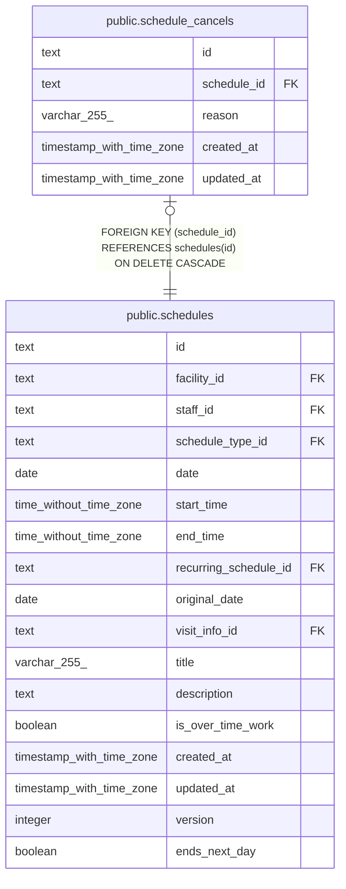

# public.schedule_cancels

## Description

予定の取り消し

## Columns

| Name        | Type                     | Default | Nullable | Children | Parents                                 | Comment |
| ----------- | ------------------------ | ------- | -------- | -------- | --------------------------------------- | ------- |
| id          | text                     |         | false    |          |                                         |         |
| schedule_id | text                     |         | false    |          | [public.schedules](public.schedules.md) |         |
| reason      | varchar(255)             |         | false    |          |                                         |         |
| created_at  | timestamp with time zone | now()   | false    |          |                                         |         |
| updated_at  | timestamp with time zone | now()   | false    |          |                                         |         |

## Viewpoints

| Name                                 | Definition                                           |
| ------------------------------------ | ---------------------------------------------------- |
| [予定と訪問](viewpoint-schedules.md) | 予定と、訪問のときの訪問の情報と区分、予定の取り消し |

## Constraints

| Name                                  | Type        | Definition                                                           |
| ------------------------------------- | ----------- | -------------------------------------------------------------------- |
| schedule_cancels_created_at_not_null  | n           | NOT NULL created_at                                                  |
| schedule_cancels_id_check             | CHECK       | CHECK ((id ~ '^[0-7][0-9A-HJKMNP-TV-Z]{25}$'::text))                 |
| schedule_cancels_id_not_null          | n           | NOT NULL id                                                          |
| schedule_cancels_reason_not_null      | n           | NOT NULL reason                                                      |
| schedule_cancels_schedule_id_not_null | n           | NOT NULL schedule_id                                                 |
| schedule_cancels_updated_at_not_null  | n           | NOT NULL updated_at                                                  |
| schedule_cancels_schedule_fkey        | FOREIGN KEY | FOREIGN KEY (schedule_id) REFERENCES schedules(id) ON DELETE CASCADE |
| schedule_cancels_pkey                 | PRIMARY KEY | PRIMARY KEY (id)                                                     |
| schedule_cancels_schedule_key         | UNIQUE      | UNIQUE (schedule_id)                                                 |

## Indexes

| Name                          | Definition                                                                                             |
| ----------------------------- | ------------------------------------------------------------------------------------------------------ |
| schedule_cancels_pkey         | CREATE UNIQUE INDEX schedule_cancels_pkey ON public.schedule_cancels USING btree (id)                  |
| schedule_cancels_schedule_key | CREATE UNIQUE INDEX schedule_cancels_schedule_key ON public.schedule_cancels USING btree (schedule_id) |

## Triggers

| Name                            | Definition                                                                                                                             |
| ------------------------------- | -------------------------------------------------------------------------------------------------------------------------------------- |
| schedule_cancels_set_updated_at | CREATE TRIGGER schedule_cancels_set_updated_at BEFORE UPDATE ON public.schedule_cancels FOR EACH ROW EXECUTE FUNCTION set_updated_at() |

## Relations

---

> Generated by [tbls](https://github.com/k1LoW/tbls)
