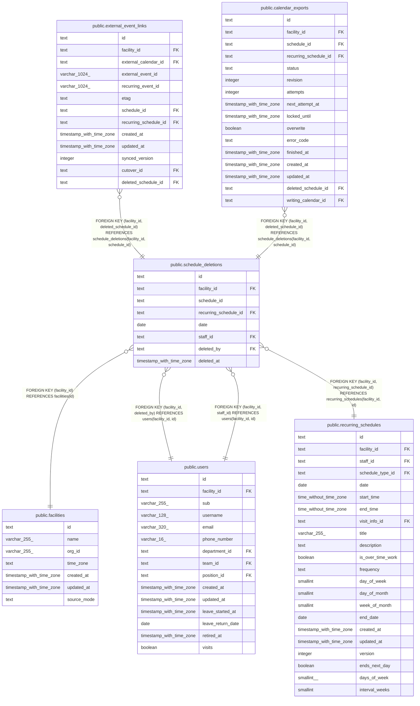

# public.schedule_deletions

## Description

誤って入れた予定を削除した監査の記録（ADR-0040）。画面に出さない。消した時点の内容（訪問の情報と利用者）は持たない

## Columns

| Name                  | Type                     | Default | Nullable | Children                                                                                                            | Parents                                                                                                                               | Comment                                               |
| --------------------- | ------------------------ | ------- | -------- | ------------------------------------------------------------------------------------------------------------------- | ------------------------------------------------------------------------------------------------------------------------------------- | ----------------------------------------------------- |
| id                    | text                     |         | false    |                                                                                                                     |                                                                                                                                       |                                                       |
| facility_id           | text                     |         | false    | [public.external_event_links](public.external_event_links.md) [public.calendar_exports](public.calendar_exports.md) | [public.facilities](public.facilities.md) [public.users](public.users.md) [public.recurring_schedules](public.recurring_schedules.md) |                                                       |
| schedule_id           | text                     |         | true     | [public.external_event_links](public.external_event_links.md) [public.calendar_exports](public.calendar_exports.md) |                                                                                                                                       | 削除した単発の予定の ID。回の削除では NULL            |
| recurring_schedule_id | text                     |         | true     |                                                                                                                     | [public.recurring_schedules](public.recurring_schedules.md)                                                                           | 回を削除した繰り返しの予定。単発の予定の削除では NULL |
| date                  | date                     |         | false    |                                                                                                                     |                                                                                                                                       | 単発の予定の開始の日か、削除した回の日                |
| staff_id              | text                     |         | false    |                                                                                                                     | [public.users](public.users.md)                                                                                                       | 削除した予定の職員                                    |
| deleted_by            | text                     |         | false    |                                                                                                                     | [public.users](public.users.md)                                                                                                       | 削除した職員                                          |
| deleted_at            | timestamp with time zone | now()   | false    |                                                                                                                     |                                                                                                                                       | 削除した時刻                                          |

## Viewpoints

| Name                                                               | Definition                                                                                                                                                                                                                                                                                                                                                                                                                                                                                 |
| ------------------------------------------------------------------ | ------------------------------------------------------------------------------------------------------------------------------------------------------------------------------------------------------------------------------------------------------------------------------------------------------------------------------------------------------------------------------------------------------------------------------------------------------------------------------------------ |
| [予定と訪問](viewpoint-schedules.md)                               | 予定と、訪問のときの訪問の情報と区分、予定の取り消し、誤って入れた予定の削除の監査の記録                                                                                                                                                                                                                                                                                                                                                                                                   |
| [外部のカレンダーの取り込みと書き出し](viewpoint-calendar-sync.md) | 職員の外部のカレンダーと同期の状態、外部の予定と予定の対応、取り込みの記録、書き出しの待ち、Google カレンダーの予定の写し（Projection）。書き出しは、予定の正本のモードが buddy_primary の事業所に限る。同期は google_primary の事業所のカレンダーだけを読み、予定の写しに書く。google_primary の事業所で buddy から Google カレンダーに書いた予定は、訪問の情報と書き込みの保留の版を記録に持つ。切り替えは、google_primary の事業所の予定を取り込み、完了で事業所を buddy_primary にする |

## Constraints

| Name                                       | Type        | Definition                                                                                       |
| ------------------------------------------ | ----------- | ------------------------------------------------------------------------------------------------ |
| schedule_deletions_date_not_null           | n           | NOT NULL date                                                                                    |
| schedule_deletions_deleted_at_not_null     | n           | NOT NULL deleted_at                                                                              |
| schedule_deletions_deleted_by_not_null     | n           | NOT NULL deleted_by                                                                              |
| schedule_deletions_facility_id_not_null    | n           | NOT NULL facility_id                                                                             |
| schedule_deletions_id_check                | CHECK       | CHECK ((id ~ '^[0-7][0-9A-HJKMNP-TV-Z]{25}$'::text))                                             |
| schedule_deletions_id_not_null             | n           | NOT NULL id                                                                                      |
| schedule_deletions_staff_id_not_null       | n           | NOT NULL staff_id                                                                                |
| schedule_deletions_target_check            | CHECK       | CHECK ((num_nonnulls(schedule_id, recurring_schedule_id) = 1))                                   |
| schedule_deletions_facility_fkey           | FOREIGN KEY | FOREIGN KEY (facility_id) REFERENCES facilities(id)                                              |
| schedule_deletions_deleted_by_fkey         | FOREIGN KEY | FOREIGN KEY (facility_id, deleted_by) REFERENCES users(facility_id, id)                          |
| schedule_deletions_staff_fkey              | FOREIGN KEY | FOREIGN KEY (facility_id, staff_id) REFERENCES users(facility_id, id)                            |
| schedule_deletions_recurring_schedule_fkey | FOREIGN KEY | FOREIGN KEY (facility_id, recurring_schedule_id) REFERENCES recurring_schedules(facility_id, id) |
| schedule_deletions_pkey                    | PRIMARY KEY | PRIMARY KEY (id)                                                                                 |
| schedule_deletions_schedule_key            | UNIQUE      | UNIQUE (facility_id, schedule_id)                                                                |

## Indexes

| Name                                      | Definition                                                                                                                                                                           |
| ----------------------------------------- | ------------------------------------------------------------------------------------------------------------------------------------------------------------------------------------ |
| schedule_deletions_pkey                   | CREATE UNIQUE INDEX schedule_deletions_pkey ON public.schedule_deletions USING btree (id)                                                                                            |
| schedule_deletions_schedule_key           | CREATE UNIQUE INDEX schedule_deletions_schedule_key ON public.schedule_deletions USING btree (facility_id, schedule_id)                                                              |
| schedule_deletions_recurring_schedule_idx | CREATE INDEX schedule_deletions_recurring_schedule_idx ON public.schedule_deletions USING btree (facility_id, recurring_schedule_id, date) WHERE (recurring_schedule_id IS NOT NULL) |
| schedule_deletions_staff_idx              | CREATE INDEX schedule_deletions_staff_idx ON public.schedule_deletions USING btree (facility_id, staff_id)                                                                           |
| schedule_deletions_deleted_by_idx         | CREATE INDEX schedule_deletions_deleted_by_idx ON public.schedule_deletions USING btree (facility_id, deleted_by)                                                                    |

## Relations

---

> Generated by [tbls](https://github.com/k1LoW/tbls)
