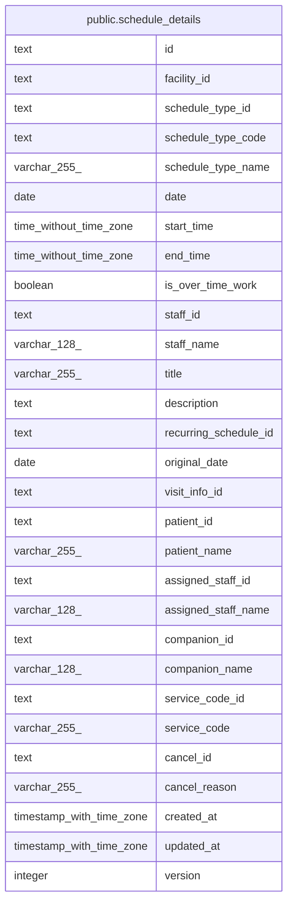

# public.schedule_details

## Description

一覧の読み出しに使う、予定と訪問の情報と名前を結合したビュー

<details>
<summary><strong>Table Definition</strong></summary>

```sql
CREATE VIEW schedule_details AS (
 SELECT s.id,
    s.facility_id,
    s.schedule_type_id,
    st.code AS schedule_type_code,
    st.name AS schedule_type_name,
    s.date,
    s.start_time,
    s.end_time,
    s.is_over_time_work,
    s.staff_id,
    u.username AS staff_name,
    s.title,
    s.description,
    s.recurring_schedule_id,
    s.original_date,
    s.visit_info_id,
    vid.patient_id,
    vid.patient_name,
    vid.assigned_staff_id,
    vid.assigned_staff_name,
    vid.companion_id,
    vid.companion_name,
    vid.service_code_id,
    vid.service_code,
    c.id AS cancel_id,
    c.reason AS cancel_reason,
    s.created_at,
    s.updated_at,
    s.version
   FROM ((((schedules s
     JOIN schedule_types st ON ((st.id = s.schedule_type_id)))
     JOIN users u ON ((u.id = s.staff_id)))
     LEFT JOIN visit_info_details vid ON ((vid.id = s.visit_info_id)))
     LEFT JOIN schedule_cancels c ON ((c.schedule_id = s.id)))
)
```

</details>

## Columns

| Name                  | Type                     | Default | Nullable | Children | Parents | Comment |
| --------------------- | ------------------------ | ------- | -------- | -------- | ------- | ------- |
| id                    | text                     |         | true     |          |         |         |
| facility_id           | text                     |         | true     |          |         |         |
| schedule_type_id      | text                     |         | true     |          |         |         |
| schedule_type_code    | text                     |         | true     |          |         |         |
| schedule_type_name    | varchar(255)             |         | true     |          |         |         |
| date                  | date                     |         | true     |          |         |         |
| start_time            | time without time zone   |         | true     |          |         |         |
| end_time              | time without time zone   |         | true     |          |         |         |
| is_over_time_work     | boolean                  |         | true     |          |         |         |
| staff_id              | text                     |         | true     |          |         |         |
| staff_name            | varchar(128)             |         | true     |          |         |         |
| title                 | varchar(255)             |         | true     |          |         |         |
| description           | text                     |         | true     |          |         |         |
| recurring_schedule_id | text                     |         | true     |          |         |         |
| original_date         | date                     |         | true     |          |         |         |
| visit_info_id         | text                     |         | true     |          |         |         |
| patient_id            | text                     |         | true     |          |         |         |
| patient_name          | varchar(255)             |         | true     |          |         |         |
| assigned_staff_id     | text                     |         | true     |          |         |         |
| assigned_staff_name   | varchar(128)             |         | true     |          |         |         |
| companion_id          | text                     |         | true     |          |         |         |
| companion_name        | varchar(128)             |         | true     |          |         |         |
| service_code_id       | text                     |         | true     |          |         |         |
| service_code          | varchar(255)             |         | true     |          |         |         |
| cancel_id             | text                     |         | true     |          |         |         |
| cancel_reason         | varchar(255)             |         | true     |          |         |         |
| created_at            | timestamp with time zone |         | true     |          |         |         |
| updated_at            | timestamp with time zone |         | true     |          |         |         |
| version               | integer                  |         | true     |          |         |         |

## Referenced Tables

| Name                                                      | Columns | Comment                                            | Type       |
| --------------------------------------------------------- | ------- | -------------------------------------------------- | ---------- |
| [public.schedules](public.schedules.md)                   | 16      | 予定                                               | BASE TABLE |
| [public.schedule_types](public.schedule_types.md)         | 5       | 予定の種類（通常、訪問）。マイグレーションで入れる | BASE TABLE |
| [public.users](public.users.md)                           | 12      | 職員                                               | BASE TABLE |
| [public.visit_info_details](public.visit_info_details.md) | 10      | 訪問の情報と名前を結合したビュー                   | VIEW       |
| [public.schedule_cancels](public.schedule_cancels.md)     | 5       | 予定の取り消し                                     | BASE TABLE |

## Viewpoints

| Name                                 | Definition                                           |
| ------------------------------------ | ---------------------------------------------------- |
| [予定と訪問](viewpoint-schedules.md) | 予定と、訪問のときの訪問の情報と区分、予定の取り消し |

## Relations



---

> Generated by [tbls](https://github.com/k1LoW/tbls)
