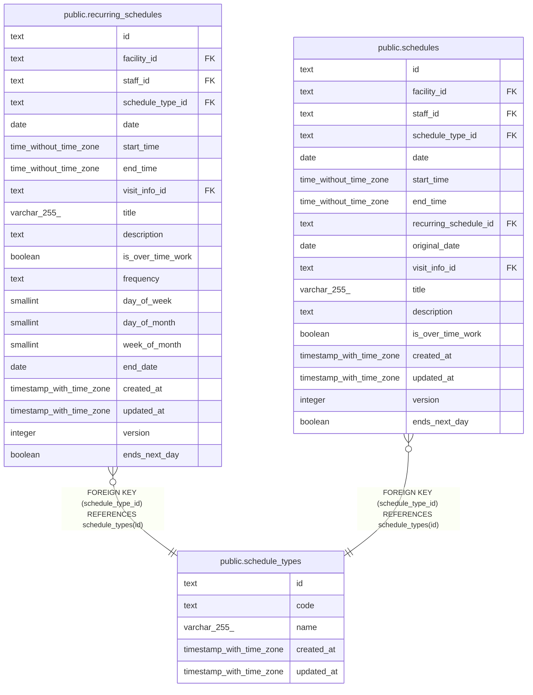

# public.schedule_types

## Description

予定の種類（通常、訪問）。マイグレーションで入れる

## Columns

| Name       | Type                     | Default | Nullable | Children                                                                                            | Parents | Comment                           |
| ---------- | ------------------------ | ------- | -------- | --------------------------------------------------------------------------------------------------- | ------- | --------------------------------- |
| id         | text                     |         | false    | [public.recurring_schedules](public.recurring_schedules.md) [public.schedules](public.schedules.md) |         |                                   |
| code       | text                     |         | false    |                                                                                                     |         | 規則が読む識別子（normal、visit） |
| name       | varchar(255)             |         | false    |                                                                                                     |         |                                   |
| created_at | timestamp with time zone | now()   | false    |                                                                                                     |         |                                   |
| updated_at | timestamp with time zone | now()   | false    |                                                                                                     |         |                                   |

## Viewpoints

| Name                                     | Definition                                                                             |
| ---------------------------------------- | -------------------------------------------------------------------------------------- |
| [予定と訪問](viewpoint-schedules.md)     | 予定と、訪問のときの訪問の情報と区分、予定の取り消し                                   |
| [繰り返しの予定](viewpoint-recurring.md) | 繰り返しの予定と規則、回にしない日。繰り返しの 1 回を置き換えた予定は schedules に入る |

## Constraints

| Name                               | Type        | Definition                                                  |
| ---------------------------------- | ----------- | ----------------------------------------------------------- |
| schedule_types_code_check          | CHECK       | CHECK ((code = ANY (ARRAY['normal'::text, 'visit'::text]))) |
| schedule_types_code_not_null       | n           | NOT NULL code                                               |
| schedule_types_created_at_not_null | n           | NOT NULL created_at                                         |
| schedule_types_id_check            | CHECK       | CHECK ((id ~ '^[0-7][0-9A-HJKMNP-TV-Z]{25}$'::text))        |
| schedule_types_id_not_null         | n           | NOT NULL id                                                 |
| schedule_types_name_not_null       | n           | NOT NULL name                                               |
| schedule_types_updated_at_not_null | n           | NOT NULL updated_at                                         |
| schedule_types_pkey                | PRIMARY KEY | PRIMARY KEY (id)                                            |
| schedule_types_code_key            | UNIQUE      | UNIQUE (code)                                               |
| schedule_types_name_key            | UNIQUE      | UNIQUE (name)                                               |

## Indexes

| Name                    | Definition                                                                              |
| ----------------------- | --------------------------------------------------------------------------------------- |
| schedule_types_pkey     | CREATE UNIQUE INDEX schedule_types_pkey ON public.schedule_types USING btree (id)       |
| schedule_types_code_key | CREATE UNIQUE INDEX schedule_types_code_key ON public.schedule_types USING btree (code) |
| schedule_types_name_key | CREATE UNIQUE INDEX schedule_types_name_key ON public.schedule_types USING btree (name) |

## Triggers

| Name                          | Definition                                                                                                                         |
| ----------------------------- | ---------------------------------------------------------------------------------------------------------------------------------- |
| schedule_types_set_updated_at | CREATE TRIGGER schedule_types_set_updated_at BEFORE UPDATE ON public.schedule_types FOR EACH ROW EXECUTE FUNCTION set_updated_at() |

## Relations

---

> Generated by [tbls](https://github.com/k1LoW/tbls)
