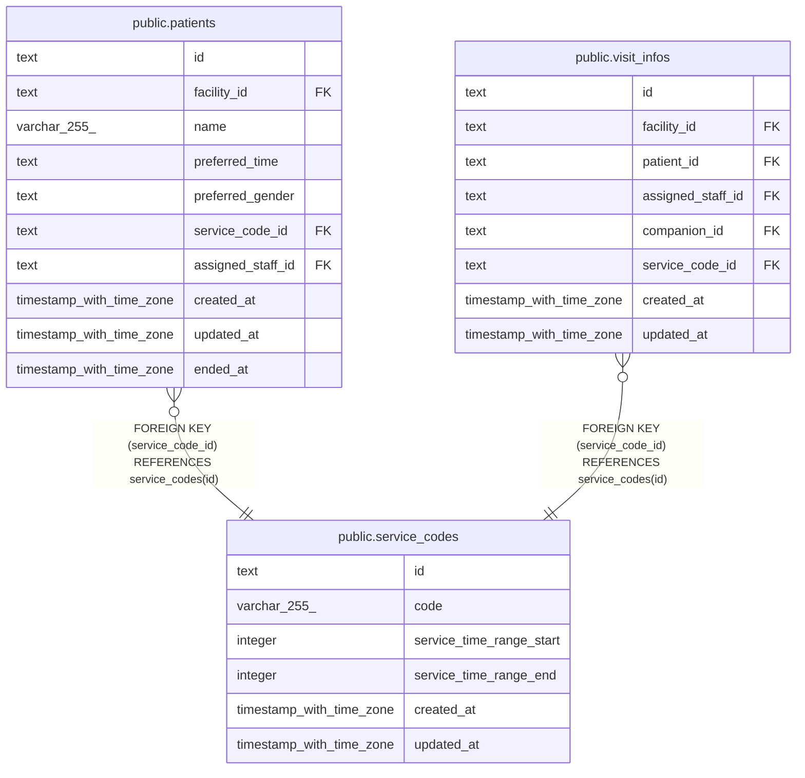

# public.service_codes

## Description

サービスコード。マイグレーションで入れる

## Columns

| Name                     | Type                     | Default | Nullable | Children                                                                          | Parents | Comment                                            |
| ------------------------ | ------------------------ | ------- | -------- | --------------------------------------------------------------------------------- | ------- | -------------------------------------------------- |
| id                       | text                     |         | false    | [public.patients](public.patients.md) [public.visit_infos](public.visit_infos.md) |         |                                                    |
| code                     | varchar(255)             |         | false    |                                                                                   |         | 例は 訪看I2、訪看I3                                |
| service_time_range_start | integer                  |         | false    |                                                                                   |         | 提供時間の範囲の下限（分）。照合の許容範囲と同じ値 |
| service_time_range_end   | integer                  |         | false    |                                                                                   |         | 提供時間の範囲の上限（分）。照合の許容範囲と同じ値 |
| created_at               | timestamp with time zone | now()   | false    |                                                                                   |         |                                                    |
| updated_at               | timestamp with time zone | now()   | false    |                                                                                   |         |                                                    |

## Viewpoints

| Name                                 | Definition                                                                               |
| ------------------------------------ | ---------------------------------------------------------------------------------------- |
| [利用者](viewpoint-patients.md)      | 利用者と、受けているサービスと、主に担当する職員                                         |
| [予定と訪問](viewpoint-schedules.md) | 予定と、訪問のときの訪問の情報と区分、予定の取り消し、誤って入れた予定の削除の監査の記録 |

## Constraints

| Name                                            | Type        | Definition                                                                                         |
| ----------------------------------------------- | ----------- | -------------------------------------------------------------------------------------------------- |
| service_codes_code_not_null                     | n           | NOT NULL code                                                                                      |
| service_codes_created_at_not_null               | n           | NOT NULL created_at                                                                                |
| service_codes_id_check                          | CHECK       | CHECK ((id ~ '^[0-7][0-9A-HJKMNP-TV-Z]{25}$'::text))                                               |
| service_codes_id_not_null                       | n           | NOT NULL id                                                                                        |
| service_codes_service_time_range_end_not_null   | n           | NOT NULL service_time_range_end                                                                    |
| service_codes_service_time_range_start_not_null | n           | NOT NULL service_time_range_start                                                                  |
| service_codes_time_range_check                  | CHECK       | CHECK (((0 <= service_time_range_start) AND (service_time_range_start <= service_time_range_end))) |
| service_codes_updated_at_not_null               | n           | NOT NULL updated_at                                                                                |
| service_codes_pkey                              | PRIMARY KEY | PRIMARY KEY (id)                                                                                   |
| service_codes_code_key                          | UNIQUE      | UNIQUE (code)                                                                                      |

## Indexes

| Name                   | Definition                                                                            |
| ---------------------- | ------------------------------------------------------------------------------------- |
| service_codes_pkey     | CREATE UNIQUE INDEX service_codes_pkey ON public.service_codes USING btree (id)       |
| service_codes_code_key | CREATE UNIQUE INDEX service_codes_code_key ON public.service_codes USING btree (code) |

## Triggers

| Name                         | Definition                                                                                                                       |
| ---------------------------- | -------------------------------------------------------------------------------------------------------------------------------- |
| service_codes_set_updated_at | CREATE TRIGGER service_codes_set_updated_at BEFORE UPDATE ON public.service_codes FOR EACH ROW EXECUTE FUNCTION set_updated_at() |

## Relations

---

> Generated by [tbls](https://github.com/k1LoW/tbls)
