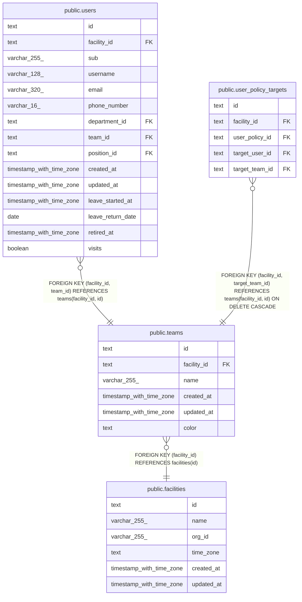

# public.teams

## Description

事業所のチーム

## Columns

| Name        | Type                     | Default | Nullable | Children                                                                                    | Parents                                   | Comment                                                                                        |
| ----------- | ------------------------ | ------- | -------- | ------------------------------------------------------------------------------------------- | ----------------------------------------- | ---------------------------------------------------------------------------------------------- |
| id          | text                     |         | false    | [public.users](public.users.md) [public.user_policy_targets](public.user_policy_targets.md) |                                           |                                                                                                |
| facility_id | text                     |         | false    | [public.users](public.users.md) [public.user_policy_targets](public.user_policy_targets.md) | [public.facilities](public.facilities.md) |                                                                                                |
| name        | varchar(255)             |         | false    |                                                                                             |                                           | 事業所の中で一意                                                                               |
| created_at  | timestamp with time zone | now()   | false    |                                                                                             |                                           |                                                                                                |
| updated_at  | timestamp with time zone | now()   | false    |                                                                                             |                                           |                                                                                                |
| color       | text                     |         | false    |                                                                                             |                                           | チームの色。packages/ui のチームの色のトークンの名前（team- の後ろ）。事業所の中で重なってよい |

## Viewpoints

| Name                                      | Definition                                                                         |
| ----------------------------------------- | ---------------------------------------------------------------------------------- |
| [事業所と組織](viewpoint-organization.md) | 事業所と、その中の部署、チーム、役職、職員                                         |
| [職員と権限](viewpoint-policies.md)       | 職員が持つ権限と、その対象。職員を登録するとき、役職のデフォルトの権限をコピーする |

## Constraints

| Name                       | Type        | Definition                                                                                                                                              |
| -------------------------- | ----------- | ------------------------------------------------------------------------------------------------------------------------------------------------------- |
| teams_color_check          | CHECK       | CHECK ((color = ANY (ARRAY['blue'::text, 'orange'::text, 'magenta'::text, 'cyan'::text, 'yellow'::text, 'purple'::text, 'green'::text, 'lime'::text]))) |
| teams_color_not_null       | n           | NOT NULL color                                                                                                                                          |
| teams_created_at_not_null  | n           | NOT NULL created_at                                                                                                                                     |
| teams_facility_id_not_null | n           | NOT NULL facility_id                                                                                                                                    |
| teams_id_check             | CHECK       | CHECK ((id ~ '^[0-7][0-9A-HJKMNP-TV-Z]{25}$'::text))                                                                                                    |
| teams_id_not_null          | n           | NOT NULL id                                                                                                                                             |
| teams_name_not_null        | n           | NOT NULL name                                                                                                                                           |
| teams_updated_at_not_null  | n           | NOT NULL updated_at                                                                                                                                     |
| teams_facility_fkey        | FOREIGN KEY | FOREIGN KEY (facility_id) REFERENCES facilities(id)                                                                                                     |
| teams_pkey                 | PRIMARY KEY | PRIMARY KEY (id)                                                                                                                                        |
| teams_facility_name_key    | UNIQUE      | UNIQUE (facility_id, name)                                                                                                                              |
| teams_facility_id_key      | UNIQUE      | UNIQUE (facility_id, id)                                                                                                                                |

## Indexes

| Name                    | Definition                                                                                  |
| ----------------------- | ------------------------------------------------------------------------------------------- |
| teams_pkey              | CREATE UNIQUE INDEX teams_pkey ON public.teams USING btree (id)                             |
| teams_facility_name_key | CREATE UNIQUE INDEX teams_facility_name_key ON public.teams USING btree (facility_id, name) |
| teams_facility_id_key   | CREATE UNIQUE INDEX teams_facility_id_key ON public.teams USING btree (facility_id, id)     |

## Triggers

| Name                 | Definition                                                                                                       |
| -------------------- | ---------------------------------------------------------------------------------------------------------------- |
| teams_set_updated_at | CREATE TRIGGER teams_set_updated_at BEFORE UPDATE ON public.teams FOR EACH ROW EXECUTE FUNCTION set_updated_at() |

## Relations

---

> Generated by [tbls](https://github.com/k1LoW/tbls)
