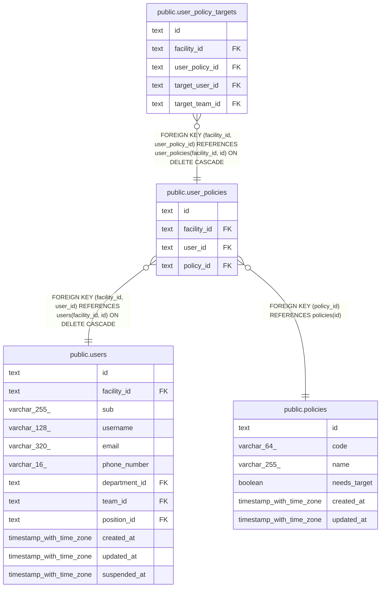

# public.user_policies

## Description

職員が持つ権限。職員と権限の組で一意

## Columns

| Name        | Type | Default | Nullable | Children                                                    | Parents                               | Comment |
| ----------- | ---- | ------- | -------- | ----------------------------------------------------------- | ------------------------------------- | ------- |
| id          | text |         | false    | [public.user_policy_targets](public.user_policy_targets.md) |                                       |         |
| facility_id | text |         | false    | [public.user_policy_targets](public.user_policy_targets.md) | [public.users](public.users.md)       |         |
| user_id     | text |         | false    |                                                             | [public.users](public.users.md)       |         |
| policy_id   | text |         | false    |                                                             | [public.policies](public.policies.md) |         |

## Viewpoints

| Name                                | Definition                                                                         |
| ----------------------------------- | ---------------------------------------------------------------------------------- |
| [職員と権限](viewpoint-policies.md) | 職員が持つ権限と、その対象。職員を登録するとき、役職のデフォルトの権限をコピーする |

## Constraints

| Name                               | Type        | Definition                                                                             |
| ---------------------------------- | ----------- | -------------------------------------------------------------------------------------- |
| user_policies_facility_id_not_null | n           | NOT NULL facility_id                                                                   |
| user_policies_id_check             | CHECK       | CHECK ((id ~ '^[0-7][0-9A-HJKMNP-TV-Z]{25}$'::text))                                   |
| user_policies_id_not_null          | n           | NOT NULL id                                                                            |
| user_policies_policy_id_not_null   | n           | NOT NULL policy_id                                                                     |
| user_policies_user_id_not_null     | n           | NOT NULL user_id                                                                       |
| user_policies_policy_fkey          | FOREIGN KEY | FOREIGN KEY (policy_id) REFERENCES policies(id)                                        |
| user_policies_user_fkey            | FOREIGN KEY | FOREIGN KEY (facility_id, user_id) REFERENCES users(facility_id, id) ON DELETE CASCADE |
| user_policies_pkey                 | PRIMARY KEY | PRIMARY KEY (id)                                                                       |
| user_policies_user_policy_key      | UNIQUE      | UNIQUE (user_id, policy_id)                                                            |
| user_policies_facility_id_key      | UNIQUE      | UNIQUE (facility_id, id)                                                               |

## Indexes

| Name                            | Definition                                                                                                 |
| ------------------------------- | ---------------------------------------------------------------------------------------------------------- |
| user_policies_pkey              | CREATE UNIQUE INDEX user_policies_pkey ON public.user_policies USING btree (id)                            |
| user_policies_user_policy_key   | CREATE UNIQUE INDEX user_policies_user_policy_key ON public.user_policies USING btree (user_id, policy_id) |
| user_policies_facility_id_key   | CREATE UNIQUE INDEX user_policies_facility_id_key ON public.user_policies USING btree (facility_id, id)    |
| user_policies_facility_user_idx | CREATE INDEX user_policies_facility_user_idx ON public.user_policies USING btree (facility_id, user_id)    |

## Relations

---

> Generated by [tbls](https://github.com/k1LoW/tbls)
