# public.users

## Description

職員

## Columns

| Name              | Type                     | Default | Nullable | Children                                                                                                                                                                                                                                                                                                                                                                                                                                                                                                                                  | Parents                                                                                                                                                       | Comment                                                      |
| ----------------- | ------------------------ | ------- | -------- | ----------------------------------------------------------------------------------------------------------------------------------------------------------------------------------------------------------------------------------------------------------------------------------------------------------------------------------------------------------------------------------------------------------------------------------------------------------------------------------------------------------------------------------------- | ------------------------------------------------------------------------------------------------------------------------------------------------------------- | ------------------------------------------------------------ |
| id                | text                     |         | false    | [public.user_policies](public.user_policies.md) [public.user_policy_targets](public.user_policy_targets.md) [public.patients](public.patients.md) [public.visit_infos](public.visit_infos.md) [public.recurring_schedules](public.recurring_schedules.md) [public.schedules](public.schedules.md) [public.external_calendars](public.external_calendars.md) [public.import_runs](public.import_runs.md) [public.calendar_event_projections](public.calendar_event_projections.md) [public.calendar_cutovers](public.calendar_cutovers.md) |                                                                                                                                                               |                                                              |
| facility_id       | text                     |         | false    | [public.user_policies](public.user_policies.md) [public.user_policy_targets](public.user_policy_targets.md) [public.patients](public.patients.md) [public.visit_infos](public.visit_infos.md) [public.recurring_schedules](public.recurring_schedules.md) [public.schedules](public.schedules.md) [public.external_calendars](public.external_calendars.md) [public.import_runs](public.import_runs.md) [public.calendar_event_projections](public.calendar_event_projections.md) [public.calendar_cutovers](public.calendar_cutovers.md) | [public.facilities](public.facilities.md) [public.departments](public.departments.md) [public.teams](public.teams.md) [public.positions](public.positions.md) |                                                              |
| sub               | varchar(255)             |         | true     |                                                                                                                                                                                                                                                                                                                                                                                                                                                                                                                                           |                                                                                                                                                               | ブローカーの職員の ID。登録のときにブローカーが発行する      |
| username          | varchar(128)             |         | false    |                                                                                                                                                                                                                                                                                                                                                                                                                                                                                                                                           |                                                                                                                                                               | 電子カルテの職員名と同じ表記。照合が名前で比べる             |
| email             | varchar(320)             |         | true     |                                                                                                                                                                                                                                                                                                                                                                                                                                                                                                                                           |                                                                                                                                                               | 小文字にそろえた値。事業所の中で一意。退職した職員では NULL  |
| phone_number      | varchar(16)              |         | true     |                                                                                                                                                                                                                                                                                                                                                                                                                                                                                                                                           |                                                                                                                                                               |                                                              |
| department_id     | text                     |         | false    |                                                                                                                                                                                                                                                                                                                                                                                                                                                                                                                                           | [public.departments](public.departments.md)                                                                                                                   |                                                              |
| team_id           | text                     |         | false    |                                                                                                                                                                                                                                                                                                                                                                                                                                                                                                                                           | [public.teams](public.teams.md)                                                                                                                               |                                                              |
| position_id       | text                     |         | false    |                                                                                                                                                                                                                                                                                                                                                                                                                                                                                                                                           | [public.positions](public.positions.md)                                                                                                                       |                                                              |
| created_at        | timestamp with time zone | now()   | false    |                                                                                                                                                                                                                                                                                                                                                                                                                                                                                                                                           |                                                                                                                                                               |                                                              |
| updated_at        | timestamp with time zone | now()   | false    |                                                                                                                                                                                                                                                                                                                                                                                                                                                                                                                                           |                                                                                                                                                               |                                                              |
| leave_started_at  | timestamp with time zone |         | true     |                                                                                                                                                                                                                                                                                                                                                                                                                                                                                                                                           |                                                                                                                                                               | 職員を休職にした時刻。休職でなければ NULL                    |
| leave_return_date | date                     |         | true     |                                                                                                                                                                                                                                                                                                                                                                                                                                                                                                                                           |                                                                                                                                                               | 休職から戻る予定の日のメモ。この日に自動では戻さない         |
| retired_at        | timestamp with time zone |         | true     |                                                                                                                                                                                                                                                                                                                                                                                                                                                                                                                                           |                                                                                                                                                               | 職員を退職にした時刻。退職していなければ NULL                |
| visits            | boolean                  | true    | false    |                                                                                                                                                                                                                                                                                                                                                                                                                                                                                                                                           |                                                                                                                                                               | 訪問するか。false の職員には、予定と担当を新しく割り振れない |

## Viewpoints

| Name                                                               | Definition                                                                                                                                                                                                                                                                                                                                                               |
| ------------------------------------------------------------------ | ------------------------------------------------------------------------------------------------------------------------------------------------------------------------------------------------------------------------------------------------------------------------------------------------------------------------------------------------------------------------ |
| [事業所と組織](viewpoint-organization.md)                          | 事業所と、その中の部署、チーム、役職、職員。事業所は予定の正本のモードを持つ                                                                                                                                                                                                                                                                                             |
| [職員と権限](viewpoint-policies.md)                                | 職員が持つ権限と、その対象。職員を登録するとき、役職のデフォルトの権限をコピーする                                                                                                                                                                                                                                                                                       |
| [利用者](viewpoint-patients.md)                                    | 利用者と、受けているサービスと、主に担当する職員                                                                                                                                                                                                                                                                                                                         |
| [予定と訪問](viewpoint-schedules.md)                               | 予定と、訪問のときの訪問の情報と区分、予定の取り消し                                                                                                                                                                                                                                                                                                                     |
| [繰り返しの予定](viewpoint-recurring.md)                           | 繰り返しの予定と規則、回にしない日。繰り返しの 1 回を置き換えた予定は schedules に入る                                                                                                                                                                                                                                                                                   |
| [外部のカレンダーの取り込みと書き出し](viewpoint-calendar-sync.md) | 職員の外部のカレンダーと同期の状態、外部の予定と予定の対応、取り込みの記録、書き出しの待ち、Google カレンダーの予定の写し（Projection）。書き出しは、予定の正本のモードが buddy_primary の事業所に限る。同期は google_primary の事業所のカレンダーだけを読み、予定の写しに書く。切り替えは、google_primary の事業所の予定を取り込み、完了で事業所を buddy_primary にする |

## Constraints

| Name                          | Type        | Definition                                                                                |
| ----------------------------- | ----------- | ----------------------------------------------------------------------------------------- |
| users_created_at_not_null     | n           | NOT NULL created_at                                                                       |
| users_department_id_not_null  | n           | NOT NULL department_id                                                                    |
| users_email_lower_check       | CHECK       | CHECK (((email)::text = lower((email)::text)))                                            |
| users_facility_id_not_null    | n           | NOT NULL facility_id                                                                      |
| users_id_check                | CHECK       | CHECK ((id ~ '^[0-7][0-9A-HJKMNP-TV-Z]{25}$'::text))                                      |
| users_id_not_null             | n           | NOT NULL id                                                                               |
| users_leave_return_date_check | CHECK       | CHECK (((leave_return_date IS NULL) OR (leave_started_at IS NOT NULL)))                   |
| users_position_id_not_null    | n           | NOT NULL position_id                                                                      |
| users_retired_check           | CHECK       | CHECK (((retired_at IS NULL) OR ((leave_started_at IS NULL) AND (phone_number IS NULL)))) |
| users_retired_email_check     | CHECK       | CHECK (((retired_at IS NULL) = (email IS NOT NULL)))                                      |
| users_team_id_not_null        | n           | NOT NULL team_id                                                                          |
| users_updated_at_not_null     | n           | NOT NULL updated_at                                                                       |
| users_username_not_null       | n           | NOT NULL username                                                                         |
| users_visits_not_null         | n           | NOT NULL visits                                                                           |
| users_facility_fkey           | FOREIGN KEY | FOREIGN KEY (facility_id) REFERENCES facilities(id)                                       |
| users_department_fkey         | FOREIGN KEY | FOREIGN KEY (facility_id, department_id) REFERENCES departments(facility_id, id)          |
| users_team_fkey               | FOREIGN KEY | FOREIGN KEY (facility_id, team_id) REFERENCES teams(facility_id, id)                      |
| users_position_fkey           | FOREIGN KEY | FOREIGN KEY (facility_id, position_id) REFERENCES positions(facility_id, id)              |
| users_pkey                    | PRIMARY KEY | PRIMARY KEY (id)                                                                          |
| users_sub_key                 | UNIQUE      | UNIQUE (sub)                                                                              |
| users_facility_email_key      | UNIQUE      | UNIQUE (facility_id, email)                                                               |
| users_facility_id_key         | UNIQUE      | UNIQUE (facility_id, id)                                                                  |

## Indexes

| Name                     | Definition                                                                                    |
| ------------------------ | --------------------------------------------------------------------------------------------- |
| users_pkey               | CREATE UNIQUE INDEX users_pkey ON public.users USING btree (id)                               |
| users_sub_key            | CREATE UNIQUE INDEX users_sub_key ON public.users USING btree (sub)                           |
| users_facility_email_key | CREATE UNIQUE INDEX users_facility_email_key ON public.users USING btree (facility_id, email) |
| users_facility_id_key    | CREATE UNIQUE INDEX users_facility_id_key ON public.users USING btree (facility_id, id)       |
| users_department_idx     | CREATE INDEX users_department_idx ON public.users USING btree (facility_id, department_id)    |
| users_team_idx           | CREATE INDEX users_team_idx ON public.users USING btree (facility_id, team_id)                |
| users_position_idx       | CREATE INDEX users_position_idx ON public.users USING btree (facility_id, position_id)        |

## Triggers

| Name                 | Definition                                                                                                       |
| -------------------- | ---------------------------------------------------------------------------------------------------------------- |
| users_set_updated_at | CREATE TRIGGER users_set_updated_at BEFORE UPDATE ON public.users FOR EACH ROW EXECUTE FUNCTION set_updated_at() |

## Relations

```mermaid
erDiagram

"public.user_policies" }o--|| "public.users" : "FOREIGN KEY (facility_id, user_id) REFERENCES users(facility_id, id) ON DELETE CASCADE"
"public.user_policy_targets" }o--|| "public.users" : "FOREIGN KEY (facility_id, target_user_id) REFERENCES users(facility_id, id) ON DELETE CASCADE"
"public.patients" }o--|| "public.users" : "FOREIGN KEY (facility_id, assigned_staff_id) REFERENCES users(facility_id, id)"
"public.visit_infos" }o--|| "public.users" : "FOREIGN KEY (facility_id, assigned_staff_id) REFERENCES users(facility_id, id)"
"public.visit_infos" }o--|| "public.users" : "FOREIGN KEY (facility_id, companion_id) REFERENCES users(facility_id, id)"
"public.recurring_schedules" }o--|| "public.users" : "FOREIGN KEY (facility_id, staff_id) REFERENCES users(facility_id, id)"
"public.schedules" }o--|| "public.users" : "FOREIGN KEY (facility_id, staff_id) REFERENCES users(facility_id, id)"
"public.external_calendars" }o--|| "public.users" : "FOREIGN KEY (facility_id, staff_id) REFERENCES users(facility_id, id) ON DELETE CASCADE"
"public.import_runs" }o--|| "public.users" : "FOREIGN KEY (facility_id, requested_by) REFERENCES users(facility_id, id)"
"public.calendar_event_projections" }o--|| "public.users" : "FOREIGN KEY (facility_id, staff_id) REFERENCES users(facility_id, id) ON DELETE CASCADE"
"public.calendar_cutovers" }o--|| "public.users" : "FOREIGN KEY (facility_id, started_by) REFERENCES users(facility_id, id)"
"public.users" }o--|| "public.facilities" : "FOREIGN KEY (facility_id) REFERENCES facilities(id)"
"public.users" }o--|| "public.departments" : "FOREIGN KEY (facility_id, department_id) REFERENCES departments(facility_id, id)"
"public.users" }o--|| "public.teams" : "FOREIGN KEY (facility_id, team_id) REFERENCES teams(facility_id, id)"
"public.users" }o--|| "public.positions" : "FOREIGN KEY (facility_id, position_id) REFERENCES positions(facility_id, id)"

"public.users" {
  text id
  text facility_id FK
  varchar_255_ sub
  varchar_128_ username
  varchar_320_ email
  varchar_16_ phone_number
  text department_id FK
  text team_id FK
  text position_id FK
  timestamp_with_time_zone created_at
  timestamp_with_time_zone updated_at
  timestamp_with_time_zone leave_started_at
  date leave_return_date
  timestamp_with_time_zone retired_at
  boolean visits
}
"public.user_policies" {
  text id
  text facility_id FK
  text user_id FK
  text policy_id FK
}
"public.user_policy_targets" {
  text id
  text facility_id FK
  text user_policy_id FK
  text target_user_id FK
  text target_team_id FK
}
"public.patients" {
  text id
  text facility_id FK
  varchar_255_ name
  text preferred_time
  text preferred_gender
  text service_code_id FK
  text assigned_staff_id FK
  timestamp_with_time_zone created_at
  timestamp_with_time_zone updated_at
  timestamp_with_time_zone ended_at
}
"public.visit_infos" {
  text id
  text facility_id FK
  text patient_id FK
  text assigned_staff_id FK
  text companion_id FK
  text service_code_id FK
  timestamp_with_time_zone created_at
  timestamp_with_time_zone updated_at
}
"public.recurring_schedules" {
  text id
  text facility_id FK
  text staff_id FK
  text schedule_type_id FK
  date date
  time_without_time_zone start_time
  time_without_time_zone end_time
  text visit_info_id FK
  varchar_255_ title
  text description
  boolean is_over_time_work
  text frequency
  smallint day_of_week
  smallint day_of_month
  smallint week_of_month
  date end_date
  timestamp_with_time_zone created_at
  timestamp_with_time_zone updated_at
  integer version
  boolean ends_next_day
}
"public.schedules" {
  text id
  text facility_id FK
  text staff_id FK
  text schedule_type_id FK
  date date
  time_without_time_zone start_time
  time_without_time_zone end_time
  text recurring_schedule_id FK
  date original_date
  text visit_info_id FK
  varchar_255_ title
  text description
  boolean is_over_time_work
  timestamp_with_time_zone created_at
  timestamp_with_time_zone updated_at
  integer version
  boolean ends_next_day
}
"public.external_calendars" {
  text id
  text facility_id FK
  text staff_id FK
  text provider
  varchar_1024_ external_calendar_id
  timestamp_with_time_zone disabled_at
  timestamp_with_time_zone created_at
  timestamp_with_time_zone updated_at
}
"public.import_runs" {
  text id
  text facility_id FK
  text external_calendar_id FK
  text requested_by FK
  date range_start
  date range_end
  text status
  integer imported_count
  integer skipped_count
  text error
  timestamp_with_time_zone started_at
  timestamp_with_time_zone finished_at
  timestamp_with_time_zone created_at
  timestamp_with_time_zone updated_at
  text cutover_id FK
}
"public.calendar_event_projections" {
  text external_calendar_id FK
  varchar_1024_ external_event_id
  text facility_id FK
  text staff_id FK
  varchar_1024_ recurring_event_id
  timestamp_with_time_zone original_start_at
  date original_start_date
  text status
  text title
  timestamp_with_time_zone start_at
  date start_date
  timestamp_with_time_zone end_at
  date end_date
  text time_zone
  text__ recurrence
  text etag
  timestamp_with_time_zone google_updated_at
  date last_end_date
  timestamp_with_time_zone projected_at
}
"public.calendar_cutovers" {
  text id
  text facility_id FK
  text status
  date range_start
  text started_by FK
  timestamp_with_time_zone started_at
  timestamp_with_time_zone finished_at
  timestamp_with_time_zone created_at
  timestamp_with_time_zone updated_at
}
"public.facilities" {
  text id
  varchar_255_ name
  varchar_255_ org_id
  text time_zone
  timestamp_with_time_zone created_at
  timestamp_with_time_zone updated_at
  text source_mode
}
"public.departments" {
  text id
  text facility_id FK
  varchar_255_ name
  timestamp_with_time_zone created_at
  timestamp_with_time_zone updated_at
}
"public.teams" {
  text id
  text facility_id FK
  varchar_255_ name
  timestamp_with_time_zone created_at
  timestamp_with_time_zone updated_at
  text color
}
"public.positions" {
  text id
  text facility_id FK
  varchar_255_ name
  timestamp_with_time_zone created_at
  timestamp_with_time_zone updated_at
}
```

---

> Generated by [tbls](https://github.com/k1LoW/tbls)
