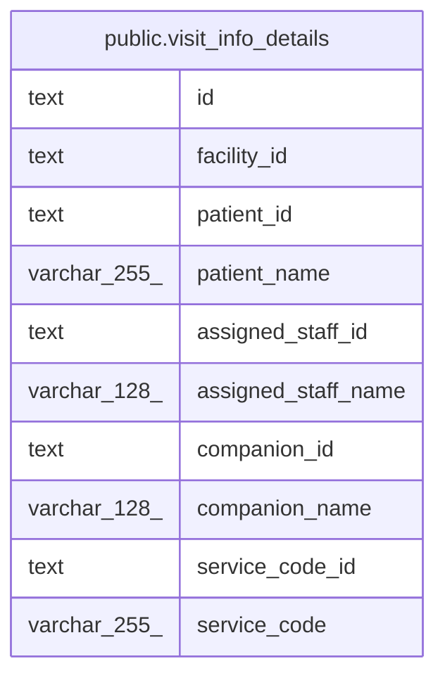

# public.visit_info_details

## Description

訪問の情報と名前を結合したビュー

<details>
<summary><strong>Table Definition</strong></summary>

```sql
CREATE VIEW visit_info_details AS (
 SELECT vi.id,
    vi.facility_id,
    vi.patient_id,
    pa.name AS patient_name,
    vi.assigned_staff_id,
    au.username AS assigned_staff_name,
    vi.companion_id,
    cu.username AS companion_name,
    vi.service_code_id,
    sc.code AS service_code
   FROM ((((visit_infos vi
     JOIN patients pa ON ((pa.id = vi.patient_id)))
     JOIN users au ON ((au.id = vi.assigned_staff_id)))
     LEFT JOIN users cu ON ((cu.id = vi.companion_id)))
     JOIN service_codes sc ON ((sc.id = vi.service_code_id)))
)
```

</details>

## Columns

| Name                | Type         | Default | Nullable | Children | Parents | Comment |
| ------------------- | ------------ | ------- | -------- | -------- | ------- | ------- |
| id                  | text         |         | true     |          |         |         |
| facility_id         | text         |         | true     |          |         |         |
| patient_id          | text         |         | true     |          |         |         |
| patient_name        | varchar(255) |         | true     |          |         |         |
| assigned_staff_id   | text         |         | true     |          |         |         |
| assigned_staff_name | varchar(128) |         | true     |          |         |         |
| companion_id        | text         |         | true     |          |         |         |
| companion_name      | varchar(128) |         | true     |          |         |         |
| service_code_id     | text         |         | true     |          |         |         |
| service_code        | varchar(255) |         | true     |          |         |         |

## Referenced Tables

| Name                                            | Columns | Comment                                  | Type       |
| ----------------------------------------------- | ------- | ---------------------------------------- | ---------- |
| [public.visit_infos](public.visit_infos.md)     | 8       | 訪問の情報                               | BASE TABLE |
| [public.patients](public.patients.md)           | 10      | 利用者                                   | BASE TABLE |
| [public.users](public.users.md)                 | 15      | 職員                                     | BASE TABLE |
| [public.service_codes](public.service_codes.md) | 6       | サービスコード。マイグレーションで入れる | BASE TABLE |

## Viewpoints

| Name                                 | Definition                                                                               |
| ------------------------------------ | ---------------------------------------------------------------------------------------- |
| [予定と訪問](viewpoint-schedules.md) | 予定と、訪問のときの訪問の情報と区分、予定の取り消し、誤って入れた予定の削除の監査の記録 |

## Relations



---

> Generated by [tbls](https://github.com/k1LoW/tbls)
