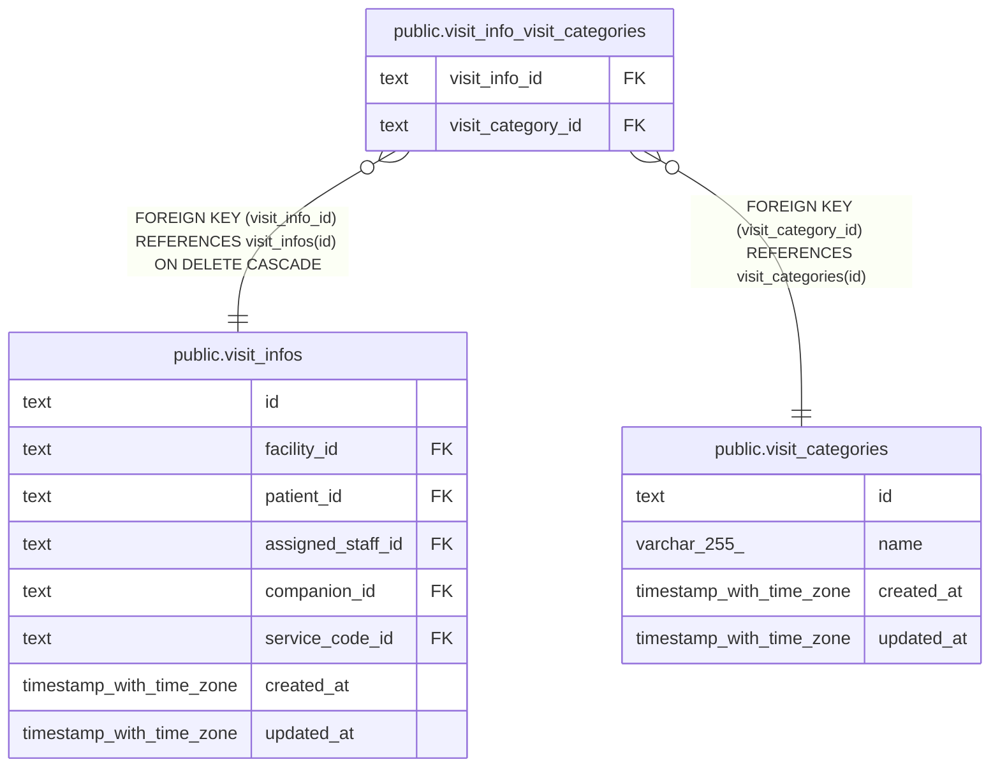

# public.visit_info_visit_categories

## Description

訪問に付けた区分。1 件の訪問に複数を付けられる

## Columns

| Name              | Type | Default | Nullable | Children | Parents                                               | Comment |
| ----------------- | ---- | ------- | -------- | -------- | ----------------------------------------------------- | ------- |
| visit_info_id     | text |         | false    |          | [public.visit_infos](public.visit_infos.md)           |         |
| visit_category_id | text |         | false    |          | [public.visit_categories](public.visit_categories.md) |         |

## Viewpoints

| Name                                 | Definition                                                                               |
| ------------------------------------ | ---------------------------------------------------------------------------------------- |
| [予定と訪問](viewpoint-schedules.md) | 予定と、訪問のときの訪問の情報と区分、予定の取り消し、誤って入れた予定の削除の監査の記録 |

## Constraints

| Name                                                   | Type        | Definition                                                               |
| ------------------------------------------------------ | ----------- | ------------------------------------------------------------------------ |
| visit_info_visit_categories_visit_category_id_not_null | n           | NOT NULL visit_category_id                                               |
| visit_info_visit_categories_visit_info_id_not_null     | n           | NOT NULL visit_info_id                                                   |
| visit_info_visit_categories_visit_category_fkey        | FOREIGN KEY | FOREIGN KEY (visit_category_id) REFERENCES visit_categories(id)          |
| visit_info_visit_categories_visit_info_fkey            | FOREIGN KEY | FOREIGN KEY (visit_info_id) REFERENCES visit_infos(id) ON DELETE CASCADE |
| visit_info_visit_categories_pkey                       | PRIMARY KEY | PRIMARY KEY (visit_info_id, visit_category_id)                           |

## Indexes

| Name                             | Definition                                                                                                                                |
| -------------------------------- | ----------------------------------------------------------------------------------------------------------------------------------------- |
| visit_info_visit_categories_pkey | CREATE UNIQUE INDEX visit_info_visit_categories_pkey ON public.visit_info_visit_categories USING btree (visit_info_id, visit_category_id) |

## Relations

---

> Generated by [tbls](https://github.com/k1LoW/tbls)
