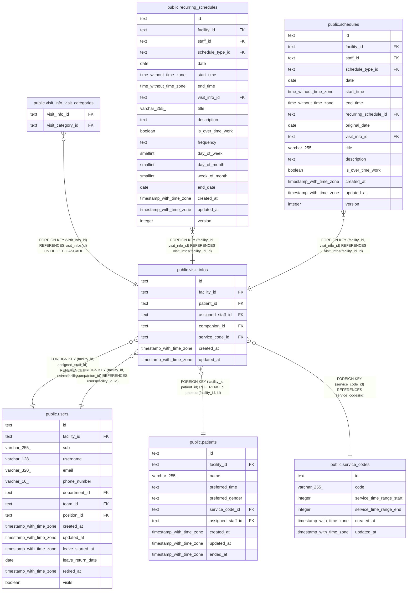

# public.visit_infos

## Description

訪問の情報

## Columns

| Name              | Type                     | Default | Nullable | Children                                                                                                                                                                        | Parents                                                               | Comment  |
| ----------------- | ------------------------ | ------- | -------- | ------------------------------------------------------------------------------------------------------------------------------------------------------------------------------- | --------------------------------------------------------------------- | -------- |
| id                | text                     |         | false    | [public.visit_info_visit_categories](public.visit_info_visit_categories.md) [public.recurring_schedules](public.recurring_schedules.md) [public.schedules](public.schedules.md) |                                                                       |          |
| facility_id       | text                     |         | false    | [public.recurring_schedules](public.recurring_schedules.md) [public.schedules](public.schedules.md)                                                                             | [public.users](public.users.md) [public.patients](public.patients.md) |          |
| patient_id        | text                     |         | false    |                                                                                                                                                                                 | [public.patients](public.patients.md)                                 |          |
| assigned_staff_id | text                     |         | false    |                                                                                                                                                                                 | [public.users](public.users.md)                                       | 主訪問者 |
| companion_id      | text                     |         | true     |                                                                                                                                                                                 | [public.users](public.users.md)                                       | 同行者   |
| service_code_id   | text                     |         | false    |                                                                                                                                                                                 | [public.service_codes](public.service_codes.md)                       |          |
| created_at        | timestamp with time zone | now()   | false    |                                                                                                                                                                                 |                                                                       |          |
| updated_at        | timestamp with time zone | now()   | false    |                                                                                                                                                                                 |                                                                       |          |

## Viewpoints

| Name                                     | Definition                                                                             |
| ---------------------------------------- | -------------------------------------------------------------------------------------- |
| [予定と訪問](viewpoint-schedules.md)     | 予定と、訪問のときの訪問の情報と区分、予定の取り消し                                   |
| [繰り返しの予定](viewpoint-recurring.md) | 繰り返しの予定と規則、回にしない日。繰り返しの 1 回を置き換えた予定は schedules に入る |

## Constraints

| Name                                   | Type        | Definition                                                                     |
| -------------------------------------- | ----------- | ------------------------------------------------------------------------------ |
| visit_infos_assigned_staff_id_not_null | n           | NOT NULL assigned_staff_id                                                     |
| visit_infos_companion_check            | CHECK       | CHECK ((companion_id <> assigned_staff_id))                                    |
| visit_infos_created_at_not_null        | n           | NOT NULL created_at                                                            |
| visit_infos_facility_id_not_null       | n           | NOT NULL facility_id                                                           |
| visit_infos_id_check                   | CHECK       | CHECK ((id ~ '^[0-7][0-9A-HJKMNP-TV-Z]{25}$'::text))                           |
| visit_infos_id_not_null                | n           | NOT NULL id                                                                    |
| visit_infos_patient_id_not_null        | n           | NOT NULL patient_id                                                            |
| visit_infos_service_code_id_not_null   | n           | NOT NULL service_code_id                                                       |
| visit_infos_updated_at_not_null        | n           | NOT NULL updated_at                                                            |
| visit_infos_assigned_staff_fkey        | FOREIGN KEY | FOREIGN KEY (facility_id, assigned_staff_id) REFERENCES users(facility_id, id) |
| visit_infos_companion_fkey             | FOREIGN KEY | FOREIGN KEY (facility_id, companion_id) REFERENCES users(facility_id, id)      |
| visit_infos_service_code_fkey          | FOREIGN KEY | FOREIGN KEY (service_code_id) REFERENCES service_codes(id)                     |
| visit_infos_patient_fkey               | FOREIGN KEY | FOREIGN KEY (facility_id, patient_id) REFERENCES patients(facility_id, id)     |
| visit_infos_pkey                       | PRIMARY KEY | PRIMARY KEY (id)                                                               |
| visit_infos_facility_id_key            | UNIQUE      | UNIQUE (facility_id, id)                                                       |

## Indexes

| Name                           | Definition                                                                                                                            |
| ------------------------------ | ------------------------------------------------------------------------------------------------------------------------------------- |
| visit_infos_pkey               | CREATE UNIQUE INDEX visit_infos_pkey ON public.visit_infos USING btree (id)                                                           |
| visit_infos_facility_id_key    | CREATE UNIQUE INDEX visit_infos_facility_id_key ON public.visit_infos USING btree (facility_id, id)                                   |
| visit_infos_patient_idx        | CREATE INDEX visit_infos_patient_idx ON public.visit_infos USING btree (facility_id, patient_id)                                      |
| visit_infos_assigned_staff_idx | CREATE INDEX visit_infos_assigned_staff_idx ON public.visit_infos USING btree (facility_id, assigned_staff_id)                        |
| visit_infos_companion_idx      | CREATE INDEX visit_infos_companion_idx ON public.visit_infos USING btree (facility_id, companion_id) WHERE (companion_id IS NOT NULL) |

## Triggers

| Name                       | Definition                                                                                                                   |
| -------------------------- | ---------------------------------------------------------------------------------------------------------------------------- |
| visit_infos_set_updated_at | CREATE TRIGGER visit_infos_set_updated_at BEFORE UPDATE ON public.visit_infos FOR EACH ROW EXECUTE FUNCTION set_updated_at() |

## Relations

---

> Generated by [tbls](https://github.com/k1LoW/tbls)
