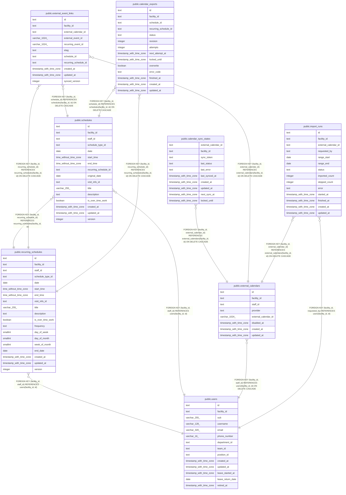

# 外部のカレンダーの取り込みと書き出し

## Description

職員の外部のカレンダーと同期の状態、外部の予定と予定の対応、取り込みの記録、書き出しの待ち

## Tables

| Name                                                          | Columns | Comment                                                                         | Type       |
| ------------------------------------------------------------- | ------- | ------------------------------------------------------------------------------- | ---------- |
| [public.users](public.users.md)                               | 14      | 職員                                                                            | BASE TABLE |
| [public.recurring_schedules](public.recurring_schedules.md)   | 19      | 繰り返しの予定と、その規則                                                      | BASE TABLE |
| [public.schedules](public.schedules.md)                       | 16      | 予定                                                                            | BASE TABLE |
| [public.external_calendars](public.external_calendars.md)     | 8       | 取り込む外部のカレンダーと、その持ち主の職員。外していないものは職員ごとに 1 つ | BASE TABLE |
| [public.calendar_sync_states](public.calendar_sync_states.md) | 10      | 外部のカレンダーごとの同期の状態                                                | BASE TABLE |
| [public.external_event_links](public.external_event_links.md) | 11      | 外部の予定と、buddy の単発か繰り返しの予定の対応                                | BASE TABLE |
| [public.import_runs](public.import_runs.md)                   | 14      | 外部のカレンダーからの取り込みの 1 回ごとの記録                                 | BASE TABLE |
| [public.calendar_exports](public.calendar_exports.md)         | 14      | 予定を外部のカレンダーに書き出す待ち。予定の変更と同じトランザクションで積む    | BASE TABLE |

## Relations

---

> Generated by [tbls](https://github.com/k1LoW/tbls)
