# 外部のカレンダーの取り込みと書き出し

## Description

職員の外部のカレンダーと同期の状態、外部の予定と予定の対応、取り込みの記録、書き出しの待ち、Google カレンダーの予定の写し（Projection）。書き出しは、予定の管理先が buddy_primary の事業所に限る。同期は google_primary の事業所のカレンダーだけを読み、予定の写しに書く。google_primary の事業所で buddy から Google カレンダーに書いた予定は、訪問の情報と書き込みの保留の版を記録に持つ。移行は、google_primary の事業所の予定を取り込み、完了で事業所を buddy_primary にする

## Tables

| Name                                                                      | Columns | Comment                                                                                                                                                        | Type       |
| ------------------------------------------------------------------------- | ------- | -------------------------------------------------------------------------------------------------------------------------------------------------------------- | ---------- |
| [public.facilities](public.facilities.md)                                 | 7       | 訪問看護の事業所                                                                                                                                               | BASE TABLE |
| [public.users](public.users.md)                                           | 15      | 職員                                                                                                                                                           | BASE TABLE |
| [public.visit_infos](public.visit_infos.md)                               | 8       | 訪問の情報                                                                                                                                                     | BASE TABLE |
| [public.recurring_schedules](public.recurring_schedules.md)               | 22      | 繰り返しの予定と、その規則                                                                                                                                     | BASE TABLE |
| [public.schedules](public.schedules.md)                                   | 17      | 予定                                                                                                                                                           | BASE TABLE |
| [public.external_calendars](public.external_calendars.md)                 | 8       | 取り込む外部のカレンダーと、その持ち主の職員。外していないものは職員ごとに 1 つ                                                                                | BASE TABLE |
| [public.calendar_sync_states](public.calendar_sync_states.md)             | 10      | 外部のカレンダーごとの同期の状態                                                                                                                               | BASE TABLE |
| [public.external_event_links](public.external_event_links.md)             | 13      | 外部の予定と、buddy の単発か繰り返しの予定の対応                                                                                                               | BASE TABLE |
| [public.import_runs](public.import_runs.md)                               | 15      | 外部のカレンダーからの取り込みの 1 回ごとの記録                                                                                                                | BASE TABLE |
| [public.calendar_exports](public.calendar_exports.md)                     | 16      | 予定を外部のカレンダーに書き出す待ち。予定の変更と同じトランザクションで積む                                                                                   | BASE TABLE |
| [public.calendar_event_projections](public.calendar_event_projections.md) | 20      | 予定を Google カレンダーで管理している事業所の、Google カレンダーの予定の写し（Projection）。1 つの予定を 1 行にする                                           | BASE TABLE |
| [public.calendar_cutovers](public.calendar_cutovers.md)                   | 9       | 事業所の予定の管理を Google カレンダーから buddy に移す作業の記録（移行）。事業所ごとに open は 1 つまで                                                       | BASE TABLE |
| [public.calendar_cutover_skips](public.calendar_cutover_skips.md)         | 6       | 移行の取り込みで、確認が必要な予定に取り込まないを選んだ記録                                                                                                   | BASE TABLE |
| [public.calendar_event_records](public.calendar_event_records.md)         | 15      | google_primary の事業所で、予定の API が Google カレンダーに書いた予定の、訪問の情報と書き込みの保留の版（ADR-0029）。通常の予定も保留の版を持つために行を作る | BASE TABLE |
| [public.schedule_deletions](public.schedule_deletions.md)                 | 8       | 誤って入れた予定を削除した監査の記録（ADR-0040）。画面に出さない。消した時点の内容（訪問の情報と利用者）は持たない                                             | BASE TABLE |

## Relations

```mermaid
erDiagram

"public.users" }o--|| "public.facilities" : "FOREIGN KEY (facility_id) REFERENCES facilities(id)"
"public.visit_infos" }o--|| "public.users" : "FOREIGN KEY (facility_id, assigned_staff_id) REFERENCES users(facility_id, id)"
"public.visit_infos" }o--|| "public.users" : "FOREIGN KEY (facility_id, companion_id) REFERENCES users(facility_id, id)"
"public.recurring_schedules" }o--|| "public.facilities" : "FOREIGN KEY (facility_id) REFERENCES facilities(id)"
"public.recurring_schedules" }o--|| "public.users" : "FOREIGN KEY (facility_id, staff_id) REFERENCES users(facility_id, id)"
"public.recurring_schedules" }o--|| "public.visit_infos" : "FOREIGN KEY (facility_id, visit_info_id) REFERENCES visit_infos(facility_id, id)"
"public.schedules" }o--|| "public.facilities" : "FOREIGN KEY (facility_id) REFERENCES facilities(id)"
"public.schedules" }o--|| "public.users" : "FOREIGN KEY (facility_id, staff_id) REFERENCES users(facility_id, id)"
"public.schedules" }o--|| "public.visit_infos" : "FOREIGN KEY (facility_id, visit_info_id) REFERENCES visit_infos(facility_id, id)"
"public.schedules" }o--|| "public.recurring_schedules" : "FOREIGN KEY (facility_id, recurring_schedule_id) REFERENCES recurring_schedules(facility_id, id)"
"public.external_calendars" }o--|| "public.users" : "FOREIGN KEY (facility_id, staff_id) REFERENCES users(facility_id, id) ON DELETE CASCADE"
"public.calendar_sync_states" }o--|| "public.external_calendars" : "FOREIGN KEY (facility_id, external_calendar_id) REFERENCES external_calendars(facility_id, id) ON DELETE CASCADE"
"public.external_event_links" }o--|| "public.recurring_schedules" : "FOREIGN KEY (facility_id, recurring_schedule_id) REFERENCES recurring_schedules(facility_id, id) ON DELETE CASCADE"
"public.external_event_links" }o--|| "public.schedules" : "FOREIGN KEY (facility_id, schedule_id) REFERENCES schedules(facility_id, id) ON DELETE CASCADE"
"public.external_event_links" }o--|| "public.external_calendars" : "FOREIGN KEY (facility_id, external_calendar_id) REFERENCES external_calendars(facility_id, id) ON DELETE CASCADE"
"public.external_event_links" }o--|| "public.calendar_cutovers" : "FOREIGN KEY (facility_id, cutover_id) REFERENCES calendar_cutovers(facility_id, id)"
"public.external_event_links" }o--|| "public.schedule_deletions" : "FOREIGN KEY (facility_id, deleted_schedule_id) REFERENCES schedule_deletions(facility_id, schedule_id)"
"public.import_runs" }o--|| "public.users" : "FOREIGN KEY (facility_id, requested_by) REFERENCES users(facility_id, id)"
"public.import_runs" }o--|| "public.external_calendars" : "FOREIGN KEY (facility_id, external_calendar_id) REFERENCES external_calendars(facility_id, id) ON DELETE CASCADE"
"public.import_runs" }o--|| "public.calendar_cutovers" : "FOREIGN KEY (facility_id, cutover_id) REFERENCES calendar_cutovers(facility_id, id)"
"public.calendar_exports" }o--|| "public.facilities" : "FOREIGN KEY (facility_id) REFERENCES facilities(id)"
"public.calendar_exports" }o--|| "public.recurring_schedules" : "FOREIGN KEY (facility_id, recurring_schedule_id) REFERENCES recurring_schedules(facility_id, id) ON DELETE CASCADE"
"public.calendar_exports" }o--|| "public.schedules" : "FOREIGN KEY (facility_id, schedule_id) REFERENCES schedules(facility_id, id) ON DELETE CASCADE"
"public.calendar_exports" }o--|| "public.external_calendars" : "FOREIGN KEY (facility_id, writing_calendar_id) REFERENCES external_calendars(facility_id, id) ON DELETE SET NULL (writing_calendar_id)"
"public.calendar_exports" }o--|| "public.schedule_deletions" : "FOREIGN KEY (facility_id, deleted_schedule_id) REFERENCES schedule_deletions(facility_id, schedule_id)"
"public.calendar_event_projections" }o--|| "public.users" : "FOREIGN KEY (facility_id, staff_id) REFERENCES users(facility_id, id) ON DELETE CASCADE"
"public.calendar_event_projections" }o--|| "public.external_calendars" : "FOREIGN KEY (facility_id, external_calendar_id) REFERENCES external_calendars(facility_id, id) ON DELETE CASCADE"
"public.calendar_cutovers" }o--|| "public.facilities" : "FOREIGN KEY (facility_id) REFERENCES facilities(id)"
"public.calendar_cutovers" }o--|| "public.users" : "FOREIGN KEY (facility_id, started_by) REFERENCES users(facility_id, id)"
"public.calendar_cutover_skips" }o--|| "public.external_calendars" : "FOREIGN KEY (facility_id, external_calendar_id) REFERENCES external_calendars(facility_id, id) ON DELETE CASCADE"
"public.calendar_cutover_skips" }o--|| "public.calendar_cutovers" : "FOREIGN KEY (facility_id, cutover_id) REFERENCES calendar_cutovers(facility_id, id) ON DELETE CASCADE"
"public.calendar_event_records" }o--|| "public.facilities" : "FOREIGN KEY (facility_id) REFERENCES facilities(id)"
"public.calendar_event_records" }o--|| "public.visit_infos" : "FOREIGN KEY (facility_id, pending_visit_info_id) REFERENCES visit_infos(facility_id, id)"
"public.calendar_event_records" }o--|| "public.visit_infos" : "FOREIGN KEY (facility_id, visit_info_id) REFERENCES visit_infos(facility_id, id)"
"public.calendar_event_records" }o--|| "public.external_calendars" : "FOREIGN KEY (facility_id, external_calendar_id) REFERENCES external_calendars(facility_id, id) ON DELETE CASCADE"
"public.calendar_event_records" }o--|| "public.external_calendars" : "FOREIGN KEY (facility_id, pending_external_calendar_id) REFERENCES external_calendars(facility_id, id) ON DELETE CASCADE"
"public.schedule_deletions" }o--|| "public.facilities" : "FOREIGN KEY (facility_id) REFERENCES facilities(id)"
"public.schedule_deletions" }o--|| "public.users" : "FOREIGN KEY (facility_id, deleted_by) REFERENCES users(facility_id, id)"
"public.schedule_deletions" }o--|| "public.users" : "FOREIGN KEY (facility_id, staff_id) REFERENCES users(facility_id, id)"
"public.schedule_deletions" }o--|| "public.recurring_schedules" : "FOREIGN KEY (facility_id, recurring_schedule_id) REFERENCES recurring_schedules(facility_id, id)"

"public.facilities" {
  text id
  varchar_255_ name
  varchar_255_ org_id
  text time_zone
  timestamp_with_time_zone created_at
  timestamp_with_time_zone updated_at
  text source_mode
}
"public.users" {
  text id
  text facility_id
  varchar_255_ sub
  varchar_128_ username
  varchar_320_ email
  varchar_16_ phone_number
  text department_id
  text team_id
  text position_id
  timestamp_with_time_zone created_at
  timestamp_with_time_zone updated_at
  timestamp_with_time_zone leave_started_at
  date leave_return_date
  timestamp_with_time_zone retired_at
  boolean visits
}
"public.visit_infos" {
  text id
  text facility_id
  text patient_id
  text assigned_staff_id
  text companion_id
  text service_code_id
  timestamp_with_time_zone created_at
  timestamp_with_time_zone updated_at
}
"public.recurring_schedules" {
  text id
  text facility_id
  text staff_id
  text schedule_type_id
  date date
  time_without_time_zone start_time
  time_without_time_zone end_time
  text visit_info_id
  varchar_255_ title
  text description
  boolean is_over_time_work
  text frequency
  smallint day_of_week
  smallint day_of_month
  smallint week_of_month
  date end_date
  timestamp_with_time_zone created_at
  timestamp_with_time_zone updated_at
  integer version
  boolean ends_next_day
  smallint__ days_of_week
  smallint interval_weeks
}
"public.schedules" {
  text id
  text facility_id
  text staff_id
  text schedule_type_id
  date date
  time_without_time_zone start_time
  time_without_time_zone end_time
  text recurring_schedule_id
  date original_date
  text visit_info_id
  varchar_255_ title
  text description
  boolean is_over_time_work
  timestamp_with_time_zone created_at
  timestamp_with_time_zone updated_at
  integer version
  boolean ends_next_day
}
"public.external_calendars" {
  text id
  text facility_id
  text staff_id
  text provider
  varchar_1024_ external_calendar_id
  timestamp_with_time_zone disabled_at
  timestamp_with_time_zone created_at
  timestamp_with_time_zone updated_at
}
"public.calendar_sync_states" {
  text external_calendar_id
  text facility_id
  text sync_token
  text last_status
  text last_error
  timestamp_with_time_zone last_synced_at
  timestamp_with_time_zone created_at
  timestamp_with_time_zone updated_at
  timestamp_with_time_zone next_sync_at
  timestamp_with_time_zone locked_until
}
"public.external_event_links" {
  text id
  text facility_id
  text external_calendar_id
  varchar_1024_ external_event_id
  varchar_1024_ recurring_event_id
  text etag
  text schedule_id
  text recurring_schedule_id
  timestamp_with_time_zone created_at
  timestamp_with_time_zone updated_at
  integer synced_version
  text cutover_id
  text deleted_schedule_id
}
"public.import_runs" {
  text id
  text facility_id
  text external_calendar_id
  text requested_by
  date range_start
  date range_end
  text status
  integer imported_count
  integer skipped_count
  text error
  timestamp_with_time_zone started_at
  timestamp_with_time_zone finished_at
  timestamp_with_time_zone created_at
  timestamp_with_time_zone updated_at
  text cutover_id
}
"public.calendar_exports" {
  text id
  text facility_id
  text schedule_id
  text recurring_schedule_id
  text status
  integer revision
  integer attempts
  timestamp_with_time_zone next_attempt_at
  timestamp_with_time_zone locked_until
  boolean overwrite
  text error_code
  timestamp_with_time_zone finished_at
  timestamp_with_time_zone created_at
  timestamp_with_time_zone updated_at
  text deleted_schedule_id
  text writing_calendar_id
}
"public.calendar_event_projections" {
  text external_calendar_id
  varchar_1024_ external_event_id
  text facility_id
  text staff_id
  varchar_1024_ recurring_event_id
  timestamp_with_time_zone original_start_at
  date original_start_date
  text status
  text title
  timestamp_with_time_zone start_at
  date start_date
  timestamp_with_time_zone end_at
  date end_date
  text time_zone
  text__ recurrence
  text etag
  timestamp_with_time_zone google_updated_at
  date last_end_date
  timestamp_with_time_zone projected_at
  boolean time_unreadable
}
"public.calendar_cutovers" {
  text id
  text facility_id
  text status
  date range_start
  text started_by
  timestamp_with_time_zone started_at
  timestamp_with_time_zone finished_at
  timestamp_with_time_zone created_at
  timestamp_with_time_zone updated_at
}
"public.calendar_cutover_skips" {
  text cutover_id
  text facility_id
  text external_calendar_id
  varchar_1024_ external_event_id
  varchar_64_ revision
  timestamp_with_time_zone created_at
}
"public.calendar_event_records" {
  text schedule_id
  text facility_id
  text external_calendar_id
  varchar_1024_ external_event_id
  text visit_info_id
  integer version
  integer pending_version
  text pending_state
  text pending_visit_info_id
  timestamp_with_time_zone pending_deadline
  timestamp_with_time_zone created_at
  timestamp_with_time_zone updated_at
  timestamp_with_time_zone pending_locked_until
  text pending_external_calendar_id
  varchar_1024_ pending_external_event_id
}
"public.schedule_deletions" {
  text id
  text facility_id
  text schedule_id
  text recurring_schedule_id
  date date
  text staff_id
  text deleted_by
  timestamp_with_time_zone deleted_at
}
```

---

> Generated by [tbls](https://github.com/k1LoW/tbls)
