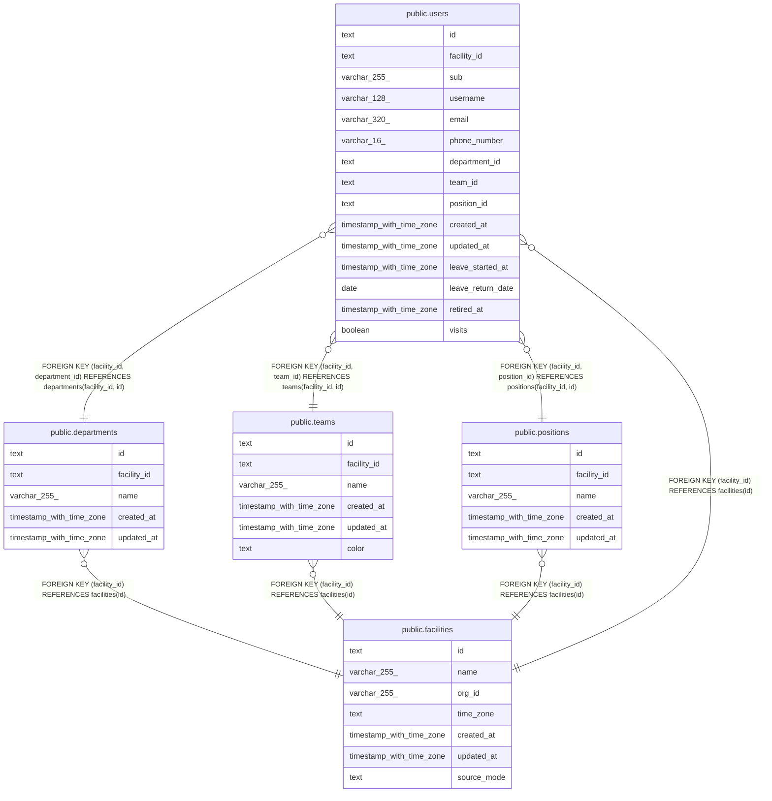

# 事業所と組織

## Description

事業所と、その中の部署、チーム、役職、職員。事業所は予定の正本のモードを持つ

## Tables

| Name                                        | Columns | Comment                                                | Type       |
| ------------------------------------------- | ------- | ------------------------------------------------------ | ---------- |
| [public.facilities](public.facilities.md)   | 7       | 訪問看護の事業所                                       | BASE TABLE |
| [public.departments](public.departments.md) | 5       | 事業所の部署                                           | BASE TABLE |
| [public.teams](public.teams.md)             | 6       | 事業所のチーム                                         | BASE TABLE |
| [public.positions](public.positions.md)     | 5       | 事業所の役職。職員を登録するときに写す既定の権限を持つ | BASE TABLE |
| [public.users](public.users.md)             | 15      | 職員                                                   | BASE TABLE |

## Relations

---

> Generated by [tbls](https://github.com/k1LoW/tbls)
