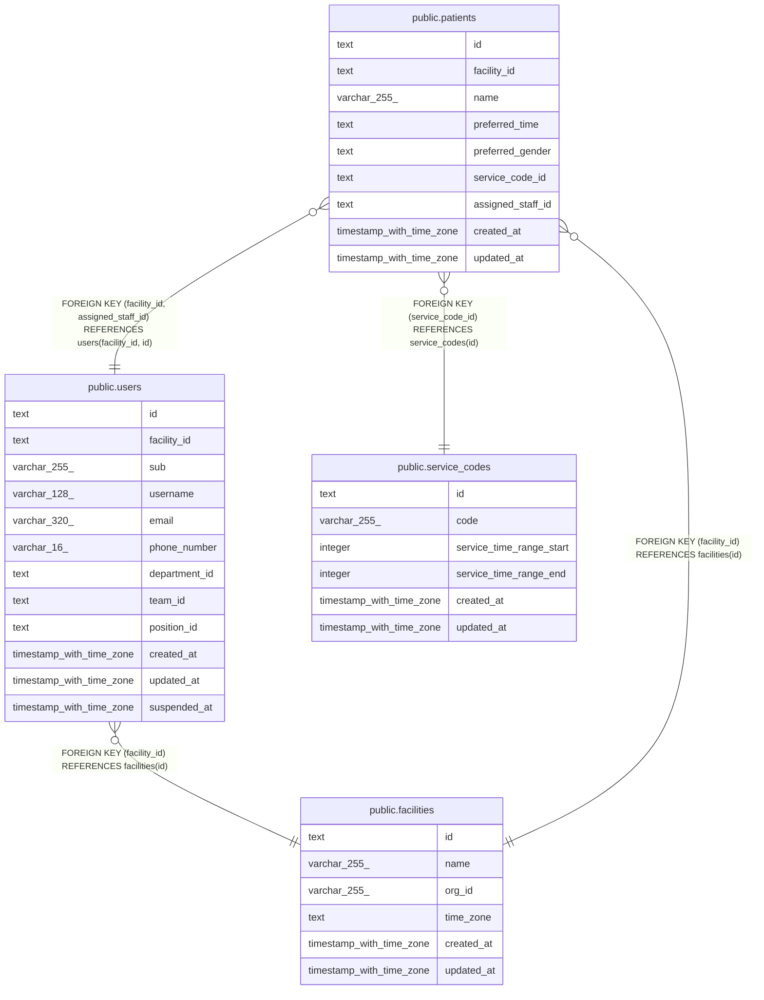

# 利用者

## Description

利用者と、受けているサービスと、主に担当する職員

## Tables

| Name                                            | Columns | Comment                                  | Type       |
| ----------------------------------------------- | ------- | ---------------------------------------- | ---------- |
| [public.facilities](public.facilities.md)       | 6       | 訪問看護の事業所                         | BASE TABLE |
| [public.users](public.users.md)                 | 12      | 職員                                     | BASE TABLE |
| [public.service_codes](public.service_codes.md) | 6       | サービスコード。マイグレーションで入れる | BASE TABLE |
| [public.patients](public.patients.md)           | 9       | 利用者                                   | BASE TABLE |

## Relations

---

> Generated by [tbls](https://github.com/k1LoW/tbls)
