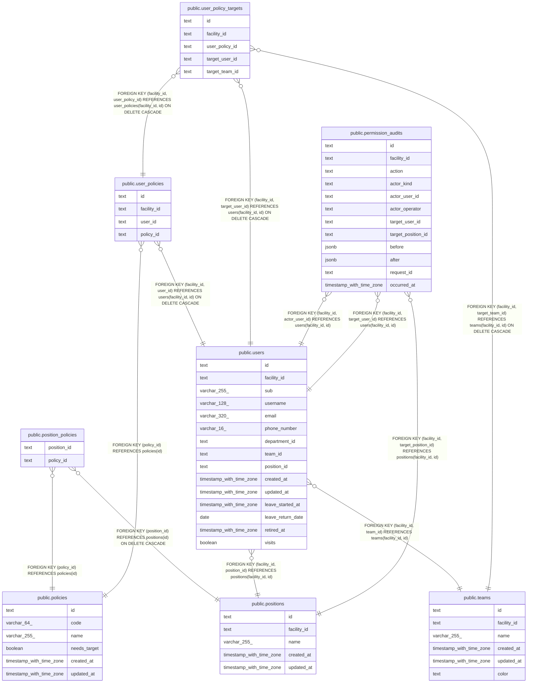

# 職員と権限

## Description

職員が持つ権限と、その対象。職員を登録するとき、役職のデフォルトの権限をコピーする。権限の変更は監査の記録に残す（ADR-0042）

## Tables

| Name                                                        | Columns | Comment                                                                                                         | Type       |
| ----------------------------------------------------------- | ------- | --------------------------------------------------------------------------------------------------------------- | ---------- |
| [public.teams](public.teams.md)                             | 6       | 事業所のチーム                                                                                                  | BASE TABLE |
| [public.positions](public.positions.md)                     | 5       | 事業所の役職。職員を登録するときに写す既定の権限を持つ                                                          | BASE TABLE |
| [public.policies](public.policies.md)                       | 6       | 権限。マイグレーションで入れ、API では作らない                                                                  | BASE TABLE |
| [public.position_policies](public.position_policies.md)     | 2       | 役職の既定の権限                                                                                                | BASE TABLE |
| [public.users](public.users.md)                             | 15      | 職員                                                                                                            | BASE TABLE |
| [public.user_policies](public.user_policies.md)             | 4       | 職員が持つ権限。職員と権限の組で一意                                                                            | BASE TABLE |
| [public.user_policy_targets](public.user_policy_targets.md) | 5       | 職員の権限の対象                                                                                                | BASE TABLE |
| [public.permission_audits](public.permission_audits.md)     | 12      | 権限の変更と運営者の登録の監査の記録（ADR-0042）。画面と API に出さず、運営者が DB で読む。消さず、書き換えない | BASE TABLE |

## Relations

---

> Generated by [tbls](https://github.com/k1LoW/tbls)
