# 予定と訪問

## Description

予定と、訪問のときの訪問の情報と区分、予定の取り消し

## Tables

| Name                                                                        | Columns | Comment                                                      | Type       |
| --------------------------------------------------------------------------- | ------- | ------------------------------------------------------------ | ---------- |
| [public.facilities](public.facilities.md)                                   | 6       | 訪問看護の事業所                                             | BASE TABLE |
| [public.users](public.users.md)                                             | 14      | 職員                                                         | BASE TABLE |
| [public.service_codes](public.service_codes.md)                             | 6       | サービスコード。マイグレーションで入れる                     | BASE TABLE |
| [public.visit_categories](public.visit_categories.md)                       | 4       | 訪問の区分（夜勤、緊急、入院）。マイグレーションで入れる     | BASE TABLE |
| [public.patients](public.patients.md)                                       | 9       | 利用者                                                       | BASE TABLE |
| [public.visit_infos](public.visit_infos.md)                                 | 8       | 訪問の情報                                                   | BASE TABLE |
| [public.visit_info_visit_categories](public.visit_info_visit_categories.md) | 2       | 訪問に付けた区分。1 件の訪問に複数を付けられる               | BASE TABLE |
| [public.schedule_types](public.schedule_types.md)                           | 5       | 予定の種類（通常、訪問）。マイグレーションで入れる           | BASE TABLE |
| [public.recurring_schedules](public.recurring_schedules.md)                 | 19      | 繰り返しの予定と、その規則                                   | BASE TABLE |
| [public.schedules](public.schedules.md)                                     | 16      | 予定                                                         | BASE TABLE |
| [public.schedule_cancels](public.schedule_cancels.md)                       | 5       | 予定の取り消し                                               | BASE TABLE |
| [public.visit_info_details](public.visit_info_details.md)                   | 10      | 訪問の情報と名前を結合したビュー                             | VIEW       |
| [public.schedule_details](public.schedule_details.md)                       | 29      | 一覧の読み出しに使う、予定と訪問の情報と名前を結合したビュー | VIEW       |

## Relations

```mermaid
erDiagram

"public.users" }o--|| "public.facilities" : "FOREIGN KEY (facility_id) REFERENCES facilities(id)"
"public.patients" }o--|| "public.facilities" : "FOREIGN KEY (facility_id) REFERENCES facilities(id)"
"public.patients" }o--|| "public.users" : "FOREIGN KEY (facility_id, assigned_staff_id) REFERENCES users(facility_id, id)"
"public.patients" }o--|| "public.service_codes" : "FOREIGN KEY (service_code_id) REFERENCES service_codes(id)"
"public.visit_infos" }o--|| "public.users" : "FOREIGN KEY (facility_id, assigned_staff_id) REFERENCES users(facility_id, id)"
"public.visit_infos" }o--|| "public.users" : "FOREIGN KEY (facility_id, companion_id) REFERENCES users(facility_id, id)"
"public.visit_infos" }o--|| "public.service_codes" : "FOREIGN KEY (service_code_id) REFERENCES service_codes(id)"
"public.visit_infos" }o--|| "public.patients" : "FOREIGN KEY (facility_id, patient_id) REFERENCES patients(facility_id, id)"
"public.visit_info_visit_categories" }o--|| "public.visit_categories" : "FOREIGN KEY (visit_category_id) REFERENCES visit_categories(id)"
"public.visit_info_visit_categories" }o--|| "public.visit_infos" : "FOREIGN KEY (visit_info_id) REFERENCES visit_infos(id) ON DELETE CASCADE"
"public.recurring_schedules" }o--|| "public.facilities" : "FOREIGN KEY (facility_id) REFERENCES facilities(id)"
"public.recurring_schedules" }o--|| "public.users" : "FOREIGN KEY (facility_id, staff_id) REFERENCES users(facility_id, id)"
"public.recurring_schedules" }o--|| "public.visit_infos" : "FOREIGN KEY (facility_id, visit_info_id) REFERENCES visit_infos(facility_id, id)"
"public.recurring_schedules" }o--|| "public.schedule_types" : "FOREIGN KEY (schedule_type_id) REFERENCES schedule_types(id)"
"public.schedules" }o--|| "public.facilities" : "FOREIGN KEY (facility_id) REFERENCES facilities(id)"
"public.schedules" }o--|| "public.users" : "FOREIGN KEY (facility_id, staff_id) REFERENCES users(facility_id, id)"
"public.schedules" }o--|| "public.visit_infos" : "FOREIGN KEY (facility_id, visit_info_id) REFERENCES visit_infos(facility_id, id)"
"public.schedules" }o--|| "public.schedule_types" : "FOREIGN KEY (schedule_type_id) REFERENCES schedule_types(id)"
"public.schedules" }o--|| "public.recurring_schedules" : "FOREIGN KEY (facility_id, recurring_schedule_id) REFERENCES recurring_schedules(facility_id, id)"
"public.schedule_cancels" |o--|| "public.schedules" : "FOREIGN KEY (schedule_id) REFERENCES schedules(id) ON DELETE CASCADE"

"public.facilities" {
  text id
  varchar_255_ name
  varchar_255_ org_id
  text time_zone
  timestamp_with_time_zone created_at
  timestamp_with_time_zone updated_at
}
"public.users" {
  text id
  text facility_id
  varchar_255_ sub
  varchar_128_ username
  varchar_320_ email
  varchar_16_ phone_number
  text department_id
  text team_id
  text position_id
  timestamp_with_time_zone created_at
  timestamp_with_time_zone updated_at
  timestamp_with_time_zone leave_started_at
  date leave_return_date
  timestamp_with_time_zone retired_at
}
"public.service_codes" {
  text id
  varchar_255_ code
  integer service_time_range_start
  integer service_time_range_end
  timestamp_with_time_zone created_at
  timestamp_with_time_zone updated_at
}
"public.visit_categories" {
  text id
  varchar_255_ name
  timestamp_with_time_zone created_at
  timestamp_with_time_zone updated_at
}
"public.patients" {
  text id
  text facility_id
  varchar_255_ name
  text preferred_time
  text preferred_gender
  text service_code_id
  text assigned_staff_id
  timestamp_with_time_zone created_at
  timestamp_with_time_zone updated_at
}
"public.visit_infos" {
  text id
  text facility_id
  text patient_id
  text assigned_staff_id
  text companion_id
  text service_code_id
  timestamp_with_time_zone created_at
  timestamp_with_time_zone updated_at
}
"public.visit_info_visit_categories" {
  text visit_info_id
  text visit_category_id
}
"public.schedule_types" {
  text id
  text code
  varchar_255_ name
  timestamp_with_time_zone created_at
  timestamp_with_time_zone updated_at
}
"public.recurring_schedules" {
  text id
  text facility_id
  text staff_id
  text schedule_type_id
  date date
  time_without_time_zone start_time
  time_without_time_zone end_time
  text visit_info_id
  varchar_255_ title
  text description
  boolean is_over_time_work
  text frequency
  smallint day_of_week
  smallint day_of_month
  smallint week_of_month
  date end_date
  timestamp_with_time_zone created_at
  timestamp_with_time_zone updated_at
  integer version
}
"public.schedules" {
  text id
  text facility_id
  text staff_id
  text schedule_type_id
  date date
  time_without_time_zone start_time
  time_without_time_zone end_time
  text recurring_schedule_id
  date original_date
  text visit_info_id
  varchar_255_ title
  text description
  boolean is_over_time_work
  timestamp_with_time_zone created_at
  timestamp_with_time_zone updated_at
  integer version
}
"public.schedule_cancels" {
  text id
  text schedule_id
  varchar_255_ reason
  timestamp_with_time_zone created_at
  timestamp_with_time_zone updated_at
}
"public.visit_info_details" {
  text id
  text facility_id
  text patient_id
  varchar_255_ patient_name
  text assigned_staff_id
  varchar_128_ assigned_staff_name
  text companion_id
  varchar_128_ companion_name
  text service_code_id
  varchar_255_ service_code
}
"public.schedule_details" {
  text id
  text facility_id
  text schedule_type_id
  text schedule_type_code
  varchar_255_ schedule_type_name
  date date
  time_without_time_zone start_time
  time_without_time_zone end_time
  boolean is_over_time_work
  text staff_id
  varchar_128_ staff_name
  varchar_255_ title
  text description
  text recurring_schedule_id
  date original_date
  text visit_info_id
  text patient_id
  varchar_255_ patient_name
  text assigned_staff_id
  varchar_128_ assigned_staff_name
  text companion_id
  varchar_128_ companion_name
  text service_code_id
  varchar_255_ service_code
  text cancel_id
  varchar_255_ cancel_reason
  timestamp_with_time_zone created_at
  timestamp_with_time_zone updated_at
  integer version
}
```

---

> Generated by [tbls](https://github.com/k1LoW/tbls)
