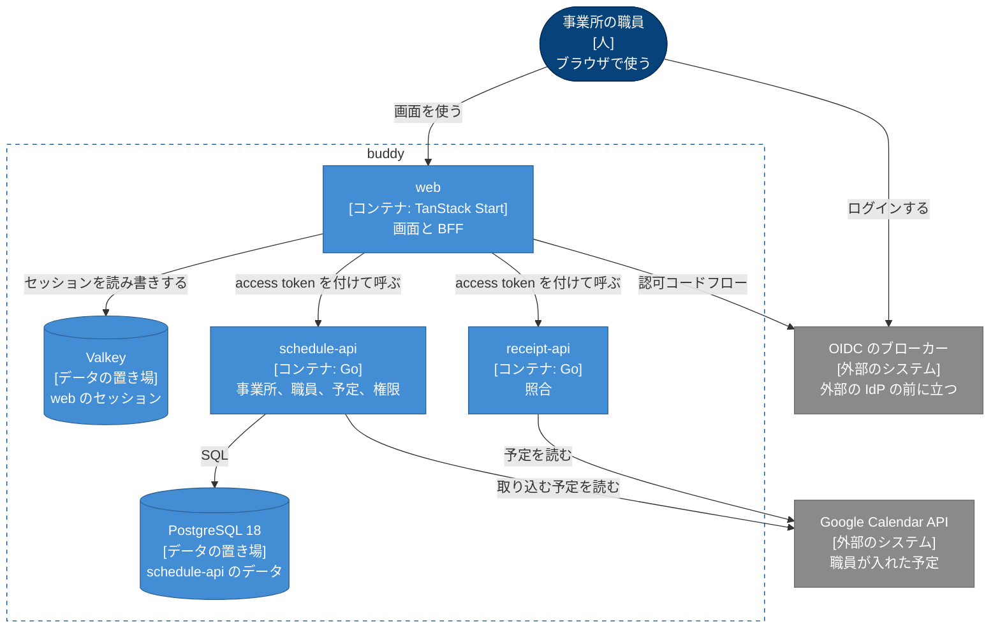

# buddy Design Doc

## Overview

buddy は、訪問看護の事業所の職員が使う、予定の管理とレセプトの照合のアプリである。  
職員はブラウザで web を開き、web が schedule-api と receipt-api を呼ぶ。  
誰のどの課題を解くかと、提供する機能と画面は [PRD](../PRD.md) にある。  
文書のサイトとカタログを公開する仕組み（`apps/docs-site`）は、[apps/docs-site/README.md](https://github.com/Fukuemon/buddy/blob/develop/apps/docs-site/README.md) にある。

## Goals and Non-Goals

### Goals

- 照合を、予定の管理と別の API（receipt-api）に分ける。事業所と職員と予定は、同じ DB を使う schedule-api が持つ。
- web と API の間の契約は、API ごとの `openapi.yaml` に置く。
- 認証は OIDC のブローカーに任せ、トークンは web のサーバーの側だけが持つ。
- 事業所のデータは schedule-api だけが持ち、ほかの事業所のデータを返さない。

### Non-Goals

- どのコンテナをどの種類の基盤で動かすかと、クラスタの構成。
  - インフラのリポジトリ（非公開）が持ち、buddy は [インフラとの約束](#インフラとの約束) だけを守る。

## Assumptions and Constraints

- 職員の IdP は事業所の外にあり、buddy は OIDC のブローカーが発行するトークンだけを受ける。
- ブローカーは、事業所を組織として持ち、access token に組織の識別子を入れる。
- 1 つの事業所の職員は 100 人前後で、同時に使う職員は事業所あたり数十人である。
- 日付と時刻は日本の時間（Asia/Tokyo）だけを扱う。
- 電子カルテ（iBow）とは API でつながず、職員が書き出した CSV を受ける。
- 職員は訪問の予定を Google カレンダーに入れている。

## Architecture

作るものが全体として何をするかは、[PRD の System Context](../PRD.md#system-context) にある。

次の図は、buddy のコンテナと、その間のデータの流れを示す。  
破線の枠が buddy の境界で、灰色は buddy の外のシステムである。



矢印ごとの約束は、[コンテナの間の契約](#コンテナの間の契約) にある。  
図に描いていない流れが 1 つある。schedule-api と receipt-api は、access token を検証するために、ブローカーの JWKS を読む。

### 業務の区切りとコンテナ

PRD の 3 つの業務の区切りは、次のコンテナが持つ。

| 業務の区切り | 持つもの | コンテナ |
| --- | --- | --- |
| 事業所と職員 | 事業所、部署、チーム、役職、権限、職員、利用者 | schedule-api |
| 予定 | 単発の予定、繰り返しの予定、キャンセル、訪問の情報 | schedule-api |
| 照合 | 予定と実績の対の作り方、判定の規則 | receipt-api |

- 事業所と職員と予定は、同じ PostgreSQL のデータベースを使い、schedule-api の中でパッケージを分ける。
  - パッケージの構成は [予定の管理の Design Doc](https://github.com/Fukuemon/buddy/blob/develop/apps/schedule-api/DesignDoc.md) にある。
- 用語と、区切りごとの呼び方の違いは [業務の知識](https://github.com/Fukuemon/buddy/blob/develop/context/domain.md) にある。

## Components

### web

- 画面を描き、BFF としてブローカーとのログインとセッションを持つ。
- API を呼ぶときに、セッションの access token を付ける。
- 持たないもの: 業務の規則と認可の判定。
  - web は職員の権限を画面の出し分けに使うが、要求を拒否するのは API である。

### schedule-api

- 事業所、部署、チーム、役職、権限、職員、利用者、予定を持つ。
- access token の検証、職員の特定、事業所の確認、職員の権限による予定の閲覧と編集の判定を行う。
- 職員に結び付けた Google カレンダーの予定を、期間を選んで予定に取り込む（ADR-0009 の段階 1）。
- 持たないもの: 照合の規則。
- 内部の構成と ER は [予定の管理の Design Doc](https://github.com/Fukuemon/buddy/blob/develop/apps/schedule-api/DesignDoc.md) にある。

### receipt-api

- 予定と実績の CSV を正規化し、対にし、判定して、4 つの区分の結果を返す。
- 予定は、予定の CSV か Google カレンダーから取る。
- access token を検証するが、職員の特定と事業所の確認はしない。
  - Google カレンダーから予定を取るときだけ、トークンの組織に結び付けたカレンダーを読む。規則は [事業所の分離](#事業所の分離) にある。
- 持たないもの: 予定と職員のデータ、DB。上げた CSV と照合の結果を保存しない。
- 規則は [レセプトの照合の Design Doc](https://github.com/Fukuemon/buddy/blob/develop/apps/receipt-api/DesignDoc.md) にある。

## Interfaces

### コンテナの間の契約

アプリの間は HTTP だけでつながり、コードで依存しない。

- ブラウザと web: HTTPS でつなぐ。
  - cookie にはセッションの ID を入れ、トークンは入れない。
  - 画面の操作は、web のサーバーの関数（BFF）を呼ぶ。API はブラウザから直接は呼ばれない。
  - 例外は、開発者が手元で文書のサイトの API の仕様のページから、手元の API を試すときだけである。API は `CORS_ALLOW_ORIGINS` に挙げたオリジンにだけ CORS のヘッダーを返し、手元の compose は、web と手元の文書のサイトのオリジンを挙げる。
- ブラウザとブローカー: ログインのときだけ、web がブラウザをブローカーの認可の画面へ転送する。
- web とブローカー: 認可コードフローでトークンを取得し、更新する。トークンは Valkey のセッションに置く。
- web と schedule-api、receipt-api: `Authorization` に access token を Bearer で付ける。
  - 契約の正本は [schedule-api の openapi.yaml](https://github.com/Fukuemon/buddy/blob/develop/apps/schedule-api/openapi.yaml) と [receipt-api の openapi.yaml](https://github.com/Fukuemon/buddy/blob/develop/apps/receipt-api/openapi.yaml) である。サーバーの Go のコードと web の型は、そこから生成する。
  - 契約を変えるときの互換の規則は ADR-0003 にある。
  - ADR-0003: [git flow で取り込み、アプリごとのバージョンでリリースする](../adr/0003-branch-and-release.md)
- schedule-api、receipt-api とブローカー: 発行者の discovery と JWKS を読み、access token を検証する。検証に失敗したら 401 を返す。
- receipt-api、schedule-api と Google Calendar API: サービスアカウントで、閲覧の権限で共有されたカレンダーの予定を読む。schedule-api は、取り込みの下見と確定のときだけ読む。
- schedule-api と PostgreSQL: schedule-api だけが読み書きする。

### インフラとの約束

buddy とインフラの約束は、コンテナのイメージ、環境変数、ヘルスチェック、マイグレーションのコマンドの 4 つである。  
インフラのリポジトリは、この 4 つだけに依存し、buddy の中の構成に依存しない。

#### コンテナのイメージ

- アプリごとに 1 つのイメージを作る。web、schedule-api、receipt-api。
- API のイメージは、ヘルスチェックのための `api healthcheck` のサブコマンドを持つ。
- イメージは設定を持たず、全ての設定を環境変数で受ける。
- プロセスは 1 つの HTTP のポートで待ち受け、ポートは環境変数 `PORT` で受ける。

#### 環境変数

| 変数 | web | schedule-api | receipt-api | 中身 |
| --- | --- | --- | --- | --- |
| `PORT` | 使う | 任意 | 任意 | 待ち受けるポート。API の既定は `8080`。web のイメージは `3000` を入れる |
| `LOG_LEVEL` | 使わない | 任意 | 任意 | ログの段階。既定は `info` |
| `OIDC_ISSUER` | 使う | 使う | 使う | ブローカーの発行者の URL。JWKS の場所もここから求める |
| `OIDC_AUDIENCE` | 使わない | 使う | 使う | access token の `aud` に求める値 |
| `OIDC_ORG_CLAIM` | 使わない | 任意 | 任意 | access token で組織の ID を持つクレームの名前。既定は `org_id` |
| `OIDC_CLIENT_ID` | 使う | 使わない | 使わない | web のクライアントの ID |
| `OIDC_CLIENT_SECRET` | 使う | 使わない | 使わない | web のクライアントの秘密の値 |
| `OIDC_AUTHORIZATION_ENDPOINT` | 任意 | 使わない | 使わない | ブラウザを転送する認可の URL。web とブラウザから届く IdP の URL が違う手元の環境だけで渡す |
| `SESSION_STORE_URL` | 使う | 使わない | 使わない | Valkey の接続先 |
| `SESSION_SECRET` | 使う | 使わない | 使わない | cookie の署名の鍵。32 バイト以上 |
| `SESSION_COOKIE_SECURE` | 任意 | 使わない | 使わない | `false` のときだけ、セッションの cookie に Secure を付けない。https でない手元の環境で使う |
| `SCHEDULE_API_URL` | 使う | 使わない | 使わない | schedule-api の URL |
| `RECEIPT_API_URL` | 使う | 使わない | 使わない | receipt-api の URL |
| `DB_HOST`、`DB_PORT` | 使わない | 任意 | 使わない | PostgreSQL のホストとポート。既定は `localhost` と `5432` |
| `DB_USER`、`DB_PASSWORD`、`DB_NAME` | 使わない | 使う | 使わない | PostgreSQL の利用者、パスワード、データベースの名前 |
| `CORS_ALLOW_ORIGINS` | 使わない | 任意 | 任意 | CORS を許すオリジン。カンマで区切る。空なら CORS のヘッダーを返さない |
| `MAX_UPLOAD_BYTES` | 使わない | 使わない | 任意 | 照合の要求の本文の上限。既定は 10 MiB |
| `GOOGLE_CALENDARS_FILE` | 使わない | 使わない | 任意 | 職員とカレンダーと組織の対応の JSON。空なら Google カレンダーから予定を取らない |
| `GOOGLE_CALENDAR_SERVICE_ACCOUNT` | 使わない | 任意 | 使わない | 職員がカレンダーを共有する相手のサービスアカウントのメールアドレス。空なら、カレンダーを読む操作は 503 を返す |
| `GOOGLE_CALENDAR_ENDPOINT` | 使わない | 任意 | 任意 | Calendar API の代わりに呼ぶ URL。テストの偽物に向けるときだけ渡す。schedule-api では `GOOGLE_CALENDAR_SERVICE_ACCOUNT` と一緒に渡す |

- web の `VITE_API_MODE` は、イメージのビルドのときに埋め込む値で、実行のときには読まない。イメージは `bff` でビルドする。
- receipt-api と schedule-api は、Google の認証情報を Application Default Credentials（`GOOGLE_APPLICATION_CREDENTIALS` など）で読む。schedule-api は、`GOOGLE_CALENDAR_SERVICE_ACCOUNT` があるときだけ読み、読めなければ起動しない。

秘密の値（`OIDC_CLIENT_SECRET`、`SESSION_SECRET`、`DB_PASSWORD`、Google のサービスアカウントの認証情報）は、インフラのリポジトリが秘密の情報の置き場から渡す。buddy のリポジトリには置かない。

#### ヘルスチェック

- `GET /healthz`: プロセスが応答できれば 200 を返す。依存先を確かめない。
- `GET /readyz`: 依存先に届けば 200、届かなければ 503 を返す。schedule-api は PostgreSQL、web は Valkey を確かめる。
  - receipt-api は起動のときにブローカーの discovery を読み、読めなければ起動しない。起動した後は依存先を確かめず、応答できれば 200 を返す。
- 2 つとも認証を求めない。

#### マイグレーション

- schedule-api のイメージは、`api` と `migrate` の 2 つのバイナリを持ち、エントリポイントは `api` である。
  - マイグレーションは、エントリポイントを `/usr/local/bin/migrate` にして `up` を渡すと当てて終わる。
- マイグレーションは golang-migrate の形式で `apps/schedule-api/db/migrations/` に置き、バイナリに埋め込む。
- インフラは、新しいイメージを動かす前に、同じイメージで `migrate up` を 1 回動かす。マイグレーションは、前のバージョンのアプリが動いたまま当てられる変更だけにする。

## Cross-Cutting Concerns

### 認証

- 職員のログインは、web の BFF とブローカーの認可コードフローで行い、トークンはブラウザに渡さない。
  - ADR-0001: [認証を OIDC のブローカーと BFF のサーバー側のセッションにする](../adr/0001-auth.md)
- 2 つの API は、access token の検証を同じ規則で行う。確かめる項目は、各 API の Design Doc にある。
- 職員とログインのアカウントの結び付け方は、[職員とログイン](https://github.com/Fukuemon/buddy/blob/develop/context/domain/staff-login.md) にある。

### 事業所の分離

- 事業所は、ブローカーの組織に対応する。
- schedule-api は、要求が指す事業所がトークンの組織の事業所と違えば、403 を返す。
  - 拒否する規則は [事業所の分離](https://github.com/Fukuemon/buddy/blob/develop/context/domain/facility.md) に、パスの形は [予定の管理の Design Doc の Interface](https://github.com/Fukuemon/buddy/blob/develop/apps/schedule-api/DesignDoc.md#interface) にある。
- receipt-api は、カレンダーに組織を結び付け、トークンの組織のカレンダーだけを読む。予定の CSV での照合は、組織を問わない。

### 認可

- 予定の閲覧と編集は、職員の権限で schedule-api が判定する。見てよくない予定は一覧から除き、1 件を指す操作には 403 を返す。
  - 規則は [予定の管理の Design Doc](https://github.com/Fukuemon/buddy/blob/develop/apps/schedule-api/DesignDoc.md#予定の認可) にある。
  - ADR-0002: [権限を役職の既定と職員ごとの上書きで持つ（PBAC）](../adr/0002-pbac.md)

### ログと個人情報

- トークン、cookie、DB の接続先、利用者の名前、CSV の中身をログに出さない。
- テストとシードのデータは架空の値で作る。

## Repository Layout

```text
.
├── apps/
│   ├── web/             # TanStack Start、React、Vite+
│   ├── schedule-api/    # Go、gin、sqlc、golang-migrate
│   │   ├── DesignDoc.md # 予定の管理の Design Doc
│   │   └── db/          # マイグレーション、クエリ、シード
│   ├── receipt-api/     # Go
│   │   ├── DesignDoc.md # レセプトの照合の Design Doc
│   │   └── tools/       # 元の照合のアプリと結果を比べるスクリプト
│   └── docs-site/       # 文書のサイトとカタログを公開する Cloudflare Worker
├── packages/
│   ├── ui/              # デザインシステム。トークン、Base と Case のコンポーネント、Storybook
│   │   └── DESIGN.md    # デザインシステムの設計
│   ├── e2e/             # E2E のテストと、人手検証の証跡を撮る kit
│   │   ├── DesignDoc.md # E2E のテストのコードの設計
│   │   └── kit/recording/DesignDoc.md # 証跡の録画の設計
│   └── go/              # 2 つの API が共有する Go の module。OIDC の検証、ヘルスチェック
├── docs/                # Zensical のサイトの元。PRD、Design Doc、ADR、画面仕様書、API の仕様、DB の設計
│   ├── PRD.md
│   ├── design/
│   │   ├── DesignDoc.md
│   │   ├── apps/        # apps/ の Design Doc へのシンボリックリンク
│   │   └── packages/    # packages/ の Design Doc へのシンボリックリンク
│   ├── adr/
│   ├── screens/         # 画面仕様書とモック
│   ├── api/             # 各 API の openapi.yaml へのシンボリックリンクと、それを描くページ
│   └── db/              # schedule-api のマイグレーションから tbls で生成する表の一覧と ER 図
├── context/             # 作業の中で参照する規約と事実
├── scripts/             # 生成物と画面仕様書のチェック、サイトの組み立て
├── compose.yml          # 手元で全部を動かす
├── compose/             # 手元の IdP の設定
├── zensical.toml
└── pyproject.toml       # Zensical を uv で入れる
```
