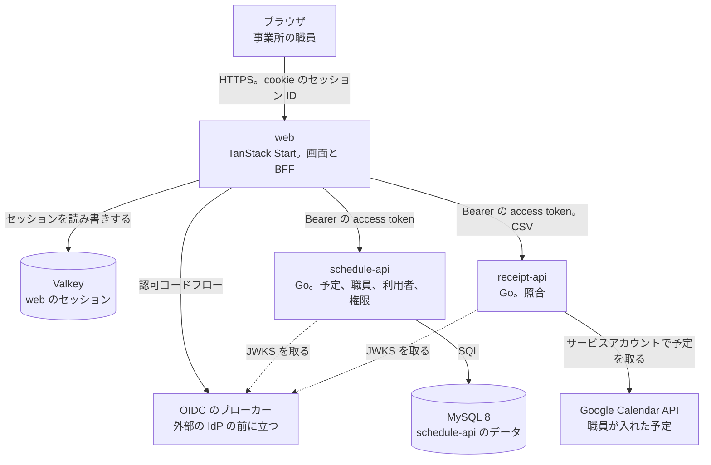

# buddy Design Doc

## Overview

buddy は、訪問看護の事業所の職員が使う、予定の管理とレセプトの照合のアプリである。  
職員はブラウザで web を開き、web が schedule-api と receipt-api を呼ぶ。  
誰のどの課題を解くかと、提供する機能と画面は [PRD](../PRD.md) にある。

## Goals and Non-Goals

### Goals

- 1 つのモノレポに、web、schedule-api、receipt-api を置き、`compose.yml` で全部を手元で動かせる。
- 認証は OIDC のブローカーに任せ、web だけがトークンをサーバー側で持つ。
- 全ての API が、リクエストの事業所とトークンの組織を比べ、ほかの事業所のデータを返さない。
- receipt-api は、照合の予定を予定の CSV か Google カレンダーから取る。

### Non-Goals

- デプロイ先のクラウドとクラスタの構成。インフラは別のリポジトリが持つ。
- 経営数値、勤怠、訪問の順路、住所とエリアの表と API。
- iOS のアプリ向けの API。

## Assumptions and Constraints

- 職員の IdP は事業所の外にあり、buddy は OIDC のブローカーが発行するトークンだけを受ける。
- ブローカーは、事業所を組織として持ち、access token に組織の識別子を入れる。
- 1 つの事業所の職員は 100 人前後で、同時に使う職員は事業所あたり数十人である。
- 日付と時刻は日本の時間（Asia/Tokyo）だけを扱う。
- 電子カルテ（iBow）とは API でつながず、職員が書き出した CSV を受ける。
- 職員は訪問の予定を Google カレンダーに入れている。

## Architecture

作るものが全体として何をするかは、[PRD の Landscape](../PRD.md#landscape) にある。

次の図は、buddy の実行の単位と、その間のデータの流れを示す。



- web だけがブラウザと話し、API はブラウザから直接は呼ばれない。
- receipt-api は、サービスアカウントに閲覧の権限で共有された職員のカレンダーだけを読む。
- receipt-api は DB を持たない。上げた CSV と照合の結果を保存しない。

## Components

### web

- 画面を描き、BFF としてブローカーとのログインとセッションを持つ。
- API を呼ぶときに、セッションの access token を付ける。
- 持たないもの: 業務の規則と認可の判定。画面の出し分けには使うが、拒否するのは API である。

### schedule-api

- 事業所、部署、チーム、役職、権限、職員、利用者、予定を持つ。
- access token の検証、職員の特定、事業所の確認、ポリシーによる認可を行う。
- 繰り返しの予定を、求められた期間の予定に展開して返す。
- 持たないもの: 照合の規則。
- 内部の構成と ER は [予定の管理の Design Doc](features/schedule/DesignDoc.md) にある。

### receipt-api

- 予定と実績の CSV を正規化し、対にし、判定して、4 つの区分の結果を返す。
- 予定は、予定の CSV か Google カレンダーから取る。
- 持たないもの: 予定と職員のデータ。DB。
- 規則は [レセプトの照合の Design Doc](features/receipt-check/DesignDoc.md) にある。

## Interfaces

buddy とインフラの約束は、コンテナのイメージ、環境変数、ヘルスチェック、マイグレーションのコマンドの 4 つである。  
インフラのリポジトリは、この 4 つだけに依存し、buddy の中の構成に依存しない。

### コンテナのイメージ

- アプリごとに 1 つのイメージを作る。web、schedule-api、receipt-api。
- イメージは設定を持たず、全ての設定を環境変数で受ける。
- プロセスは 1 つの HTTP のポートで待ち受け、ポートは環境変数 `PORT` で受ける。

### 環境変数

| 変数 | web | schedule-api | receipt-api | 中身 |
| --- | --- | --- | --- | --- |
| `PORT` | 使う | 使う | 使う | 待ち受けるポート |
| `OIDC_ISSUER` | 使う | 使う | 使う | ブローカーの発行者の URL。JWKS の場所もここから求める |
| `OIDC_AUDIENCE` | 使わない | 使う | 使う | access token の `aud` に求める値 |
| `OIDC_ORG_CLAIM` | 使わない | 使う | 使う | access token で組織の ID を持つクレームの名前。既定は `org_id` |
| `OIDC_CLIENT_ID` | 使う | 使わない | 使わない | web のクライアントの ID |
| `OIDC_CLIENT_SECRET` | 使う | 使わない | 使わない | web のクライアントの秘密の値 |
| `SESSION_STORE_URL` | 使う | 使わない | 使わない | Valkey の接続先 |
| `SESSION_SECRET` | 使う | 使わない | 使わない | cookie の署名の鍵 |
| `SCHEDULE_API_URL` | 使う | 使わない | 使わない | schedule-api の URL |
| `RECEIPT_API_URL` | 使う | 使わない | 使わない | receipt-api の URL |
| `DATABASE_URL` | 使わない | 使う | 使わない | MySQL の接続先 |

秘密の値（`OIDC_CLIENT_SECRET`、`SESSION_SECRET`、`DATABASE_URL`）は、インフラのリポジトリが秘密の情報の置き場から渡す。buddy のリポジトリには置かない。

### ヘルスチェック

- `GET /healthz`: プロセスが応答できれば 200 を返す。依存先を確かめない。
- `GET /readyz`: 依存先に届けば 200、届かなければ 503 を返す。schedule-api は MySQL、web は Valkey を確かめる。
- 2 つとも認証を求めない。
- receipt-api は、今は `GET /health` だけを持つ。`/healthz` と `/readyz` に合わせる作業は残っている。

### マイグレーション

- schedule-api のイメージは、`schedule-api migrate up` でマイグレーションを当てて終わる。
- マイグレーションは golang-migrate の形式で `apps/schedule-api/migrations/` に置く。
- インフラは、新しいイメージを動かす前に、同じイメージで `migrate up` を 1 回動かす。マイグレーションは、前のバージョンのアプリが動いたまま当てられる変更だけにする。

## Cross-Cutting Concerns

### 認証

- web は認可コードフローでログインし、トークンを Valkey のセッションに置く。ブラウザには cookie でセッションの ID だけを渡す。
- API は access token の JWT を JWKS で検証し、署名、`iss`、`aud`、`exp` を確かめる。署名のアルゴリズムは RS256 と ES256 だけを受け付ける。失敗したら 401 を返す。
- 職員は事前にメールアドレスで登録し、初回のログインで `sub` と結び付く。
  - ADR-0001: [認証を OIDC のブローカーと BFF のサーバー側のセッションにする](../adr/0001-auth.md)

### 事業所の分離

- 事業所は、ブローカーの組織に対応する。API のパスは `/v1/facilities/{facility_id}/...` の形で事業所を指す。
- API は、パスの事業所とトークンの組織が違えば 403 を返す。DB の問い合わせは、全て事業所の ID で絞る。

### 認可

- 予定の閲覧と編集は、職員の `user_policies` で決まる。拒否したら 403 を返す。
  - ADR-0002: [権限を役職の既定と職員ごとの上書きで持つ（PBAC）](../adr/0002-pbac.md)

### ログと個人情報

- トークン、cookie、DB の接続先、利用者の名前、CSV の中身をログに出さない。
- テストとシードのデータは架空の値で作る。

### ID と時刻

- 表の主キーは UUID で、MySQL では `BINARY(16)` に置く。
- 日付と時刻は Asia/Tokyo で解釈する。日付は `DATE`、時刻は `TIME` に置く。

## Repository Layout

```text
.
├── apps/
│   ├── web/             # TanStack Start、React、Vite+
│   ├── schedule-api/    # Go、gin、sqlc、golang-migrate
│   │   └── migrations/
│   └── receipt-api/     # Go
├── packages/
│   └── ui/              # デザインシステム。トークン、Base と Case のコンポーネント、Storybook
├── docs/                # Zensical のサイトの元。PRD、Design Doc、ADR
│   ├── PRD.md
│   ├── design/
│   │   ├── DesignDoc.md
│   │   └── features/    # コードがまだない機能の Design Doc
│   └── adr/
├── context/             # 作業の中で参照する規約と事実
├── compose.yml          # 手元で全部を動かす
├── zensical.toml
└── pyproject.toml       # Zensical を uv で入れる
```
