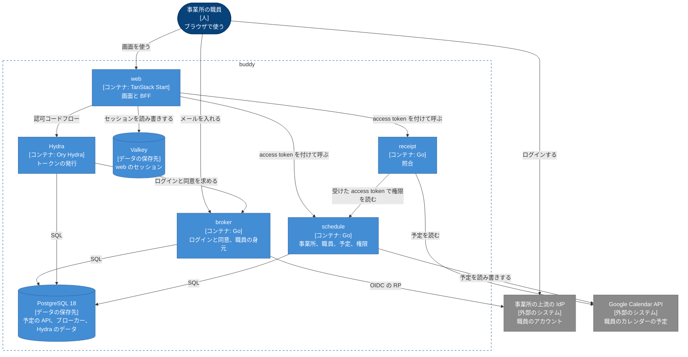

# buddy Design Doc

## Overview

buddy は、訪問看護の事業所の職員が使う、予定の管理とレセプトの照合のアプリである。  
職員はブラウザで web を開き、web が予定の API と照合の API を呼ぶ。  
誰のどの課題を解くかと、提供する機能と画面は [PRD](../PRD.md) にある。  
ドキュメントサイトとカタログのデプロイの構成（`apps/docs-site`）は、[apps/docs-site/README.md](https://github.com/Fukuemon/buddy/blob/develop/apps/docs-site/README.md) にある。

## Goals and Non-Goals

### Goals

- 照合を、予定の管理と別の照合の API に分ける。事業所と職員と予定は、同じ DB を使う予定の API が持つ。
- web と API の間の契約は、API ごとの `openapi.yaml` に置く。
- 認証は OIDC のブローカーに任せ、トークンは web のサーバーの側だけが持つ。
- 事業所のデータは予定の API だけが持ち、ほかの事業所のデータを返さない。

### Non-Goals

- どのコンテナをどの種類の基盤で実行するかと、クラスタの構成。
  - インフラのリポジトリ（非公開）が持ち、buddy は [デプロイの要件](#デプロイの要件) だけを満たす。

## Assumptions and Constraints

- 職員の IdP は事業所ごとに違い、事業所の外にある。buddy は、Hydra が発行するトークンだけを受ける。
- 1 つの事業所の職員は 100 人前後で、同時に使う職員は事業所あたり数十人である。
- 日付と時刻は日本の時間（Asia/Tokyo）だけを扱う。
- 電子カルテ（iBow）とは API でつながず、職員が書き出した CSV を受ける。
- 職員は訪問の予定を Google カレンダーに入れている。

## Architecture

作るものが全体として何をするかは、[PRD の System Context](../PRD.md#system-context) にある。

次の図は、buddy のコンテナと、その間のデータの流れを示す。  
破線の枠が buddy の境界で、灰色は buddy の外のシステムである。



矢印ごとのつなぎ方とトークンと、図に描いていない 4 つの流れ（Hydra の JWKS、Hydra の admin API、ブローカーの内部の API、token_hook）は、[コンテナの間の通信](#コンテナの間の通信) にある。

### 業務の領域とコンテナ

PRD の 3 つの業務の領域は、次のコンテナが持つ。

| 業務の領域 | 持つもの | コンテナ |
| --- | --- | --- |
| 事業所と職員 | 事業所、部署、チーム、役職、権限、職員、利用者 | 予定の API |
| 予定 | 単発の予定、繰り返しの予定、キャンセル、訪問の情報 | 予定の API |
| 照合 | 予定と実績の対の作り方、判定の規則 | 照合の API |

- 事業所と職員と予定は、同じ PostgreSQL のデータベースを使い、予定の API の中でパッケージを分ける。
  - パッケージの構成は [予定の管理の Design Doc](https://github.com/Fukuemon/buddy/blob/develop/services/schedule/DesignDoc.md) にある。
- 用語と、業務の領域ごとの呼び方の違いは [業務の知識](https://github.com/Fukuemon/buddy/blob/develop/context/domain.md) にある。

## Components

### web

- 画面を描き、BFF として、Hydra との認可コードフローと、web のセッションを持つ。
- API を呼ぶときに、セッションの access token を付ける。
- 持たないもの: 業務の規則と認可の判定。
  - web は職員の権限を画面の出し分けに使うが、リクエストを拒否するのは API である。

### ID ブローカーと Hydra

- Hydra は、認可コード、トークンの発行、JWKS、refresh token のローテーションを持つ。web と 2 つの API から見える Issuer は Hydra だけである。
- ブローカーは、Hydra の login and consent app として、ログインと同意の画面を持つ。
- ブローカーは、職員の ID、メール、所属の事業所、有効か休職か退職か、上流のアカウントを持つ。access token の `sub` は職員の ID で、予定の API の `users.sub` に入る。
- 持たないもの: 職員の名前、役職、権限。予定の API が持つ。
  - ADR-0016: [OIDC のブローカーを、Ory Hydra と、自作の login and consent app で作る](../adr/0016-id-broker-hydra.md)
  - ADR-0017: [職員の身元をブローカーが持ち、権限と業務のデータは予定の API が持つ](../adr/0017-identity-boundary.md)
- 内部の構成と流れは [ID ブローカーの Design Doc](https://github.com/Fukuemon/buddy/blob/develop/services/broker/DesignDoc.md) にある。

### 予定の API

- 事業所、部署、チーム、役職、権限、職員、利用者、予定を持つ。
- access token の検証、職員の特定、事業所の確認、職員の権限による予定の閲覧と編集の判定を行う。
- 職員に結び付けた Google カレンダーの予定を、期間を選んで予定に取り込む（ADR-0009 の段階 1）。
- buddy の予定を、職員に結び付けた Google カレンダーに書き出す（段階 2）。Google カレンダーで変わった予定を読み、buddy の予定に当てる（段階 3）。
- 持たないもの: 照合の規則。
- 内部の構成と ER は [予定の管理の Design Doc](https://github.com/Fukuemon/buddy/blob/develop/services/schedule/DesignDoc.md) にある。

### 照合の API

- 予定と実績の CSV を正規化し、対にし、判定して、4 つの区分の結果を返す。
- 予定は、予定の CSV か Google カレンダーから取る。
- access token を検証するが、職員の特定と事業所の確認はしない。
- 照合の前に、受けた access token で予定の API の `GET /v1/me` を呼び、照合の権限を確認する。予定の API が止まっていると、照合できない。
  - Google カレンダーから予定を取るときだけ、トークンの組織に結び付けたカレンダーを読む。規則は [事業所の分離](#事業所の分離) にある。
- 持たないもの: 予定と職員のデータ、DB。上げた CSV と照合の結果を保存しない。
- 規則は [レセプトの照合の Design Doc](https://github.com/Fukuemon/buddy/blob/develop/services/receipt/DesignDoc.md) にある。

## Interfaces

### コンテナの間の通信

アプリの間は HTTP だけでつながり、コードで依存しない。

コンテナの組ごとの、つなぎ方とトークンは次のとおり。

| 呼ぶ側 | 呼ばれる側 | つなぎ方とトークン | 詳しい文書 |
| --- | --- | --- | --- |
| ブラウザ | web | HTTPS でつなぐ | - |
| ブラウザ | Hydra とブローカー | ログインとログアウトのリダイレクトの流れ | ID ブローカーの Design Doc の [ログイン](https://github.com/Fukuemon/buddy/blob/develop/services/broker/DesignDoc.md#ログイン) と [ログアウト](https://github.com/Fukuemon/buddy/blob/develop/services/broker/DesignDoc.md#ログアウト) |
| web | Hydra | 認可コードフローでトークンを取得し、更新する。トークンは Valkey のセッションに置く | - |
| ブローカー | Hydra | ブローカーが Hydra の admin API でログインと同意を accept か reject し、ログアウトを accept する。同意の accept で、access token の `aud`（`schedule`、`receipt`）と `org_id` を決める | - |
| ブローカー | 上流の IdP | 認可コードフローで ID token を取り、署名、`iss`、`aud`、`nonce` を確認する | - |
| 予定の API | ブローカー | 職員の登録、休職、復職、退職で、予定の API が職員の管理の権限を確認してから、ブローカーの内部の API を呼ぶ。予定の API は、Hydra の client credentials で `aud` が `broker` の access token を取って付ける | ブローカーが内部の API で受けるトークンは、[ID ブローカーの Design Doc の職員の登録、休職、復職、退職](https://github.com/Fukuemon/buddy/blob/develop/services/broker/DesignDoc.md#職員の登録休職復職退職) にある |
| Hydra | ブローカー | Hydra は、トークンを発行するたびに `oauth2.token_hook` でブローカーを呼ぶ | トークンを出さない条件は、[ID ブローカーの Design Doc のトークンの発行の確認](https://github.com/Fukuemon/buddy/blob/develop/services/broker/DesignDoc.md#トークンの発行の確認) にある |
| web | 予定の API、照合の API | `Authorization` に access token を Bearer で付ける | 契約の正本は [予定の API の openapi.yaml](https://github.com/Fukuemon/buddy/blob/develop/services/schedule/openapi.yaml) と [照合の API の openapi.yaml](https://github.com/Fukuemon/buddy/blob/develop/services/receipt/openapi.yaml) である |
| 照合の API | 予定の API | 照合の API が、web から受けた access token をそのまま Bearer で付けて、予定の API の `GET /v1/me` を呼ぶ | ADR-0022: [照合を照合の権限で許し、事務の役職を足し、訪問しない職員を予定と担当から外す](../adr/0022-receipt-check-policy-and-non-visiting-staff.md) |
| 予定の API、照合の API | Hydra | Issuer の discovery と JWKS を読み、access token を検証する。検証に失敗したら 401 を返す | - |
| 照合の API、予定の API | Google Calendar API | 事業所ごとのサービスアカウントになりすまして得たトークンで、そのアカウントに共有されたカレンダーの予定を読み書きする。サービスアカウントのキーは使わない | ADR-0012: [Google カレンダーのサービスアカウントを事業所ごとに分け、buddy は IAM の権限借用で切り替える](../adr/0012-google-calendar-facility-service-accounts.md) |
| 予定の API | PostgreSQL | 予定の API だけが読み書きする | - |

ブラウザと web の間の cookie には、セッションの ID を入れ、トークンは入れない。  
画面の操作は、web のサーバーの関数（BFF）を呼ぶ。  
API はブラウザから直接は呼ばれない。  
例外は、開発者がローカルでドキュメントサイトの API の仕様のページから、ローカルの API を試すときだけである。

web のセッションは、トークンと ID token のほかに、ログインのときに予定の API の `GET /v1/me` で引いた職員の ID、名前、事業所、職員の管理の権限と照合の権限の有無を 12 時間持つ。  
画面を読み込むときは、職員の値を `GET /v1/me` で読み直して画面に渡す。  
名前や権限を変えたら、画面を読み込み直すと出し分けに写る。  
`GET /v1/me` が失敗したときは、セッションの値を渡す。  
リクエストを拒否するのは API なので、拒否の判定は変わった値で行われる。

web と予定の API、照合の API の契約を変えるときの互換の規則は ADR-0003 にある。

- ADR-0003: [git flow でマージし、アプリごとのバージョンでリリースする](../adr/0003-branch-and-release.md)

照合の API は、予定の API が返した権限に照合（`receipt.check`）が無ければ、403 を返す。  
access token の `aud` に `schedule` と `receipt` の両方が入るので、同じトークンで 2 つの API を呼べる。

照合の API と予定の API が Google Calendar API を呼ぶときの事業所は、リクエストの職員かトークンの組織から決める。  
リクエストを受けない書き出しと増分の取得は、結び付けたカレンダーのレコードの事業所で決める。

### デプロイの要件

buddy がデプロイのために満たす要件は、コンテナのイメージ、環境変数、ヘルスチェック、マイグレーションのコマンドの 4 つである。  
インフラのリポジトリは、この 4 つだけに依存し、buddy の中の構成に依存しない。

#### コンテナのイメージ

- イメージは、web、予定の API、照合の API、ブローカーのアプリごとに 1 つ作る。Hydra は Ory の公開のイメージを使う。
- ブローカーのイメージは、ヘルスチェックのための `broker healthcheck` のサブコマンドを持つ。ブローカーの環境変数は [ブローカーの README](https://github.com/Fukuemon/buddy/blob/develop/services/broker/README.md#configuration) にある。
- API のイメージは、ヘルスチェックのための `api healthcheck` のサブコマンドを持つ。
- イメージは設定を持たず、全ての設定を環境変数で受ける。
- プロセスは 1 つの HTTP のポートで待ち受け、ポートは環境変数 `PORT` で受ける。

#### 環境変数

| 変数 | web | 予定の API | 照合の API | 中身 |
| --- | --- | --- | --- | --- |
| `PORT` | 使う | 任意 | 任意 | 待ち受けるポート。API のデフォルトは `8080`。web のイメージは `3000` を入れる |
| `LOG_LEVEL` | 使わない | 任意 | 任意 | ログの段階。デフォルトは `info` |
| `OIDC_ISSUER` | 使う | 使う | 使う | Hydra の Issuer の URL。JWKS の場所もここから求める |
| `OIDC_AUDIENCE` | 使わない | 使う | 使う | access token の `aud` に求める値 |
| `OIDC_ORG_CLAIM` | 使わない | 任意 | 任意 | access token で組織の ID を持つクレームの名前。デフォルトは `org_id` |
| `OIDC_CLIENT_ID` | 使う | 使わない | 使わない | web のクライアントの ID |
| `OIDC_CLIENT_SECRET` | 使う | 使わない | 使わない | web のクライアントのシークレット |
| `OIDC_AUTHORIZATION_ENDPOINT` | 任意 | 使わない | 使わない | ブラウザをリダイレクトする認可の URL |
| `OIDC_END_SESSION_ENDPOINT` | 任意 | 使わない | 使わない | ログアウトでブラウザをリダイレクトする RP-Initiated Logout の URL |
| `SESSION_STORE_URL` | 使う | 使わない | 使わない | Valkey の接続先 |
| `SESSION_SECRET` | 使う | 使わない | 使わない | cookie の署名の鍵。32 バイト以上 |
| `SESSION_COOKIE_SECURE` | 任意 | 使わない | 使わない | `false` のときだけ、セッションの cookie に Secure を付けない。https でないローカル環境で使う |
| `SCHEDULE_URL` | 使う | 使わない | 使う | 予定の API の URL。照合の API は、照合の権限を確認するために `GET /v1/me` を呼ぶ |
| `RECEIPT_URL` | 使う | 使わない | 使わない | 照合の API の URL |
| `DB_HOST`、`DB_PORT` | 使わない | 任意 | 使わない | PostgreSQL のホストとポート。デフォルトは `localhost` と `5432` |
| `DB_USER`、`DB_PASSWORD`、`DB_NAME` | 使わない | 使う | 使わない | PostgreSQL の利用者、パスワード、データベースの名前 |
| `CORS_ALLOW_ORIGINS` | 使わない | 任意 | 任意 | CORS を許すオリジン。カンマで区切る。空なら CORS のヘッダーを返さない |
| `MAX_UPLOAD_BYTES` | 使わない | 使わない | 任意 | 照合のリクエストの本文の上限。デフォルトは 10 MiB |
| `GOOGLE_CALENDARS_FILE` | 使わない | 使わない | 任意 | 職員とカレンダーと組織の対応の JSON。空なら Google カレンダーから予定を取らない |
| `GOOGLE_CALENDAR_SERVICE_ACCOUNTS_FILE` | 使わない | 任意 | 任意 | 組織の ID と、その事業所の職員がカレンダーを共有するサービスアカウントの対応の JSON。2 つの API で同じ形 |
| `GOOGLE_CALENDAR_ENDPOINT` | 使わない | 任意 | 任意 | Calendar API の代わりに呼ぶ URL。ローカル環境の calendarpit に向けるときだけ渡す |
| `GOOGLE_CALENDAR_EXPORT_ENABLED` | 使わない | 任意 | 使わない | `true` なら予定を Google カレンダーに書き出す。デフォルトは `false` |
| `GOOGLE_CALENDAR_EXPORT_INTERVAL` | 使わない | 任意 | 使わない | 予定の書き出しの待ちを確認する間隔。デフォルトは 30 秒 |
| `GOOGLE_CALENDAR_SYNC_ENABLED` | 使わない | 任意 | 使わない | `true` なら Google カレンダーの変更を buddy の予定に当てる。デフォルトは `false`。`GOOGLE_CALENDAR_EXPORT_ENABLED` を `true` にして渡す |
| `GOOGLE_CALENDAR_SYNC_INTERVAL` | 使わない | 任意 | 使わない | Google カレンダーの変わった予定を読む間隔。デフォルトは 2 分 |

`OIDC_AUTHORIZATION_ENDPOINT` は、web とブラウザから届く IdP の URL が違うローカル環境だけで渡す。  
`OIDC_END_SESSION_ENDPOINT` は、ブラウザが Issuer の URL に届かないときに渡す。  
Hydra は discovery の `end_session_endpoint` を Issuer の URL から作るためである。

予定の API では、`GOOGLE_CALENDAR_SERVICE_ACCOUNTS_FILE` が空なら、カレンダーを読む操作は 503 を返し、予定を Google カレンダーに書き出さない。  
照合の API では、`GOOGLE_CALENDAR_SERVICE_ACCOUNTS_FILE` を `GOOGLE_CALENDARS_FILE` と一緒に渡す。

`GOOGLE_CALENDAR_ENDPOINT` を渡したときは、`GOOGLE_APPLICATION_CREDENTIALS` を渡したときだけ、その認証情報をなりすまさずに全ての事業所で使う。  
`GOOGLE_CALENDAR_ENDPOINT` を渡し、`GOOGLE_APPLICATION_CREDENTIALS` を渡さなければ、認証をしない。  
予定の API では、`GOOGLE_CALENDAR_ENDPOINT` を `GOOGLE_CALENDAR_SERVICE_ACCOUNTS_FILE` と一緒に渡す。

サービスアカウントが「予定の変更」の共有だけで書けるかを確認するまで、本番では `GOOGLE_CALENDAR_EXPORT_ENABLED` を `false` にする（ADR-0012 の承認の条件）。

- web の `VITE_API_MODE` は、イメージのビルドのときに埋め込む値で、実行のときには読まない。イメージは `bff` でビルドする。
- 照合の API と予定の API は、Google の認証情報を Application Default Credentials（`GOOGLE_APPLICATION_CREDENTIALS` など）で読む。  
  読んだ認証情報で、事業所のサービスアカウントになりすます。  
  `GOOGLE_CALENDAR_SERVICE_ACCOUNTS_FILE` があるときだけ読み、読めなければ起動しない。
- Application Default Credentials で認証する主体に付けるロールと、有効にする API は、[基盤と運用の Adding a Facility](https://github.com/Fukuemon/buddy/blob/develop/context/operations.md#adding-a-facility) にある。
- 予定の API は、同じプロセスの中で予定の書き出しの処理を実行する。複数のレプリカで実行しても、同じ書き出しの待ちは 1 つのレプリカだけが書く。

シークレットと、その渡し方は、[基盤と運用の Secrets](https://github.com/Fukuemon/buddy/blob/develop/context/operations.md#secrets) にある。

#### ヘルスチェック

- `GET /healthz`: プロセスが動いていれば 200 を返す。依存先を確認しない。
- `GET /readyz`: 依存先に届けば 200、届かなければ 503 を返す。予定の API は PostgreSQL、web は Valkey を確認する。
  - 照合の API は起動のときに Hydra の discovery を読み、読めなければ起動しない。起動した後は依存先を確認せず、プロセスが動いていれば 200 を返す。
- 2 つとも認証を求めない。

#### マイグレーション

- 予定の API のイメージは、`api` と `migrate` の 2 つのバイナリを持ち、エントリポイントは `api` である。
  - マイグレーションは、エントリポイントを `/usr/local/bin/migrate` にして `up` を渡すと適用して終わる。
- インフラは、新しいイメージを起動する前に、同じイメージで `migrate up` を 1 回実行する。マイグレーションは、前のバージョンのアプリが動いたまま適用できる変更だけにする。
- ブローカーのイメージも、`broker` と `migrate` の 2 つのバイナリを持ち、同じ手順でマイグレーションを適用する。
- Hydra のマイグレーションは、Hydra のイメージの `migrate sql up` で適用する。

## Cross-Cutting Concerns

### 認証

- 職員のログインは、web の BFF と Hydra の認可コードフローで行い、トークンはブラウザに渡さない。上流の IdP で職員が誰かを確認するのは、ブローカーである。
  - ADR-0001: [認証を OIDC のブローカーと BFF のサーバー側のセッションにする](../adr/0001-auth.md)
- 2 つの API は、access token の検証を同じ規則で行う。確認する項目は、各 API の Design Doc にある。
- 職員とログインのアカウントの結び付け方は、[職員とログイン](https://github.com/Fukuemon/buddy/blob/develop/context/domain/staff-login.md) にある。

### 事業所の分離

- 事業所は、ブローカーの組織に対応する。ブローカーは、職員の事業所の組織の ID を access token の `org_id` に入れる。
- 予定の API は、リクエストが指す事業所がトークンの組織の事業所と違えば、403 を返す。
  - 拒否する規則は [事業所の分離](https://github.com/Fukuemon/buddy/blob/develop/context/domain/facility.md) に、パスの形は [予定の管理の Design Doc の Interface](https://github.com/Fukuemon/buddy/blob/develop/services/schedule/DesignDoc.md#interface) にある。
- 照合の API は、カレンダーに組織を結び付け、トークンの組織のカレンダーだけを読む。予定の CSV での照合は、組織を問わない。

### 認可

- 予定の閲覧と編集は、職員の権限で予定の API が判定する。職員が見てはいけない予定は一覧から除き、1 件を指す操作には 403 を返す。
  - 規則は [権限の Design Doc の予定の認可](https://github.com/Fukuemon/buddy/blob/develop/services/schedule/internal/access/DesignDoc.md#予定の認可) にある。
  - ADR-0002: [権限を役職のデフォルトと職員ごとの上書きで持つ（PBAC）](../adr/0002-pbac.md)
- 照合は、照合の権限を持つ職員だけに照合の API が許す。照合の API は権限を持たず、照合のたびに予定の API の `GET /v1/me` で読む。
  - 確認の仕方は [権限の Design Doc の照合の API の権限の確認](https://github.com/Fukuemon/buddy/blob/develop/services/schedule/internal/access/DesignDoc.md#照合の-api-の権限の確認) にある。
  - web は、同じ権限で、ナビゲーションの照合と照合の画面を出し分ける。拒むのは照合の API である。

### ログと個人情報

- ログに出さない値は、[基盤と運用の Health and Monitoring](https://github.com/Fukuemon/buddy/blob/develop/context/operations.md#health-and-monitoring) にある。
- テストとシードのデータの規則は、[テストの Mocking and Test Data](https://github.com/Fukuemon/buddy/blob/develop/context/testing.md#mocking-and-test-data) にある。

## Repository Layout

```text
.
├── apps/
│   ├── web/             # 画面と BFF
│   └── docs-site/       # ドキュメントサイトとカタログを公開する Cloudflare Worker
├── services/
│   ├── schedule/        # 予定の API
│   │   ├── DesignDoc.md # 予定の管理の Design Doc
│   │   └── db/          # マイグレーション、クエリ、シード
│   ├── receipt/         # 照合の API
│   │   ├── DesignDoc.md # レセプトの照合の Design Doc
│   │   └── tools/       # 元の照合のアプリと結果を比べるスクリプト
│   └── broker/          # ID ブローカー
│       ├── DesignDoc.md # ID ブローカーの Design Doc
│       └── db/          # マイグレーションとシード
├── packages/
│   ├── ui/              # デザインシステム。トークン、Base と Case のコンポーネント、Storybook
│   │   └── DESIGN.md    # デザインシステムの設計
│   ├── e2e/             # E2E のテストと、手動検証のエビデンスを撮る spec
│   │   └── DesignDoc.md # E2E のテストのコードの設計
│   └── go/              # 2 つの API が共有する Go の module
├── docs/                # サイトの元。PRD、Design Doc、ADR、画面仕様書、API の仕様、DB の設計
│   ├── PRD.md
│   ├── design/
│   │   ├── DesignDoc.md
│   │   ├── services/    # services/ の Design Doc へのシンボリックリンク
│   │   └── packages/    # packages/ の Design Doc へのシンボリックリンク
│   ├── adr/
│   ├── screens/         # 画面仕様書とモック
│   ├── api/             # 各 API の openapi.yaml へのシンボリックリンクと、それを描くページ
│   └── db/              # 予定の API のマイグレーションから tbls で生成するテーブルの一覧と ER 図
├── context/             # 作業の中で参照する規約と事実
├── scripts/             # 生成物と画面仕様書のチェック、サイトのビルド
├── compose.yml          # ローカル環境で全体を起動する
├── compose/             # Hydra とブローカーの設定、calendarpit の fixture と同意のスクリプト、サービスアカウントの対応のダミー
├── zensical.toml
└── pyproject.toml
```
