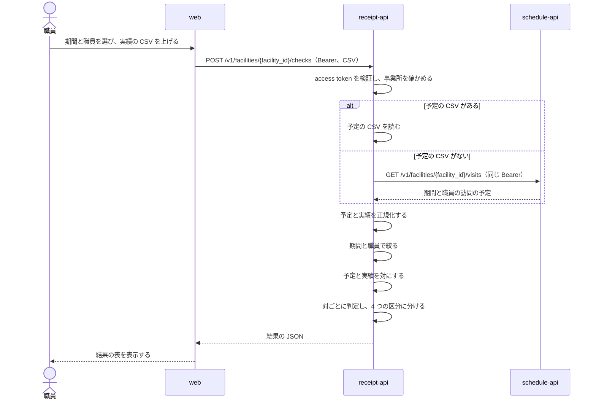

# レセプトの照合

## Overview

receipt-api は、訪問の予定と電子カルテ（iBow）の実績を比べ、食い違いを 4 つの区分に分けて返す。  
全体の中での責務と依存は [buddy Design Doc](../../DesignDoc.md) にある。

## Scope

持つもの

- 実績の CSV と予定の CSV の読み込み
- schedule-api からの予定の取得
- 正規化、予定と実績の対の作り方、判定、結果の並べ方
- 結果の JSON と CSV の書き出し

持たないもの

- 予定と職員のデータ。schedule-api が持つ
- 上げた CSV と結果の保存
- 電子カルテへの書き戻し

## Design

### 処理の流れ

次の図は、職員が実績の CSV を上げてから結果を受け取るまでの流れを示す。

予定の取得元は、予定の CSV と schedule-api の 2 つを同じインターフェイスで差し替える。  
予定の CSV は、予定の管理へ移る途中だけ受ける。

### 入力の CSV

実績の CSV は、電子カルテが書き出した CSV をそのまま受ける。

- 文字コードは UTF-8（BOM の有無を問わない）と CP932 を受ける。
- 1 行目を列名として読み、次の列だけを使う。ほかの列は読み捨てる。
- 次の列のどれかがないときは、400 を返し、足りない列の名前を示す。

| 列 | 実績の CSV | 予定の CSV | 値の例 |
| --- | --- | --- | --- |
| 訪問日 | 必須 | 必須 | 2026/10/01、2026-10-01 |
| 利用者名 | 必須 | 必須 | 架空 太郎 |
| 主訪問者 | 必須 | 必須 | 架空 花子 |
| 開始時間 | 必須 | 必須 | 9:00、09:00 |
| 終了時間 | 必須 | 必須 | 09:30 |
| 提供時間 | 必須 | 必須 | 30（分） |
| サービス内容 | 必須 | 必須 | 訪看Ⅰ3 |
| 加算①から加算⑤ | 必須 | 使わない | 通常 |

- 実績の加算は、加算①から加算⑤のうち空でない値を「, 」でつないだ 1 つの値にする。

schedule-api から取るときは、訪問の予定の値を次のように対応させる。

- 訪問日は `schedules.visit_date`、開始時間と終了時間は `start_time` と `end_time`
- 利用者名は利用者の `name`、主訪問者は `visit_infos.assigned_user_id` の職員の `name`
- 提供時間は `visit_infos.service_time`、サービス内容はサービスコードの `code`

### 正規化

予定と実績の両方に、次の順で当てる。

1. 開始時間と終了時間を `HH:MM` にそろえる（例: 9:00 は 09:00）。
2. 主訪問者、利用者名、サービス内容の全角の空白を半角の空白にする。
3. サービス内容の「Ⅰ」「１」「1」を「I」にし、半角の「･」を全角の「・」にし、残りの半角の数字を全角にする（例: 訪看Ⅰ3 は 訪看I３）。
4. 訪問日を日付にする。
5. 利用者名の空白を全て除く。主訪問者の空白は残す。

予定だけに、次を当てる。

- サービス内容が訪看I２から I４ の系統（下の許容範囲の表の 20〜29、30〜59、60〜89 の行）のとき、終了時間と提供時間を 1 分減らす。予定を 30 分の枠で入れると、許容範囲の上限を 1 分超えるためである。

正規化の後に、選んだ期間と職員で予定と実績の両方を絞る。実績を絞らないと、選ばなかった職員の実績が全て実績のみに入るためである。

### 対の作り方

予定と実績を、訪問日、利用者名、主訪問者の 3 つが同じものどうしで対にする。

- 3 つが同じ予定と実績が 1 件ずつなら、その 2 件を対にする。
- 同じ利用者を同じ職員が 1 日に 2 回以上訪問すると、3 つが同じ予定と実績が複数になる。このときは、開始時間が最も近いものどうしを対にする。
  1. 同じ 3 つを持つ予定と実績の全ての組について、開始時間の差の絶対値を求める。
  2. 差が最も小さい組を対にし、その予定と実績を候補から除く。差が同じ組が複数あれば、予定の開始時間が早い組を先にし、それも同じなら実績の開始時間が早い組を先にする。
  3. 予定か実績のどちらかがなくなるまで 2 を繰り返す。
- 対にならなかった予定は予定のみに、対にならなかった実績は実績のみに入れる。

開始時間が最も近いものどうしを対にする理由は、同じ日の 2 回の訪問は、開始時間が数時間離れるのが普通で、近いものどうしが同じ訪問を指すためである。  
3 つのキーで全ての組を作る結合では、2 回の訪問が 4 行になり、存在しない食い違いが出る。

### 判定

対になった予定と実績ごとに、次の項目を確かめる。

| 項目 | 規則に合う条件 |
| --- | --- |
| 開始時間 | 予定と実績が同じ |
| サービス内容 | 予定と実績が同じ。または、予定が「医」で、実績が「基本療養費」か「難病等複数回訪問」を含む |
| 提供時間（予定） | 予定の提供時間が、予定のサービス内容の許容範囲に入る |
| 提供時間（実績） | 実績の提供時間が、実績のサービス内容の許容範囲に入る |
| 終了時間（予定） | 予定の終了時間から開始時間を引いた分が、予定のサービス内容の許容範囲に入る |
| 終了時間（実績） | 実績の終了時間から開始時間を引いた分が、実績のサービス内容の許容範囲に入る |
| 加算 | 実績の加算が「通常」 |

- 1 つでも規則に合わない項目があれば不整合、全て合えば整合にする。
- 予定と実績の提供時間の値、終了時間の値が同じかどうかは、区分を決めない。両方が許容範囲に入るが値が違うときは、整合のまま注意の印を付ける。
- サービス内容が許容範囲の表にないときは、提供時間と終了時間の項目を規則に合わないとし、許容範囲を空にする。

### サービスごとの許容範囲

サービス内容を、次の順で許容範囲の表の行に当てる。

1. 「基本療養費」を含むなら、基本療養費の行
2. 「難病等複数回訪問」を含むなら、難病等複数回訪問加算(２回) の行
3. ほかは、正規化した後のサービス内容と同じ名前の行

| サービス内容（正規化の後） | 下限（分） | 上限（分） |
| --- | --- | --- |
| 訪看I２、予防看I２、予訪看I２、予防訪看I２ | 20 | 29 |
| 訪看I３、予防看I３、予訪看I３、予防訪看I３ | 30 | 59 |
| 訪看I４、予防看I４、予訪看I４、予防訪看I４ | 60 | 89 |
| 訪看I５、予防看I５、予訪看I５、予防訪看I５ | 21 | 40 |
| 訪看I５・２超、訪看I５２超、予防看I５・２超、予訪看I５・２超、予防訪看I５２超 | 41 | 60 |
| 基本療養費 | 30 | 90 |
| 医 | 30 | 90 |
| 難病等複数回訪問加算(２回) | 30 | 90 |

下限と上限は、両端を含む。

### 出力

- 結果は、不整合、予定のみ、実績のみ、整合の順に並べる。区分の中は、訪問日、予定の開始時間（なければ実績の開始時間）の順に並べる。
- 結果の 1 行は、区分と、次の列を持つ。
  - 訪問日、利用者名、主訪問者
  - 予定のサービス内容、開始時間、終了時間、提供時間
  - 実績のサービス内容、開始時間、終了時間、提供時間
  - 加算
- JSON では、値ごとに判定（一致、不一致、注意）と、許容範囲（例: 20〜29）を持たせる。画面は判定を色と印で示す。
- CSV では、値の後ろに印を付ける。不一致は「 ×」、注意は「 ※」で、許容範囲があれば「(20~29)」を続ける。値がない欄は「データなし」にする。
- CSV の文字コードは BOM つきの UTF-8 にする。表計算のソフトで開いたときに文字化けしないためである。

## Interface

- `POST /v1/facilities/{facility_id}/checks`
  - `multipart/form-data` で、`actual`（実績の CSV、必須）、`planned`（予定の CSV、任意）、`from` と `to`（期間、必須）、`user_ids`（職員、任意。省くと全ての職員）を受ける。
  - `Accept: application/json` なら結果の JSON を、`Accept: text/csv` なら結果の CSV を返す。
  - CSV の列が足りないときと、文字コードが読めないときは 400 を返す。
- 環境変数とヘルスチェックは [buddy Design Doc の Interfaces](../../DesignDoc.md#interfaces) にある。
