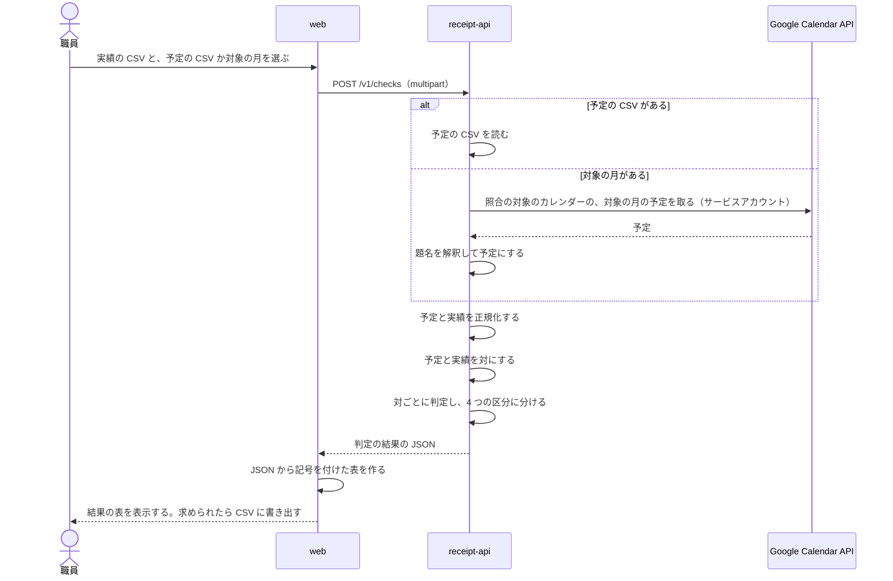

# レセプトの照合

## Overview

receipt-api は、訪問の予定と電子カルテ（iBow）の実績を比べ、食い違いを 4 つの区分に分けて JSON で返す。  
全体の中での責務と依存は [buddy Design Doc](../../DesignDoc.md) にある。  
実装の置き場と、元の Python から変えた点は `apps/receipt-api/DesignDoc.md` にある。

## Scope

持つもの

- 実績の CSV と予定の CSV の読み込み
- Google カレンダーからの予定の取得
- 正規化、予定と実績の対の作り方、判定、結果の並べ方
- 判定の結果の JSON

持たないもの

- 予定と職員のデータ。予定は職員が Google カレンダーに入れる
- 結果の記号、区分の区切りの行、結果の CSV の書き出し。画面（apps/web）が JSON から作る
- 上げた CSV と結果の保存
- 電子カルテへの書き戻し

## Design

### 処理の流れ

次の図は、職員が実績の CSV を上げてから結果の表を見るまでの流れを示す。

予定の取得元は、予定の CSV と Google カレンダーの 2 つを、同じインターフェイス（`ScheduleSource`）で差し替える。

### 予定の取得元: Google カレンダー

Google カレンダーは、今も職員が予定を入れる場所なので、照合の予定の取得元として残す。  
receipt-api は、Google Calendar API を直接呼ぶ。GAS は使わない。GAS の Web アプリは匿名で呼べる設定で公開され、利用者名を含む予定を返していたためである。

- 認証はサービスアカウントで、Application Default Credentials で読む。手元では鍵のファイル、クラスタでは Workload Identity Federation を使う。
- ドメイン全体の委任は使わない。職員のカレンダーを、サービスアカウントに閲覧の権限で共有する。サービスアカウントが読めるカレンダーを、照合に使うものだけに絞るためである。
- 照合の対象のカレンダーは、receipt-api の設定で受ける。

カレンダーの予定は、次の規則で照合の予定にする。

- 期間は、対象の月の 1 日から月末まで。
- 繰り返しの予定は、1 回ずつに展開する。
- 終日の予定と、取り消された予定は除く。
- 題名が `【サービス内容】利用者名` の形の予定だけを選ぶ。ほかの題名の予定は除く。
  - 例: `【訪看I３】架空太郎` は、サービス内容が 訪看I３、利用者名が 架空太郎
- 主訪問者は、カレンダーの表示名にする。表示名は、電子カルテの職員名と同じ表記にしておく。
- 訪問日は予定の開始の日付、開始時間と終了時間は予定の開始と終了の時刻にする。
- 提供時間は、終了時間から開始時間を引いた分にする。

### 予定の取得元: 予定の CSV

予定の CSV は、Google カレンダーを使わずに照合するときと、テストのときに使う。列は次の入力の CSV の表にある。

### 入力の CSV

実績の CSV は、電子カルテが書き出した CSV をそのまま受ける。

- 文字コードは UTF-8（BOM の有無を問わない）と CP932 を受ける。
- 1 行目を列名として読み、次の列だけを使う。ほかの列は読み捨てる。
- 次の列のどれかがないときは、入力の誤りとして、足りない列の名前を返す。

| 列 | 実績の CSV | 予定の CSV | 値の例 |
| --- | --- | --- | --- |
| 訪問日 | 必須 | 必須 | 2026/10/1、2026-10-01 |
| 利用者名 | 必須 | 必須 | 架空 太郎 |
| 主訪問者 | 必須 | 必須 | 架空 花子 |
| 開始時間 | 必須 | 必須 | 9:00、09:00 |
| 終了時間 | 必須 | 必須 | 09:30 |
| 提供時間 | 必須 | 必須 | 30（分） |
| サービス内容 | 必須 | 必須 | 訪看Ⅰ3 |
| 加算①から加算⑤ | 必須 | 使わない | 通常 |

- 訪問日は `2026/10/1` と `2026-10-01` の形だけを読む。後ろに空白で区切った時刻があれば無視する。
- 実績の加算は、加算①から加算⑤のうち空でない値を「, 」でつないだ 1 つの値にする。
- 照合に使う列が全て空の行は読み飛ばす。
- 次の行は照合に混ぜず、入力の誤りとして行番号つきで返す。
  - 訪問日、利用者名、主訪問者、サービス内容のどれかが空の行
  - 訪問日、開始時間、終了時間、提供時間が読めない行
  - 終了時間が開始時間より前の行。日付をまたぐ訪問は扱わない
- 入力の誤りは、実績と予定の両方の行を集めてから、まとめて返す。

### 正規化

予定と実績の両方に、次の順で当てる。

1. 開始時間と終了時間を `HH:MM` にそろえる（例: 9:00 は 09:00）。
2. 主訪問者、利用者名、サービス内容の全角の空白を半角の空白にする。
3. サービス内容の「Ⅰ」「１」「1」を「I」にし、半角の「･」を全角の「・」にし、残りの半角の数字を全角にする（例: 訪看Ⅰ3 は 訪看I３）。
4. 訪問日を日付にする。
5. 利用者名の空白を全て除く。主訪問者の空白は残す。

予定だけに、次を当てる。

- サービス内容が訪看I２から I４ の系統（下の許容範囲の表の 20〜29、30〜59、60〜89 の行）のとき、終了時間と提供時間を 1 分減らす。元の規則のままにした。理由はコードから読み取れない（未確認）。

### 対の作り方

予定と実績を、訪問日、利用者名、主訪問者の 3 つが同じものどうしで対にする。

- 3 つが同じ予定と実績が 1 件ずつなら、その 2 件を対にする。
- 同じ利用者を同じ職員が 1 日に 2 回以上訪問すると、3 つが同じ予定と実績が複数になる。このときは、開始時間が最も近いものどうしを対にする。
  1. 同じ 3 つを持つ予定と実績の全ての組について、開始時間の差の絶対値を求める。
  2. 差が最も小さい組を対にし、その予定と実績を候補から除く。差が同じ組が複数あれば、予定の開始時間が早い組を先にし、それも同じなら実績の開始時間が早い組を先にする。
  3. 予定か実績のどちらかがなくなるまで 2 を繰り返す。
- 対にならなかった予定は予定のみに、対にならなかった実績は実績のみに入れる。

開始時間が最も近いものどうしを対にする理由は、同じ日の 2 回の訪問は、開始時間が数時間離れるのが普通で、近いものどうしが同じ訪問を指すためである。  
3 つのキーで全ての組を作る結合では、2 回の訪問が 4 行になり、存在しない食い違いが出る。

### 判定

対になった予定と実績ごとに、次の項目を確かめる。

| 項目 | 規則に合う条件 |
| --- | --- |
| 開始時間 | 予定と実績が同じ |
| サービス内容 | 予定と実績が同じ。または、予定が「医」で、実績が「基本療養費」か「難病等複数回訪問」を含む |
| 提供時間（予定） | 予定の提供時間が、予定のサービス内容の許容範囲に入る |
| 提供時間（実績） | 実績の提供時間が、実績のサービス内容の許容範囲に入る |
| 終了時間（予定） | 予定の終了時間から開始時間を引いた分が、予定のサービス内容の許容範囲に入る |
| 終了時間（実績） | 実績の終了時間から開始時間を引いた分が、実績のサービス内容の許容範囲に入る |
| 加算 | 実績の加算①から加算⑤に「通常」の 1 つだけが入っている |

- 1 つでも規則に合わない項目があれば不整合、全て合えば整合にする。
- 予定と実績の提供時間の値、終了時間の値が同じかどうかは、区分を決めない。両方が許容範囲に入るが値が違うときは、整合のまま注意の印を付ける。
- サービス内容が許容範囲の表にないときは、提供時間と終了時間の項目を規則に合わないとし、許容範囲を空にする。

### サービスごとの許容範囲

サービス内容を、次の順で許容範囲の表の行に当てる。

1. 「基本療養費」を含むなら、基本療養費の行
2. 「難病等複数回訪問」を含むなら、難病等複数回訪問加算(２回) の行
3. ほかは、正規化した後のサービス内容と同じ名前の行

| サービス内容（正規化の後） | 下限（分） | 上限（分） |
| --- | --- | --- |
| 訪看I２、予防看I２、予訪看I２、予防訪看I２ | 20 | 29 |
| 訪看I３、予防看I３、予訪看I３、予防訪看I３ | 30 | 59 |
| 訪看I４、予防看I４、予訪看I４、予防訪看I４ | 60 | 89 |
| 訪看I５、予防看I５、予訪看I５、予防訪看I５ | 21 | 40 |
| 訪看I５・２超、訪看I５２超、予防看I５・２超、予訪看I５・２超、予防訪看I５２超 | 41 | 60 |
| 基本療養費 | 30 | 90 |
| 医 | 30 | 90 |
| 難病等複数回訪問加算(２回) | 30 | 90 |

下限と上限は、両端を含む。

### 結果の JSON

API は、判定の結果だけを JSON で返す。記号と CSV は返さない。  
記号は元のデスクトップのツールの表示の名残で、表示を変えるたびに API を変えないためである。

- `summary` は、区分ごとの行の数を持つ。
- `rows` は、不整合、予定のみ、実績のみ、整合の順に並べ、区分の中は訪問日、開始時間、利用者名、主訪問者の順に並べる。
- 1 行は、次の値を持つ。
  - `category`: 区分（`mismatch`、`schedule_only`、`visit_only`、`match`）
  - `date`、`client`、`staff`: 訪問日、利用者名、主訪問者
  - `schedule` と `visit`: 両側の開始時間、終了時間、提供時間、サービス内容。実績の側は加算も持つ。片側がない行では `null`
  - `checks`: 両側があるときだけ持つ。開始時間、サービス内容、加算の判定と、終了時間から開始時間を引いた分と提供時間の、判定した分、許容範囲、判定。提供時間と終了時間の値が両側で同じか

### 画面が JSON から作る表示

画面（apps/web）は、結果の JSON から次の表示を作る。記号の規則は API ではなく画面が持つ。

- 規則に合わない値の後ろに、不一致の印を付ける。許容範囲があれば「(20~29)」を続ける。
- 整合の行で、提供時間か終了時間の値が両側で違うが、両方が許容範囲に入るときは、注意の印「 ※」を付ける。
- 加算が規則に合わないときは、加算の後ろに「 ※」を付ける。
- 片側がない欄は「データなし」と表示する。
- 区分の間に、区分の名前の区切りを入れる。
- 結果の CSV は、画面が同じ表示を書き出す。
- 不一致の印を、元のツールに合わせて「 ❌」にするか、「 ×」にするかは画面で決める。

## Interface

- `POST /v1/checks`
  - `multipart/form-data` で、`visits`（実績の CSV）と `schedules`（予定の CSV）を受ける。
  - 結果は、`Accept` によらず結果の JSON で返す。
  - 予定の CSV の代わりに対象の月を受け、Google カレンダーから予定を取る形は、まだ実装していない。フィールドの名前は issue #6 で決める。
- エラーは `{"code","message"}` の JSON で返す。
  - ファイルのフィールドがない、multipart を読めない: 400
  - 本文が上限を超える: 413
  - 入力の CSV の誤り: 422。行ごとの誤り（`errors` の `source`、`line`、`column`、`message`）を持つ
- 環境変数は [buddy Design Doc の Interfaces](../../DesignDoc.md#interfaces) にある。ヘルスチェックは、今は `GET /health` である。

## Open Questions

- 期間と職員で予定と実績を絞る（`from`、`to`、`user_ids`）かは決めていない。今の実装は絞らないので、予定にない職員の実績は全て実績のみに入る。
- 予定を schedule-api から取る形は、職員が画面で予定を入れるようになってから選ぶ。
- receipt-api は、まだ access token を検証せず、パスに事業所を持たない。[buddy Design Doc の事業所の分離](../../DesignDoc.md#事業所の分離)に合わせる作業は残っている。
- 照合の対象のカレンダーを、receipt-api の設定で持つか、画面で選ばせるかは issue #6 で決める。
