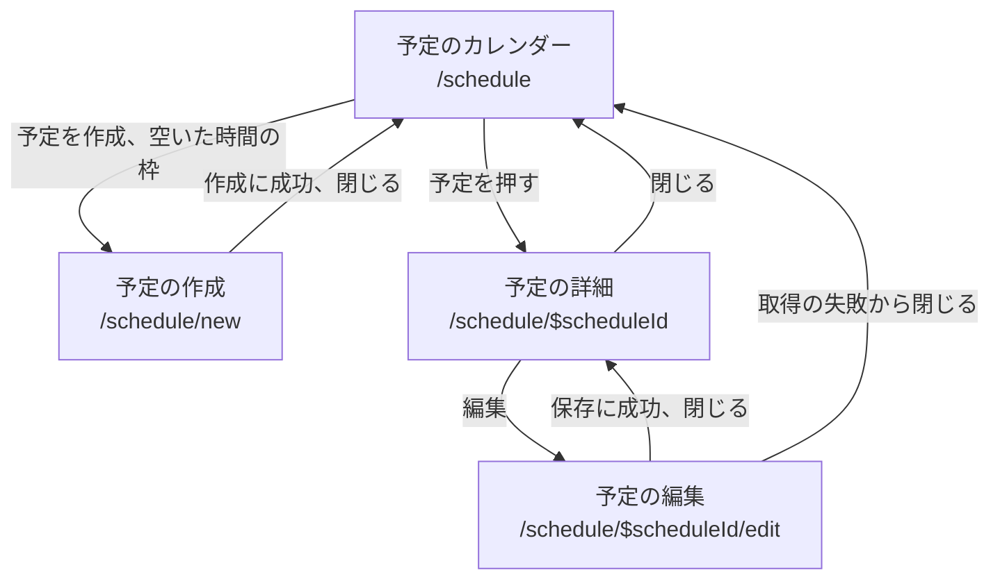

# 画面仕様書

画面ごとに、何を表示し、何ができるかを書く。  
画面の一覧は [PRD の画面の一覧](../PRD.md#画面の一覧)を元にし、PRD がカレンダーにまとめているモーダルは、URL が違うので画面を分けた。  
新しい画面の仕様書は、雛形の `docs/screens/template.md` を写して書く。

## 画面の一覧

| 画面の ID | 名前 | URL | 使う人 | 仕様書 | 状態 |
| --- | --- | --- | --- | --- | --- |
| `login` | ログイン | 未決 | 全ての職員 | なし | 未実装 |
| `schedule-calendar` | 予定のカレンダー | `/schedule` | 全ての職員。表示する予定は権限で決まる | [予定のカレンダー](schedule-calendar.md) | 実装済み |
| `schedule-new` | 予定の作成 | `/schedule/new` | 全ての職員。予定を作れる職員の範囲は権限で決まる | [予定の作成](schedule-new.md) | 実装済み |
| `schedule-detail` | 予定の詳細 | `/schedule/$scheduleId` | 予定を見る権限を持つ職員 | [予定の詳細](schedule-detail.md) | 実装済み |
| `schedule-edit` | 予定の編集 | `/schedule/$scheduleId/edit` | 予定を編集する権限を持つ職員 | [予定の編集](schedule-edit.md) | 実装済み |
| `schedule-cancel` | 予定のキャンセル | 未決 | 予定を編集する権限を持つ職員 | なし | 未実装 |
| `patient-list` | 利用者の一覧 | 未決 | 全ての職員 | なし | 未実装 |
| `patient-form` | 利用者の登録と編集 | 未決 | マネージャー | なし | 未実装 |
| `staff-list` | 職員の一覧と詳細 | 未決 | マネージャー | なし | 未実装 |
| `staff-form` | 職員の登録と編集（権限の変更を含む） | 未決 | マネージャー | なし | 未実装 |
| `profile` | プロフィール | 未決 | 全ての職員 | なし | 未実装 |
| `receipt-check` | 照合（対象の月の選択、CSV のアップロード） | 未決 | 全ての職員 | なし | 未実装 |
| `receipt-check-result` | 照合の結果 | 未決 | 全ての職員 | なし | 未実装 |

- 役職と権限の対応は、PRD の役職ごとの権限にある。マネージャーだけが開ける画面は、PRD で仮決定である。
- 予定の作成、詳細、編集は、予定のカレンダーの上にモーダルとして重ねて出す。URL は `/schedule` の子で、カレンダーの search params を引き継ぐ。

## 画面の間の遷移

実装済みの 4 つの画面の間の遷移は次のとおり。

