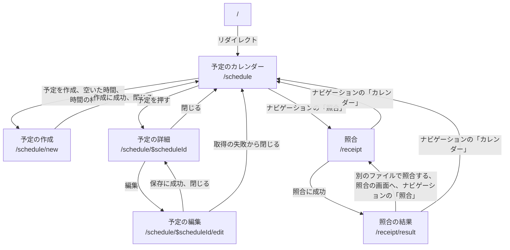
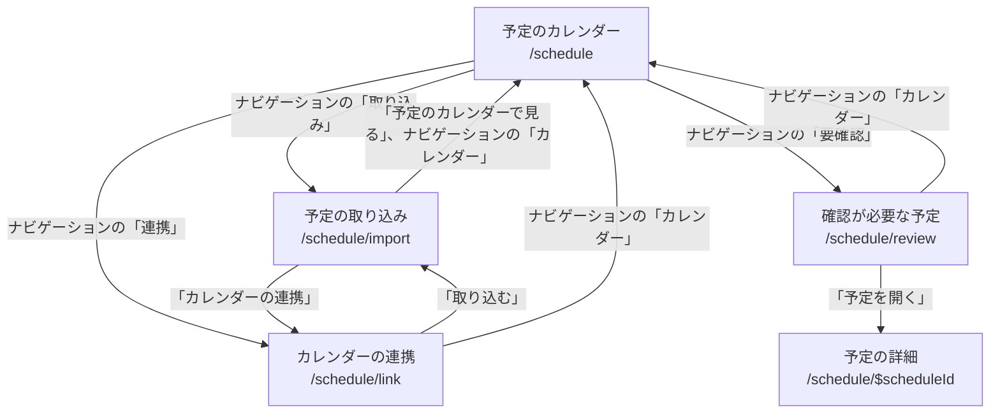
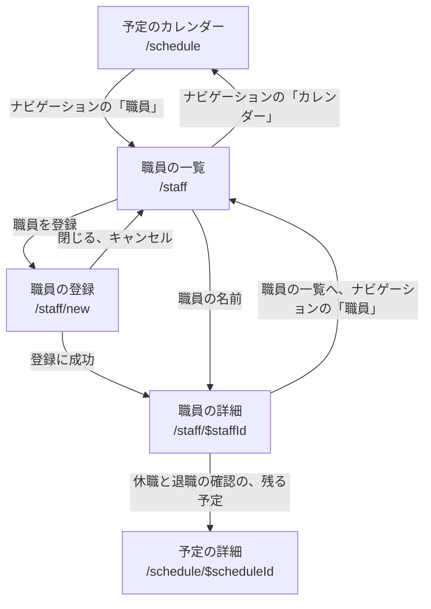
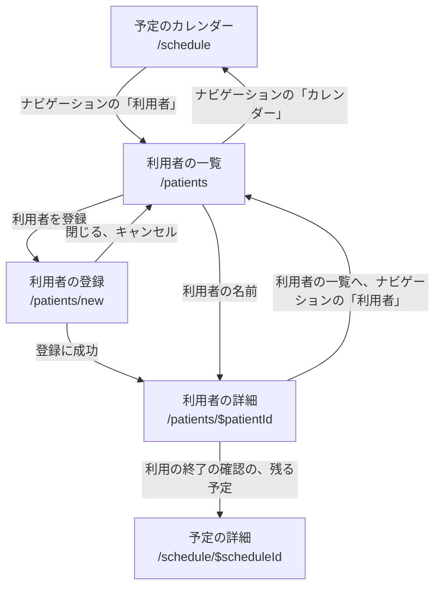
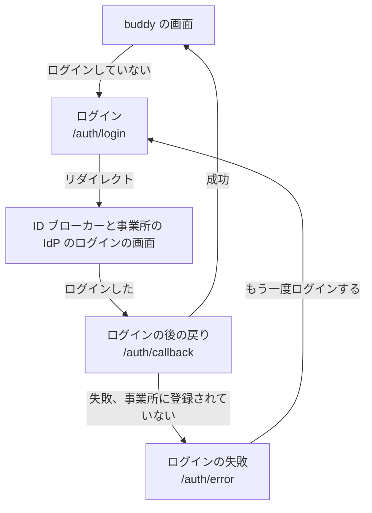

# 画面仕様書

画面ごとに、何を表示し、何ができるかを書く。  
画面の一覧は、[PRD の画面の一覧](../PRD.md#画面の一覧) を元にした。  
PRD がカレンダーにまとめているモーダルは、URL が違うので、別の画面に分けた。  
新しい画面の仕様書は、テンプレートの `docs/screens/_template/` をコピーし、[画面仕様書の規約](rules.md) に従って書く。

## 画面の一覧

| 画面の ID | 名前 | URL | 使う人 | 仕様書 |
| --- | --- | --- | --- | --- |
| `schedule-calendar` | 予定のカレンダー | `/schedule` | 全ての職員。表示する予定は権限で決まる | [予定のカレンダー](schedule-calendar_予定のカレンダー/index.md) |
| `schedule-new` | 予定の作成 | `/schedule/new` | 全ての職員。予定を作れる職員の範囲は権限で決まる | [予定の作成](schedule-new_予定の作成/index.md) |
| `schedule-detail` | 予定の詳細 | `/schedule/$scheduleId` | 予定を見る権限を持つ職員 | [予定の詳細](schedule-detail_予定の詳細/index.md) |
| `schedule-edit` | 予定の編集 | `/schedule/$scheduleId/edit` | 予定を編集する権限を持つ職員 | [予定の編集](schedule-edit_予定の編集/index.md) |
| `schedule-link` | カレンダーの連携（職員と Google カレンダーの結び付け） | `/schedule/link` | 職員の管理の権限を持つ職員（デフォルトはマネージャー） | [カレンダーの連携](schedule-link_カレンダーの連携/index.md) |
| `schedule-import` | 予定の取り込み（期間の選択、プレビュー、確定） | `/schedule/import` | 職員の管理の権限を持つ職員（デフォルトはマネージャー） | [予定の取り込み](schedule-import_予定の取り込み/index.md) |
| `schedule-review` | 確認が必要な予定（Google カレンダーと食い違った予定） | `/schedule/review` | 職員の管理の権限を持つ職員（デフォルトはマネージャー） | [確認が必要な予定](schedule-review_確認が必要な予定/index.md) |
| `patient-list` | 利用者の一覧 | `/patients` | 職員の管理の権限を持つ職員（デフォルトはマネージャー） | [利用者の一覧](patient-list_利用者の一覧/index.md) |
| `patient-new` | 利用者の登録 | `/patients/new` | 職員の管理の権限を持つ職員（デフォルトはマネージャー） | [利用者の登録](patient-new_利用者の登録/index.md) |
| `patient-detail` | 利用者の詳細（利用者の編集、利用の終了、利用の再開を含む） | `/patients/$patientId` | 職員の管理の権限を持つ職員（デフォルトはマネージャー） | [利用者の詳細](patient-detail_利用者の詳細/index.md) |
| `staff-list` | 職員の一覧 | `/staff` | 職員の管理の権限を持つ職員（デフォルトはマネージャー） | [職員の一覧](staff-list_職員の一覧/index.md) |
| `staff-new` | 職員の登録 | `/staff/new` | 職員の管理の権限を持つ職員（デフォルトはマネージャー） | [職員の登録](staff-new_職員の登録/index.md) |
| `staff-detail` | 職員の詳細（基本の情報の編集、役職と権限の変更、休職、復職、退職を含む） | `/staff/$staffId` | 職員の管理の権限を持つ職員（デフォルトはマネージャー） | [職員の詳細](staff-detail_職員の詳細/index.md) |
| `organization-list` | 部署とチーム（部署とチームの作成、名前とチームの色の変更を含む） | `/organization` | 職員の管理の権限を持つ職員（デフォルトはマネージャー） | [部署とチーム](organization-list_部署とチーム/index.md) |
| `receipt-upload` | 照合（対象の月の選択、CSV のアップロード） | `/receipt` | 全ての職員 | [照合](receipt-upload_照合/index.md) |
| `receipt-result` | 照合の結果 | `/receipt/result` | 全ての職員 | [照合の結果](receipt-result_照合の結果/index.md) |
| `account-login` | ログイン | `/auth/login` | 全ての職員 | [ログイン](account-login_ログイン/index.md)。Hydra を通して、ID ブローカー（`services/broker`）のメールの入力の画面へリダイレクトする。ブローカーの画面は web の画面ではない |
| `account-error` | ログインの失敗 | `/auth/error` | 全ての職員 | [ログインの失敗](account-error_ログインの失敗/index.md) |
| `account-profile` | プロフィール | 未決 | 全ての職員 | なし |

- 役職と権限の対応は、PRD の役職ごとの権限にある。
  - 利用者と職員の登録と編集は、職員の管理の権限を持つ職員だけが開ける。
  - 役職のデフォルトで職員の管理の権限をマネージャーに付けることは、PRD で仮決定である。
- 予定の作成、詳細、編集は、予定のカレンダーの上にモーダルとして重ねて出す。
  - URL は `/schedule` の子で、カレンダーの search params を引き継ぐ。
- 職員の登録は、職員の一覧の上にモーダルとして重ねて出す。
  - 職員の編集は、職員の詳細の中で行うので、別の画面にしない。
- 利用者の登録は、利用者の一覧の上にモーダルとして重ねて出す。
  - 利用者の編集は、利用者の詳細の中で行うので、別の画面にしない。

## 画面の ID の規則

- 形は `<ドメイン>-<種類>` にする。
  - 小文字の英語と `-` だけを使う。
- ドメインは BCD Design の Domain の名詞にする。
  - 今使うのは `schedule`、`patient`、`staff`、`organization`、`receipt`、`account`。
  - `organization` は、事業所の中の部署、チーム、役職を指す。予定の API の Go のパッケージと OpenAPI の tag の名前にそろえた。
- 種類は次の語から選ぶ。足すときはこの表に足す。

| 種類 | 意味 |
| --- | --- |
| `list` | 一覧 |
| `calendar` | カレンダーの表示 |
| `detail` | 1 件の詳細 |
| `new` | 作成 |
| `edit` | 編集 |
| `upload` | ファイルを受け取る |
| `result` | 処理の結果 |
| `link` | 外部のサービスとの結び付け |
| `import` | 外部のサービスからの取り込み |
| `review` | 人が確認して決める必要があるものの一覧 |
| `login`、`profile`、`error` | `account` のドメインだけで使う。`error` はログインの失敗 |

- 固有の URL を持つものを 1 つの画面に数える。
  - URL を持つモーダルも画面にする。
  - URL を持たない確認のダイアログ（予定のキャンセルなど）は、親の画面の構成要素にする。
- URL と ID をそろえる。
  - `/schedule/new` は `schedule-new` にする。
- 一度決めた ID は、画面の名前を変えても変えない。
  - 仕様書のファイル名、ワイヤーフレーム、E2E のシナリオの ID が ID を使うためである。

## 画面の間の遷移

ログインした後の画面は、左端のナビゲーションで互いに移れる。  
ナビゲーションは、見出し「予定」の下にカレンダー、取り込み、要確認、連携を並べ、見出し「照合」の下に照合を、見出し「職員」の下に職員と部署とチームを、見出し「利用者」の下に利用者を並べる。  
予定と照合の画面の間の遷移は次のとおり。

ナビゲーションの取り込み、要確認、連携が出るのは、職員の管理の権限を持つ職員だけである。  
カレンダーの連携、予定の取り込み、確認が必要な予定の画面にも、同じナビゲーションを出す。  
職員の管理の権限を持つ職員が使う、Google カレンダーとの連携の画面の間の遷移は次のとおり。  
図には、ナビゲーションによる遷移のうち、予定のカレンダーとの間の遷移だけを描く。

ナビゲーションの見出し「職員」のまとまりも、職員の管理の権限を持つ職員にだけ出す。  
職員の画面の間の遷移は次のとおり。  
図には、ナビゲーションによる遷移のうち、予定のカレンダーとの間の遷移だけを描く。

部署とチームの画面は、見出し「職員」の下の「部署とチーム」から開く。  
部署とチームの作成と編集は URL を持たないダイアログで、画面の間の遷移は無い。

ナビゲーションの見出し「利用者」のまとまりも、職員の管理の権限を持つ職員にだけ出す。  
利用者の画面の間の遷移は次のとおり。  
図には、ナビゲーションによる遷移のうち、予定のカレンダーとの間の遷移だけを描く。

ログアウトすると `/` へ移り、ログインしていないので、`/` からそのままログインへ進む。  
ログインした後は、`/` を経て予定のカレンダーに戻る。  
ログインしていないときと、ログインに失敗したときの遷移は次のとおり。

## 全ての画面に共通する状態

### 画面を表示できない

画面を開く前の処理か画面の描画で、画面が扱っていない失敗が起きたときに、どの画面もこの表示に替わる。  
例えば、BFF を通すときに、ログインした職員を読むためのセッションの保存先に届かないと、この表示になる。  
画面ごとの仕様書は、この状態を状態のタブに数えない。

- ヘッダーは「buddy」だけを出し、メニューのボタンとアカウントのボタンは出さない。
  - ナビゲーションも出さない。
- タイトルは「画面を表示できませんでした」、説明の文は「時間をおいて、読み直してください。」。
- 「読み直す」のリンクを押すと、今の画面の URL を読み込み直す。
- E2E が指す目印は、表示の全体の `page-error`。
  - この状態はモックを持たないので、`page-error` の正本はこのセクションである。
- 実装は `apps/web/src/routes/__root.tsx` の `RootError` と、`apps/web/src/components/site/PageErrorMessage.tsx`。
- カタログ: [PageErrorMessage の Default](https://buddy-docs.emon-apps.workers.dev/storybook/?path=/story/画面-common-pageerrormessage--default)
