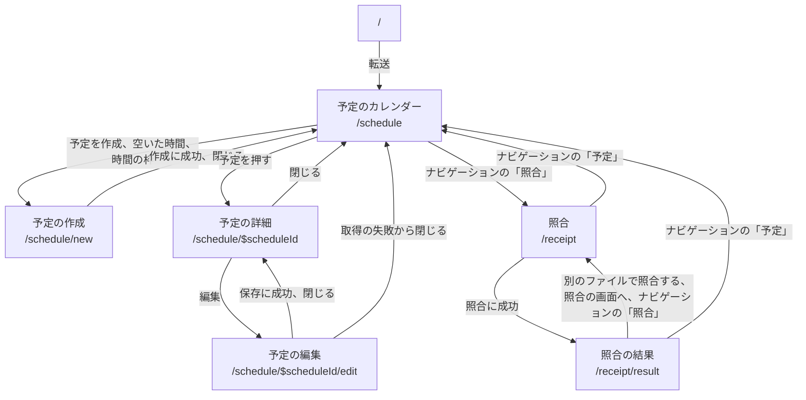
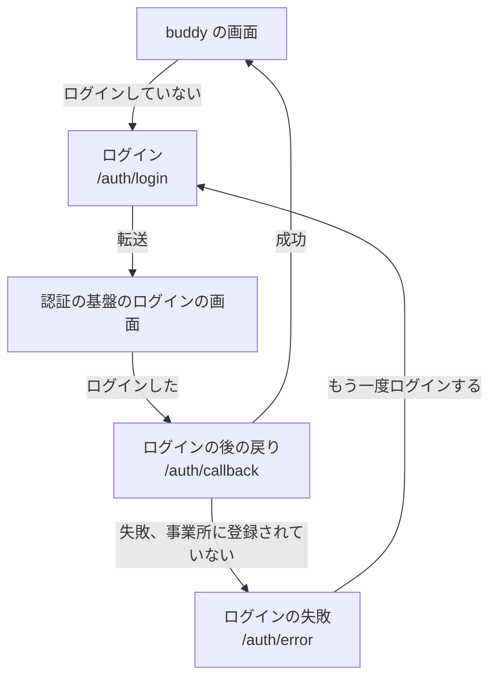

# 画面仕様書

画面ごとに、何を表示し、何ができるかを書く。  
画面の一覧は [PRD の画面の一覧](../PRD.md#画面の一覧)を元にし、PRD がカレンダーにまとめているモーダルは、URL が違うので画面を分けた。  
新しい画面の仕様書は、雛形の `docs/screens/_template/` を写し、[画面仕様書の規約](rules.md) に従って書く。

## 画面の一覧

| 画面の ID | 名前 | URL | 使う人 | 仕様書 |
| --- | --- | --- | --- | --- |
| `schedule-calendar` | 予定のカレンダー | `/schedule` | 全ての職員。表示する予定は権限で決まる | [予定のカレンダー](schedule-calendar_予定のカレンダー/index.md) |
| `schedule-new` | 予定の作成 | `/schedule/new` | 全ての職員。予定を作れる職員の範囲は権限で決まる | [予定の作成](schedule-new_予定の作成/index.md) |
| `schedule-detail` | 予定の詳細 | `/schedule/$scheduleId` | 予定を見る権限を持つ職員 | [予定の詳細](schedule-detail_予定の詳細/index.md) |
| `schedule-edit` | 予定の編集 | `/schedule/$scheduleId/edit` | 予定を編集する権限を持つ職員 | [予定の編集](schedule-edit_予定の編集/index.md) |
| `patient-list` | 利用者の一覧 | 未決 | 全ての職員 | なし |
| `patient-new` | 利用者の登録 | 未決 | 職員の管理の権限を持つ職員（既定はマネージャー） | なし |
| `patient-edit` | 利用者の編集 | 未決 | 職員の管理の権限を持つ職員（既定はマネージャー） | なし |
| `staff-list` | 職員の一覧 | 未決 | マネージャー | なし |
| `staff-detail` | 職員の詳細 | 未決 | マネージャー | なし |
| `staff-new` | 職員の登録 | 未決 | 職員の管理の権限を持つ職員（既定はマネージャー） | なし |
| `staff-edit` | 職員の編集（権限の変更を含む） | 未決 | 職員の管理の権限を持つ職員（既定はマネージャー） | なし |
| `receipt-upload` | 照合（対象の月の選択、CSV のアップロード） | `/receipt` | 全ての職員 | [照合](receipt-upload_照合/index.md) |
| `receipt-result` | 照合の結果 | `/receipt/result` | 全ての職員 | [照合の結果](receipt-result_照合の結果/index.md) |
| `account-login` | ログイン | `/auth/login` | 全ての職員 | なし。ブローカーの画面へ転送し、buddy は画面を持たない |
| `account-error` | ログインの失敗 | `/auth/error` | 全ての職員 | [ログインの失敗](account-error_ログインの失敗/index.md) |
| `account-profile` | プロフィール | 未決 | 全ての職員 | なし |

- 役職と権限の対応は、PRD の役職ごとの権限にある。職員の管理の権限をマネージャーに付ける既定は、PRD で仮決定である。
- 職員の一覧と詳細を開ける職員は、PRD がマネージャーとしており、権限では決めていない。
- 予定の作成、詳細、編集は、予定のカレンダーの上にモーダルとして重ねて出す。URL は `/schedule` の子で、カレンダーの search params を引き継ぐ。

## 画面の ID の規則

- 形は `<ドメイン>-<種類>` にする。小文字の英語と `-` だけを使う。
- ドメインは BCD Design の Domain の名詞にする。今使うのは `schedule`、`patient`、`staff`、`receipt`、`account`。
- 種類は次の語から選ぶ。足すときはこの表に足す。

| 種類 | 意味 |
| --- | --- |
| `list` | 一覧 |
| `calendar` | カレンダーの表示 |
| `detail` | 1 件の詳細 |
| `new` | 作成 |
| `edit` | 編集 |
| `upload` | ファイルを受け取る |
| `result` | 処理の結果 |
| `login`、`profile`、`error` | `account` のドメインだけで使う。`error` はログインの失敗 |

- 固有の URL を持つものを 1 つの画面に数える。URL を持つモーダルも画面にする。URL を持たない確認のダイアログ（予定のキャンセルなど）は、親の画面の構成要素にする。
- URL と ID をそろえる。`/schedule/new` は `schedule-new` にする。
- 一度決めた ID は、画面の名前を変えても変えない。仕様書のファイル名、ワイヤーフレーム、E2E のシナリオの ID が ID を使うため。

## 画面の間の遷移

実装済みの画面の間の遷移は次のとおり。
予定と照合の画面は、ヘッダーのナビゲーションで互いに移れる。

ログインしていないときと、ログインに失敗したときの遷移は次のとおり。
ログアウトすると `/` へ移り、ログインしていないのでログインへ進む。

## 全ての画面に共通する状態

### 画面を表示できない

画面を開く前の処理か画面の描画で、画面が扱っていない失敗が起きたときに、どの画面もこの表示に替わる。
例えば、BFF を通すときに、ログインした職員を読むためのセッションの置き場に届かないと、この表示になる。
画面ごとの仕様書は、この状態を状態のタブに数えない。

- ヘッダーは「buddy」だけを出し、ナビゲーションとログインした職員は出さない。
- 題は「画面を表示できませんでした」、説明の文は「時間をおいて、読み直してください。」。
- 「読み直す」のリンクを押すと、今の画面の URL を読み込み直す。
- E2E が指す目印は、表示の全体の `page-error`。
- 実装は `apps/web/src/routes/__root.tsx` の `RootError` と、`apps/web/src/components/site/PageErrorMessage.tsx`。
- カタログ: [PageErrorMessage の Default](https://buddy-docs.emon-apps.workers.dev/storybook/?path=/story/画面-common-pageerrormessage--default)
